# Charts

Figures drawn in mosaics: bars and columns scaled to the largest, lines and points on axes, heat maps, the shares of a whole as a bar or a pie, a cup's bracket and a sound's spectrum. Each says its figures in words or marks as well, so none is read by colour alone.

- [BarChart](#barchart)
- [Bar](#bar)
- [ColumnChart](#columnchart)
- [LineChart](#linechart)
- [ScatterPlot](#scatterplot)
- [Sparkline](#sparkline)
- [Heatmap](#heatmap)
- [BreakdownBar](#breakdownbar)
- [PieChart](#piechart)
- [Bracket](#bracket)
- [Spectrum](#spectrum)

## BarChart

Bars across: one to the half cell, and a chart of labelled bars scaled to the largest, drawn as a bar on its own is (bar.ts), the bottom sixel row of each left clear so one bar stands apart from the next. A chart whose bars can be chosen (onChoose) makes each bar, its label to its end, a control: a click chooses it, and while the pointer is on one the hint row says what it is.

```ts
import { BarChart } from "neoteletext-server-ts-ui-components";
```

### Props

| Prop | Type | What it is |
| --- | --- | --- |
| `bars` (needed) | `readonly ChartRow[]` | The bars, a row each from the top, scaled to the largest value that is a finite number. |
| `empty` | `string` | What it says when there are no bars; "no data" when absent. |
| `labelCells` | `number` | The labels' column, its colour's cell included, nought or more; 14 when absent. |
| `foreground` | `Colour` | Every bar's colour, each label taking its row's own; green when absent. |
| `onChoose` | `(index: number, session: number) => void` | A click on a bar chooses it: each bar is then a control, and while the pointer is on one the hint row gives its label and figure. |

#### ChartRow

| Prop | Type | What it is |
| --- | --- | --- |
| `label` (needed) | `string` | What it is: beside its bar, or under its column. |
| `value` (needed) | `number` | How much: its figure, scaled to the chart's largest. |
| `foreground` | `Colour` | Its label's colour on a bar chart, white when absent; its column's on a column chart, the chart's when absent. |

### A league table's points

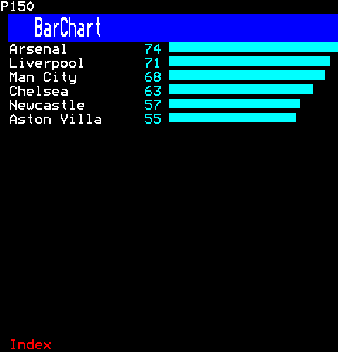

```ts
h(BarChart, {
  bars: [
    { label: "Arsenal", value: 74 },
    { label: "Liverpool", value: 71 },
    { label: "Man City", value: 68 },
    { label: "Chelsea", value: 63 },
    { label: "Newcastle", value: 57 },
    { label: "Aston Villa", value: 55 },
  ],
  foreground: Colour.Cyan,
})
```

### Seats, the labels in party colours, the pointer on one

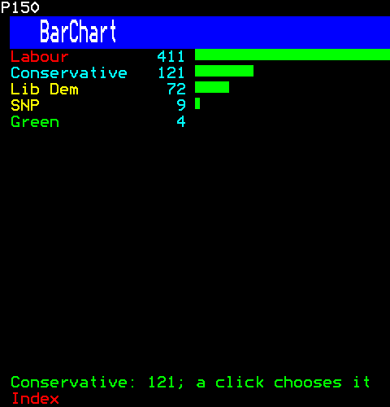

```ts
h(BarChart, {
  bars: [
    { label: "Labour", value: 411, foreground: Colour.Red },
    { label: "Conservative", value: 121, foreground: Colour.Cyan },
    { label: "Lib Dem", value: 72, foreground: Colour.Yellow },
    { label: "SNP", value: 9, foreground: Colour.Yellow },
    { label: "Green", value: 4, foreground: Colour.Green },
  ],
  labelCells: 14,
  onChoose: () => {},
})
```

Then the viewer:

```ts
page.hover(1, "enter", 1, 4);
```

## Bar

One bar across its box, a value of a most, to the half cell: a bar on its own, as a poll's count is, without a chart's labels and figures. A bar takes its cells' upper two rows of sixels, the bottom row left clear, so bars in rows one under another, a chart's or a poll's, stand apart rather than reading as one block. A bar chart (bar-chart.ts) draws its bars by the same rule.

```ts
import { Bar } from "neoteletext-server-ts-ui-components";
```

### Props

| Prop | Type | What it is |
| --- | --- | --- |
| `value` (needed) | `number` | How much of max: past max, a whole bar; nought or less, none. |
| `max` (needed) | `number` | What a whole bar is; nought or less is no bar. |
| `foreground` | `Colour` | Its colour; green when absent. |

### Bars on their own

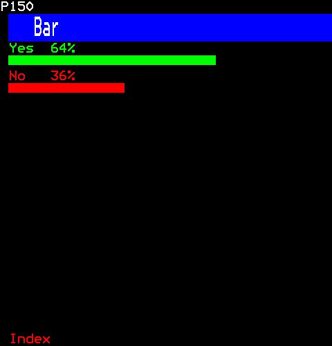

```ts
[
  h(Text, { key: "yes-label", text: "Yes  64%", foreground: Colour.Green }),
  h(Bar, { key: "yes", value: 64, max: 100, foreground: Colour.Green }),
  h(Text, { key: "no-label", text: "No   36%", foreground: Colour.Red }),
  h(Bar, { key: "no", value: 36, max: 100, foreground: Colour.Red }),
]
```

## ColumnChart

Columns up from a floor, a third of a row at a time (three sixels down a cell): each column in its own colour, since the colour's cell is the gap before it; its label under it and its figure over it. Labels longer than a column go on two rows by turns, each then as wide as two columns and so in full where a column's own width would cut "Mar" and "May" both to "Ma"; a label longer still is cut to that. A chart whose columns can be chosen (onChoose) makes each column, with its label, a control: a click chooses it, and while the pointer is on one the hint row says what it is.

```ts
import { ColumnChart } from "neoteletext-server-ts-ui-components";
```

### Props

| Prop | Type | What it is |
| --- | --- | --- |
| `bars` (needed) | `readonly ChartRow[]` | The columns, left to right, scaled to the largest value that is a finite number; as many as fit across. |
| `empty` | `string` | What it says when there are no columns; "no data" when absent. |
| `plotRows` (needed) | `number` | The rows the columns rise through. |
| `columnCells` | `number` | The cells each column is wide, after its colour's cell. |
| `foreground` | `Colour` | A column's colour when it has none of its own; green when absent. |
| `figures` | `boolean` | The figures over the columns. |
| `onChoose` | `(index: number, session: number) => void` | A click on a column chooses it: each column is then a control, and while the pointer is on one the hint row gives its label and figure. |

#### ChartRow

| Prop | Type | What it is |
| --- | --- | --- |
| `label` (needed) | `string` | What it is: beside its bar, or under its column. |
| `value` (needed) | `number` | How much: its figure, scaled to the chart's largest. |
| `foreground` | `Colour` | Its label's colour on a bar chart, white when absent; its column's on a column chart, the chart's when absent. |

### Rainfall by month, with figures

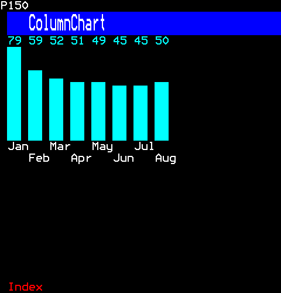

```ts
h(ColumnChart, {
  bars: ["Jan", "Feb", "Mar", "Apr", "May", "Jun", "Jul", "Aug"].map((label, index) => ({
    label,
    value: [79, 59, 52, 51, 49, 45, 45, 50][index] ?? 0,
  })),
  plotRows: 8,
  figures: true,
  foreground: Colour.Cyan,
})
```

### Medals, each in its colour

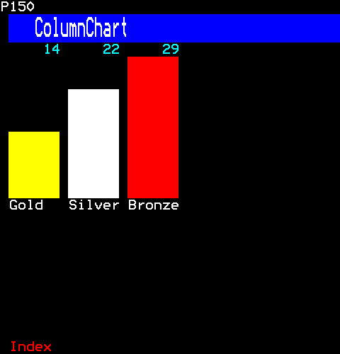

```ts
h(ColumnChart, {
  bars: [
    { label: "Gold", value: 14, foreground: Colour.Yellow },
    { label: "Silver", value: 22, foreground: Colour.White },
    { label: "Bronze", value: 29, foreground: Colour.Red },
  ],
  plotRows: 10,
  columnCells: 6,
  figures: true,
})
```

## LineChart

Charts on axes, drawn in mosaic sixels: a line chart of a series, its points joined or the area under it filled, and the plot and axes it shares with the scatter plot (scatter-plot.ts). Every plot row is one colour, as a row of mosaics is after its colour's cell; the axes are text before and under the plot.

```ts
import { LineChart } from "neoteletext-server-ts-ui-components";
```

### Props

| Prop | Type | What it is |
| --- | --- | --- |
| `values` (needed) | `readonly number[]` | The series; a value that is not a finite number is left out. |
| `plotRows` (needed) | `number` | The rows the plot takes, above the labels' row. |
| `empty` | `string` | What it says when no value is a finite number; "no data" when absent. |
| `foreground` | `Colour` | The line's colour; green when absent. |
| `area` | `boolean` | The area under the line filled. |
| `labels` | `readonly string[]` | Labels spread along the bottom. |

### A day's temperature

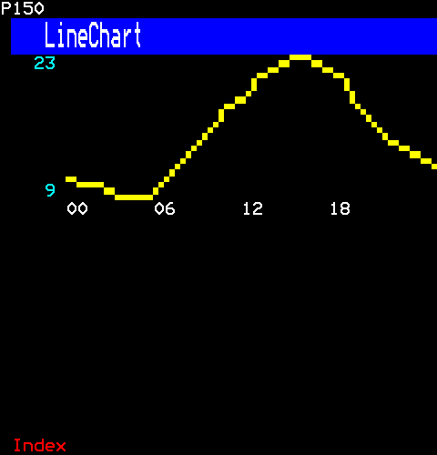

```ts
h(LineChart, {
  values: [11, 10, 10, 9, 9, 9, 10, 12, 14, 16, 18, 19, 21, 22, 23, 23, 22, 21, 19, 17, 15, 14, 13, 12],
  plotRows: 8,
  labels: ["00", "06", "12", "18"],
  foreground: Colour.Yellow,
})
```

### The area under it filled

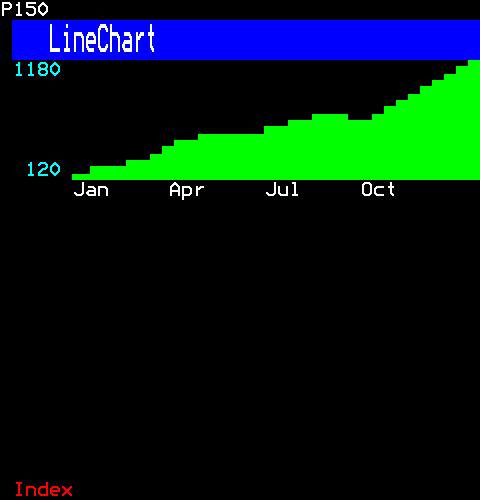

```ts
h(LineChart, {
  values: [120, 180, 260, 410, 520, 480, 610, 700, 650, 820, 1010, 1180],
  plotRows: 6,
  area: true,
  labels: ["Jan", "Apr", "Jul", "Oct"],
  foreground: Colour.Green,
})
```

## ScatterPlot

A scatter plot: points on the line chart's axes (line-chart.ts), each a block of sixels, scaled from the least to the most each way. A point either of whose figures is NaN or Infinity has no place on the axes, and is left out, as the line chart leaves such a value out.

```ts
import { ScatterPlot } from "neoteletext-server-ts-ui-components";
```

### Props

| Prop | Type | What it is |
| --- | --- | --- |
| `points` (needed) | `readonly (readonly [x: number, y: number])[]` | The points, each its x and y, scaled from the least to the most each way; a point with a figure that is not a finite number is left out. |
| `plotRows` (needed) | `number` | The rows the plot takes, above the labels' row. |
| `empty` | `string` | What it says when no point has two finite numbers; "no data" when absent. |
| `foreground` | `Colour` | The points' colour; yellow when absent. |
| `labels` | `readonly string[]` | Labels spread along the bottom. |

### Goals scored and points won

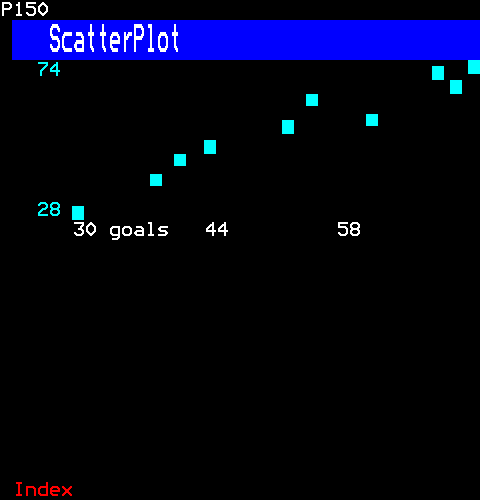

```ts
h(ScatterPlot, {
  // Each club's goals scored and points won.
  points: [72, 68, 70, 55, 61, 52, 44, 41, 38, 30].map((goals, index) => [goals, [74, 71, 68, 63, 57, 55, 48, 45, 39, 28][index] ?? 0]),
  plotRows: 8,
  labels: ["30 goals", "44", "58"],
  foreground: Colour.Cyan,
})
```

## Sparkline

A sparkline: a series in one or more rows of mosaic sixels, a value to each column of sixels (two to a cell), scaled from its least to its most; its label before it and its last value after. A value that is NaN or Infinity has no level, and is left out, as the line chart leaves it.

```ts
import { Sparkline } from "neoteletext-server-ts-ui-components";
```

### Props

| Prop | Type | What it is |
| --- | --- | --- |
| `values` (needed) | `readonly number[]` | The series, oldest first: the latest that fit, two to a cell, scaled from their least to their most; a value that is not a finite number is left out. |
| `label` | `string` | What it is, before it on its bottom row; no column when absent. |
| `labelCells` | `number` | The label's column; 8 when absent, and none for less than none. |
| `plotRows` | `number` | One row has three levels; each row more, three more. |
| `empty` | `string` | What it says when no value is a finite number; "no data" when absent. |
| `foreground` | `Colour` | Its colour; green when absent. |
| `last` | `boolean` | The last value after it. |

### Prices with their last

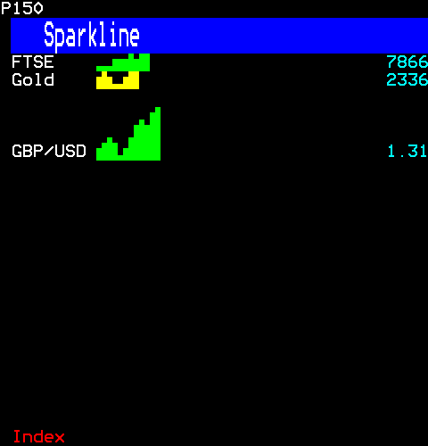

```ts
[
  h(Sparkline, { key: "ftse", label: "FTSE", values: [7612, 7650, 7598, 7701, 7745, 7730, 7802, 7790, 7841, 7866], last: true }),
  h(Sparkline, { key: "gold", label: "Gold", values: [2311, 2330, 2302, 2288, 2295, 2320, 2341, 2336], last: true, foreground: Colour.Yellow }),
  h(Gap, { key: "gap" }),
  h(Sparkline, {
    key: "pound",
    label: "GBP/USD",
    values: [1.25, 1.26, 1.27, 1.26, 1.24, 1.25, 1.27, 1.28, 1.29, 1.28, 1.3, 1.31],
    plotRows: 3,
    last: true,
    foreground: Colour.Green,
  }),
]
```

## Heatmap

A heat map: rows of values, each a block whose colour, or whose density of sixels, says how high it is. A block changes colour in a cell of its own; with Hold Mosaics that cell shows the last block again (EN 300 706 clause 12.2), so each value is two cells wide with no gap. A density map needs no colour changes, so each value is one cell, and it reads without colour.

```ts
import { Heatmap } from "neoteletext-server-ts-ui-components";
```

### Props

| Prop | Type | What it is |
| --- | --- | --- |
| `rows` (needed) | `readonly HeatRow[]` | The rows, from the top, each its label and its values left to right; as many values as fit across. |
| `scale` | `"colour" \| "density"` | By colour, or by how many sixels are set. |
| `labelCells` | `number` | The labels' column, its colour's cell included; 6 when absent, and none for less than none. |
| `max` | `number` | The highest value; the most in the rows when absent. |
| `legend` | `boolean` | A row under it saying what the colours or densities mean. |
| `foreground` | `Colour` | The density scale's colour. |
| `empty` | `string` | What it says when there are no rows; "no data" when absent. |

#### HeatRow

| Prop | Type | What it is |
| --- | --- | --- |
| `label` (needed) | `string` | What it is, in the labels' column. |
| `values` (needed) | `readonly number[]` | Its values, left to right, a block each. |

### Temperatures by colour, with a legend

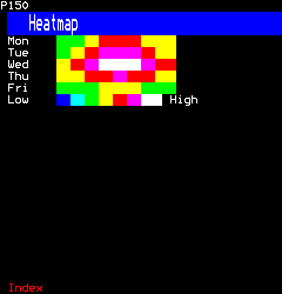

```ts
h(Heatmap, {
  rows: [
    { label: "Mon", values: [8, 9, 12, 15, 17, 16, 13, 10] },
    { label: "Tue", values: [9, 11, 14, 18, 20, 19, 15, 11] },
    { label: "Wed", values: [12, 14, 18, 22, 24, 23, 19, 15] },
    { label: "Thu", values: [10, 12, 15, 17, 18, 17, 14, 12] },
    { label: "Fri", values: [6, 7, 9, 11, 12, 11, 9, 7] },
  ],
  legend: true,
})
```

### Viewers by the hour, by density

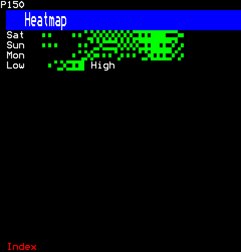

```ts
h(Heatmap, {
  rows: [
    { label: "Sat", values: [1, 1, 0, 0, 0, 1, 2, 3, 4, 4, 5, 5, 4, 4, 5, 6, 7, 8, 9, 9, 8, 6, 4, 2] },
    { label: "Sun", values: [2, 1, 1, 0, 0, 0, 1, 2, 3, 5, 6, 6, 5, 4, 4, 5, 6, 8, 9, 8, 7, 5, 3, 1] },
    { label: "Mon", values: [0, 0, 0, 0, 0, 1, 3, 5, 4, 2, 2, 2, 3, 2, 2, 2, 3, 5, 7, 8, 7, 5, 3, 1] },
  ],
  scale: "density",
  max: 9,
  legend: true,
  foreground: Colour.Green,
})
```

## BreakdownBar

One bar split into the parts of a whole, as an election's shares of the vote are: each part a run of whole cells in its colour, shared by the largest remainder (shares.ts). A colour change takes a cell (EN 300 706 clause 12.2); with Hold Mosaics that cell shows the last block again in the colour before, so the runs meet with no gap and each part is exactly its cells, one to the right of its colour's. Under the bar each part's mark sits under its middle, so a part is told by its mark and not by its colour alone (core/look.ts); under that, the legend names every part with its share, those too small for a cell of the bar too.

```ts
import { BreakdownBar } from "neoteletext-server-ts-ui-components";
```

### Props

| Prop | Type | What it is |
| --- | --- | --- |
| `parts` (needed) | `readonly Share[]` | The parts of the whole, left to right; a value that is no finite number, or is below nought, counts for none. |
| `barRows` | `number` | The rows the bar is tall. |
| `legendColumns` | `number` | The legend's entries across a row. |
| `empty` | `string` | What it says when the parts make no whole; "no data" when absent. |

#### Share

| Prop | Type | What it is |
| --- | --- | --- |
| `label` (needed) | `string` | What it is, in the legend. |
| `value` (needed) | `number` | How much of the whole; one that is no finite number, or is below nought, counts for none. |
| `foreground` | `Colour` | Its colour; the next of SHARE_COLOURS in turn when absent. |
| `mark` | `string` | The character that stands for it in the legend and on the chart; its letter, A for the first, when absent. |

### An election's shares of the vote

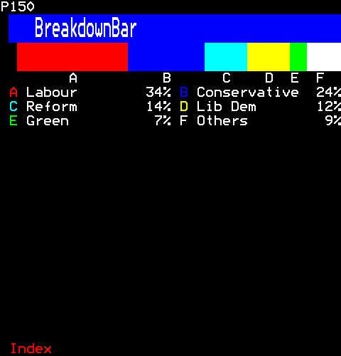

```ts
h(BreakdownBar, {
  parts: [
    { label: "Labour", value: 33.7, foreground: Colour.Red },
    { label: "Conservative", value: 23.7, foreground: Colour.Blue },
    { label: "Reform", value: 14.3, foreground: Colour.Cyan },
    { label: "Lib Dem", value: 12.2, foreground: Colour.Yellow },
    { label: "Green", value: 6.7, foreground: Colour.Green },
    { label: "Others", value: 9.4, foreground: Colour.White },
  ],
  barRows: 2,
  legendColumns: 2,
})
```

## PieChart

A pie, or a donut, of the parts of a whole (shares.ts), drawn in mosaic sixels: slices clockwise from twelve o'clock, round on the screen, where a sixel is a little taller than it is wide (core/mosaics.ts). A row of mosaics has one foreground colour at a time, so each cell keeps every sixel of the pie in it and takes the colour of the slice most of them are in. A change of colour takes a cell (EN 300 706 clause 12.2): it goes in the cell before the one that needs it, and with Hold Mosaics, set at the head of each row, that cell shows the block before it again in the colour before, so slices meet with no notch between them, and the first and last, which meet at twelve o'clock, with no seam. Each slice's mark is drawn outside the rim at its middle, and the legend beside the pie names every slice with its share, those too thin to win a cell too, so a slice is never told by its colour alone (core/look.ts).

```ts
import { PieChart } from "neoteletext-server-ts-ui-components";
```

### Props

| Prop | Type | What it is |
| --- | --- | --- |
| `slices` (needed) | `readonly Share[]` | The slices, clockwise from twelve o'clock; a value that is no finite number, or is below nought, counts for none. |
| `plotRows` | `number` | The rows the pie takes, with a row over it and one under it for the marks. |
| `donut` | `boolean` | A hole in the middle. |
| `empty` | `string` | What it says when the slices make no whole; "no data" when absent. |

#### Share

| Prop | Type | What it is |
| --- | --- | --- |
| `label` (needed) | `string` | What it is, in the legend. |
| `value` (needed) | `number` | How much of the whole; one that is no finite number, or is below nought, counts for none. |
| `foreground` | `Colour` | Its colour; the next of SHARE_COLOURS in turn when absent. |
| `mark` | `string` | The character that stands for it in the legend and on the chart; its letter, A for the first, when absent. |

### Shares of the vote

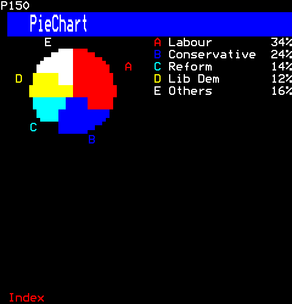

```ts
h(PieChart, {
  slices: [
    { label: "Labour", value: 33.7, foreground: Colour.Red },
    { label: "Conservative", value: 23.7, foreground: Colour.Blue },
    { label: "Reform", value: 14.3, foreground: Colour.Cyan },
    { label: "Lib Dem", value: 12.2, foreground: Colour.Yellow },
    { label: "Others", value: 16.1, foreground: Colour.White },
  ],
})
```

### A donut, with marks of its own

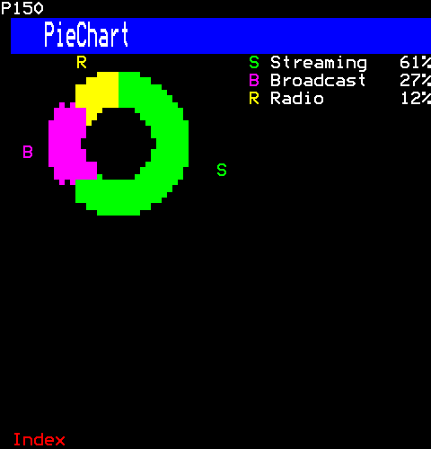

```ts
h(PieChart, {
  slices: [
    { label: "Streaming", value: 61, foreground: Colour.Green, mark: "S" },
    { label: "Broadcast", value: 27, foreground: Colour.Magenta, mark: "B" },
    { label: "Radio", value: 12, foreground: Colour.Yellow, mark: "R" },
  ],
  plotRows: 10,
  donut: true,
})
```

## Bracket

A single-elimination bracket: a column for each round, each match its two entrants on two rows with their scores, and each match of a later round level with the middle of the two it follows. The first round shown takes three rows a match, its two entrants and a row between; each round after it, twice the rows of the one before. As many rounds are shown as fit across; when they do not all fit, Left and Right move the rounds shown a round at a time, or a click on the heading's arrows, and when the matches do not fit down, Up and Down move them. A round's name longer than its column, as "Quarter-finals" is in the thirteen cells three rounds across a page have, takes a second row of the heading, broken at a space or after a hyphen. A winner is marked as well as coloured, so it is not told by colour alone (core/look.ts).

```ts
import { Bracket } from "neoteletext-server-ts-ui-components";
```

**Keys:** `Left Right` rounds; `Up Down` matches.

**It takes of its page:** a copy of the page for each viewer.

### Props

| Prop | Type | What it is |
| --- | --- | --- |
| `rounds` (needed) | `readonly BracketRound[]` | The rounds, first to last, a column each. |
| `roundCells` | `number` | The cells each round's column takes. |
| `empty` | `string` | What it says when there are no rounds; "no rounds" when absent. |

And the props of [`ControlProps`](common.md#controlprops).

#### BracketRound

| Prop | Type | What it is |
| --- | --- | --- |
| `name` (needed) | `string` | Its heading, over its column. |
| `matches` (needed) | `readonly BracketMatch[]` | Its matches, from the top. |

#### BracketMatch

| Prop | Type | What it is |
| --- | --- | --- |
| `entrants` (needed) | `readonly [string, string]` | Its two entrants, the first on top; an empty name shows as "tbd". |
| `scores` | `readonly [number, number]` | Their scores, in the entrants' order; one that is no finite number is left blank. |
| `winner` | `0 \| 1` | Its winner, 0 for the first entrant and 1 for the second: marked "*" and in yellow. |

### A cup from the quarter-finals

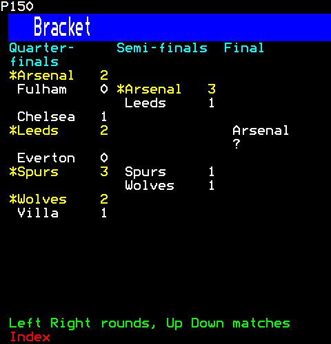

```ts
h(Bracket, {
  rounds: [
    {
      name: "Quarter-finals",
      matches: [
        { entrants: ["Arsenal", "Fulham"], scores: [2, 0], winner: 0 },
        { entrants: ["Chelsea", "Leeds"], scores: [1, 2], winner: 1 },
        { entrants: ["Everton", "Spurs"], scores: [0, 3], winner: 1 },
        { entrants: ["Wolves", "Villa"], scores: [2, 1], winner: 0 },
      ],
    },
    {
      name: "Semi-finals",
      matches: [
        { entrants: ["Arsenal", "Leeds"], scores: [3, 1], winner: 0 },
        { entrants: ["Spurs", "Wolves"], scores: [1, 1] },
      ],
    },
    { name: "Final", matches: [{ entrants: ["Arsenal", "?"] }] },
  ],
})
```

### Moved on a round

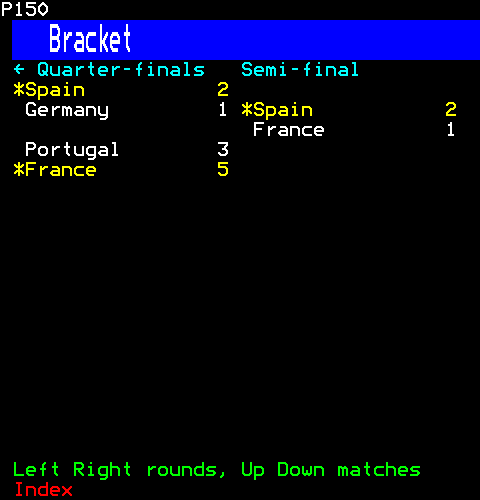

```ts
h(Bracket, {
  rounds: [
    {
      name: "Round of 16",
      matches: [
        { entrants: ["Spain", "Georgia"], scores: [4, 1], winner: 0 },
        { entrants: ["Germany", "Denmark"], scores: [2, 0], winner: 0 },
        { entrants: ["Portugal", "Slovenia"], scores: [3, 0], winner: 0 },
        { entrants: ["France", "Belgium"], scores: [1, 0], winner: 0 },
      ],
    },
    {
      name: "Quarter-finals",
      matches: [
        { entrants: ["Spain", "Germany"], scores: [2, 1], winner: 0 },
        { entrants: ["Portugal", "France"], scores: [3, 5], winner: 1 },
      ],
    },
    { name: "Semi-final", matches: [{ entrants: ["Spain", "France"], scores: [2, 1], winner: 0 }] },
  ],
  roundCells: 19,
})
```

Then the viewer:

```ts
page.press(1, Key.Right);
```

## Spectrum

A spectrum, as an audio player shows one: a column for each band of frequency, lowest on the left, as tall as its level, nought to one, to the sixel (three to a row). A band's column is a sixel narrower than its cells, so the columns stand apart. Each row of mosaics is one colour after its colour's cell (EN 300 706 clause 12.2), so the rows are coloured as a meter is, by how loud they stand for: green, yellow near the top, red at it; or all one colour, when one is given. The levels are the program's, as bandLevels (band-levels.ts) makes them.

```ts
import { Spectrum } from "neoteletext-server-ts-ui-components";
```

### Props

| Prop | Type | What it is |
| --- | --- | --- |
| `levels` (needed) | `readonly number[]` | Each band's level, nought to one, lowest band first. |
| `plotRows` | `number` | The rows the columns rise through. |
| `bandCells` | `number` | The cells each band's column takes. |
| `foreground` | `Colour` | One colour for every row, in place of a meter's. |
| `empty` | `string` | What it says when there are no levels; "no sound" when absent. |

### A meter's colours

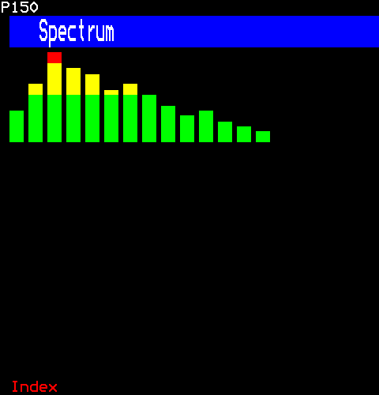

```ts
h(Spectrum, { levels: [0.35, 0.6, 0.95, 0.8, 0.7, 0.55, 0.62, 0.48, 0.4, 0.3, 0.36, 0.22, 0.15, 0.1], plotRows: 6, bandCells: 2 })
```

### In one colour

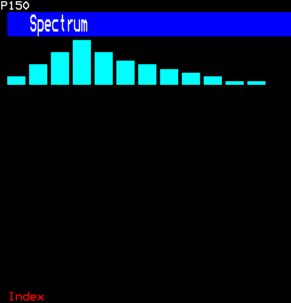

```ts
h(Spectrum, { levels: [0.2, 0.45, 0.7, 0.9, 0.65, 0.5, 0.42, 0.3, 0.25, 0.18, 0.12, 0.08], plotRows: 4, bandCells: 3, foreground: Colour.Cyan })
```
