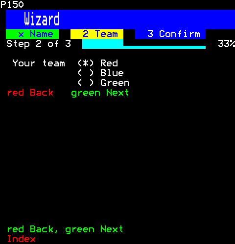
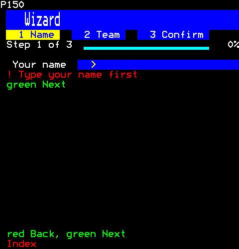
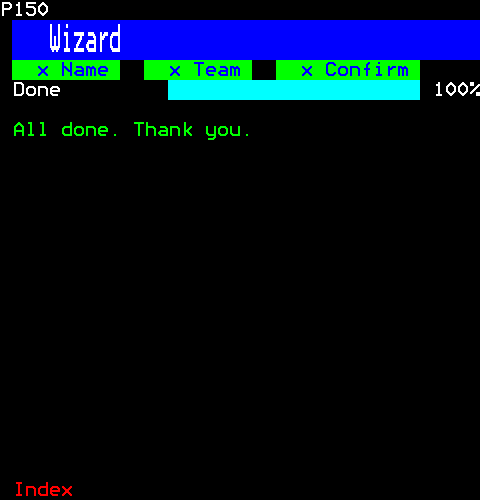

# Composition

Components made of others: a wizard that takes the viewer through a form a step at a time, with Back and Next on the red and green keys.

- [Wizard](#wizard)

## Wizard

A wizard: steps taken in order. The steps' names run along the top, the current one on a band and those done ticked; a progress bar shows how far along; the current step's content is under it; Back and Next are the red and green keys (F1 and F2 on a keyboard), so the page takes the coloured keys, and the last step's Next is Finish. Back and Next are also actions a click takes (input/action.ts), and a step done is a badge a click goes back to; each is a control the browser lights. Disabled or finished, it has no Back or Next: it takes no coloured key, the page keeps them, and its hint offers none.

```ts
import { Wizard } from "neottx-server-ts-ui-components";
```

**Keys:** `red` Back; `green` Next; `Tab` to a step's fields.

**It takes of its page:** the coloured keys, a copy of the page for each viewer.

### Props

| Prop | Type | What it is |
| --- | --- | --- |
| `steps` (needed) | `readonly string[]` | The steps' names; the children are their contents, in order. |
| `ready` | `(step: number) => string \| null` | Whether the step may be left forward: a step with something missing says what. |
| `onFinish` | `(session: number) => void` | Next on the last step, once it is ready: the wizard is done. |
| `onStep` | `(step: number, session: number) => void` | The step changed, by Back, Next or a click on a step done: the step now shown. |

And the props of [`ControlProps`](common.md#controlprops).

### On the second step



```ts
h(
  Wizard,
  { steps: ["Name", "Team", "Confirm"], onFinish: () => {} },
  h(TextField, { label: "Your name", longest: 20, initial: "Anna" }),
  h(RadioGroup, { label: "Your team", items: ["Red", "Blue", "Green"] }),
  h(Text, { text: "Anna joins the Red team." }),
)
```

Then the viewer:

```ts
page.press(1, Key.Green);
```

### A step not ready to leave



```ts
h(
  Wizard,
  { steps: ["Name", "Team", "Confirm"], ready: (step) => (step === 0 ? "Type your name first" : null), onFinish: () => {} },
  h(TextField, { label: "Your name", longest: 20 }),
  h(RadioGroup, { label: "Your team", items: ["Red", "Blue", "Green"] }),
  h(Text, { text: "Ready to join." }),
)
```

Then the viewer:

```ts
page.press(1, Key.Green);
```

### Finished



```ts
h(
  Wizard,
  { steps: ["Name", "Team", "Confirm"], onFinish: () => {} },
  h(TextField, { label: "Your name", longest: 20, initial: "Anna" }),
  h(RadioGroup, { label: "Your team", items: ["Red", "Blue", "Green"] }),
  h(Text, { text: "Anna joins the Red team." }),
)
```

Then the viewer:

```ts
page.press(1, Key.Green);
page.press(1, Key.Green);
page.press(1, Key.Green);
```
