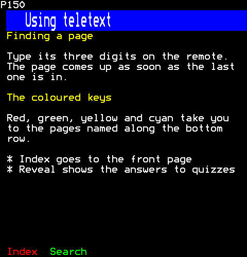
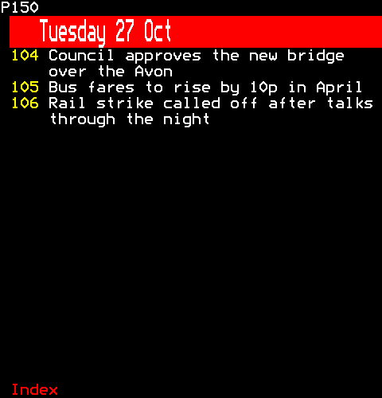
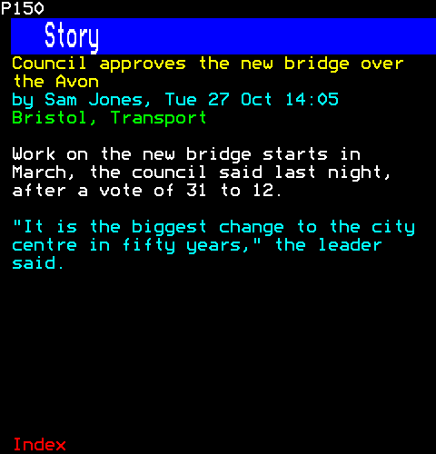
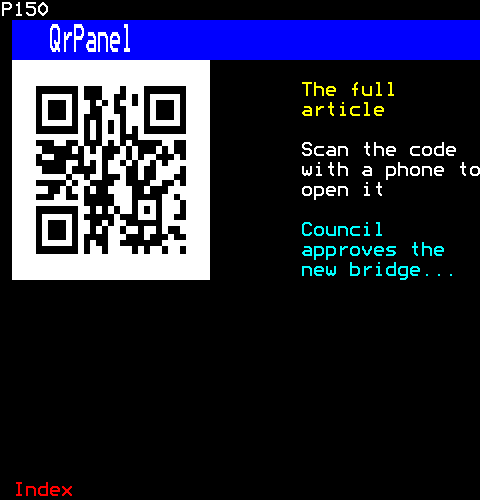
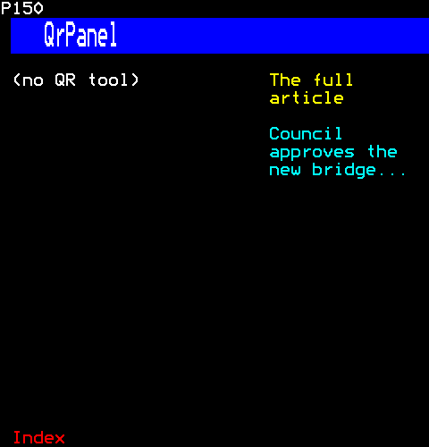

# Documents

Pages of several sub-pages, each named in its title band: a document's lines over as many screens as they need, a day's headlines a sub-page a day, and an article's home with its text, picture, links and where else it appears.

- [Document](#document)
- [DayPages](#daypages)
- [StoryPages](#storypages)
- [QrPanel](#qrpanel)

## Document

Document: a document's lines over named sub-pages ("Help 2/4"), and what the other pages of several sub-pages (story-pages.ts, day-pages.ts) share. Each renders several Frames; the mount publishes them as one page.

```ts
import { Document } from "neoteletext-server-ts-ui-components";
```

### Props

| Prop | Type | What it is |
| --- | --- | --- |
| `title` (needed) | `string` | The sub-pages' name, each with its place when there are several: "Title 2/3". |
| `lines` (needed) | `readonly Line[]` | The lines, DOCUMENT_ROWS a sub-page. |
| `maxSubPages` | `number` | The most sub-pages it takes; as many as the lines need when absent. |

And the props of [`Framing`](common.md#framing).

#### Line

| Prop | Type | What it is |
| --- | --- | --- |
| `foreground` (needed) | `Colour` | Its colour. |
| `text` (needed) | `string` | Its text: one row of it. |

### Help over its sub-pages



```ts
h(Document, {
  title: "Using teletext",
  background: Colour.Blue,
  prompts: [
    ["Index", 0x100],
    ["Search", 0x199],
  ],
  lines: articleLines(
    [
      { kind: "heading", text: "Finding a page" },
      { kind: "paragraph", text: "Type its three digits on the remote. The page comes up as soon as the last one is in." },
      { kind: "heading", text: "The coloured keys" },
      { kind: "paragraph", text: "Red, green, yellow and cyan take you to the pages named along the bottom row." },
      { kind: "item", text: "Index goes to the front page" },
      { kind: "item", text: "Reveal shows the answers to quizzes" },
    ],
    38,
  ),
})
```

## DayPages

DayPages: headlines over sub-pages, a day's on as many as they need, as a document's lines are (document.ts), each named by its day and, when it takes several, its place among them: "Today 2/3". A sub-page holds the headlines its body has the rows for, whole, as each measures itself.

```ts
import { DayPages } from "neoteletext-server-ts-ui-components";
```

### Props

| Prop | Type | What it is |
| --- | --- | --- |
| `days` (needed) | `readonly Day[]` | The days, each on as many sub-pages as its headlines need, named by the day. A page has MOST_SUBPAGES sub-pages at most: the headlines and days past them are left out, and are not walked. |

And the props of [`Framing`](common.md#framing).

#### Day

| Prop | Type | What it is |
| --- | --- | --- |
| `name` (needed) | `string` | The sub-page's name: "Today", "Yesterday", "Thursday 22 Oct". |
| `articles` (needed) | `readonly Article[]` | Its articles, a headline each that links to its page. |

#### Article

| Prop | Type | What it is |
| --- | --- | --- |
| `page` (needed) | `number` | The page it is on, which its headline links to. |
| `title` (needed) | `string` | Its headline. |
| `writer` (needed) | `string` | Who wrote it, in its byline. |
| `date` (needed) | `number` | Milliseconds since the Unix epoch. |
| `blocks` (needed) | `readonly Block[]` | Its text, block by block, as its story's sub-pages show it. |
| `tags` (needed) | `readonly string[]` | Its labels, under its byline. |

#### Block

| Prop | Type | What it is |
| --- | --- | --- |
| `kind` (needed) | `"paragraph" \| "heading" \| "quote" \| "item"` | What it is: a paragraph in white, a heading in yellow, a quotation in cyan, or an item of a list, marked "*". |
| `text` (needed) | `string` | Its text, wrapped to the width. |

### A day's headlines



```ts
const story = { writer: "Sam Jones", date: Date.UTC(2026, 9, 27), blocks: [], tags: [] };
return h(DayPages, {
  background: Colour.Red,
  prompts: [["Index", 0x100]],
  days: [
    {
      name: "Tuesday 27 Oct",
      articles: [
        { ...story, page: 0x104, title: "Council approves the new bridge over the Avon" },
        { ...story, page: 0x105, title: "Bus fares to rise by 10p in April" },
        { ...story, page: 0x106, title: "Rail strike called off after talks through the night" },
      ],
    },
  ],
});
```

## StoryPages

StoryPages: an article's home, over sub-pages of its own: its text, its picture, its links with a QR code, and where else it appears.

```ts
import { StoryPages } from "neoteletext-server-ts-ui-components";
```

### Props

| Prop | Type | What it is |
| --- | --- | --- |
| `article` (needed) | `Article` | The article: its headline, byline and text, over as many "Story" sub-pages as it needs. |
| `picture` | `string` | The lead picture, as the engine's converter made it, whole-page; none, and the sub-page says so. |
| `qr` | `string` | The QR code of the article's address, from `neottx qr`. |
| `where` (needed) | `readonly NumberedRow[]` | Where else it appears. |

And the props of [`Framing`](common.md#framing).

#### Article

| Prop | Type | What it is |
| --- | --- | --- |
| `page` (needed) | `number` | The page it is on, which its headline links to. |
| `title` (needed) | `string` | Its headline. |
| `writer` (needed) | `string` | Who wrote it, in its byline. |
| `date` (needed) | `number` | Milliseconds since the Unix epoch. |
| `blocks` (needed) | `readonly Block[]` | Its text, block by block, as its story's sub-pages show it. |
| `tags` (needed) | `readonly string[]` | Its labels, under its byline. |

#### Block

| Prop | Type | What it is |
| --- | --- | --- |
| `kind` (needed) | `"paragraph" \| "heading" \| "quote" \| "item"` | What it is: a paragraph in white, a heading in yellow, a quotation in cyan, or an item of a list, marked "*". |
| `text` (needed) | `string` | Its text, wrapped to the width. |

#### NumberedRow

| Prop | Type | What it is |
| --- | --- | --- |
| `page` (needed) | `number` | The page a click on it goes to, its number first in yellow. |
| `label` (needed) | `string` | What it is, cut to the room before the figure. |
| `figure` | `number \| string` | What it says on the right, in cyan; nothing when absent. |
| `foreground` | `Colour` | The label's colour; white when absent. |

### An article's first sub-page



```ts
h(StoryPages, {
  background: Colour.Blue,
  prompts: [["Index", 0x100]],
  article: {
    page: 0x104,
    title: "Council approves the new bridge over the Avon",
    writer: "Sam Jones",
    date: Date.UTC(2026, 9, 27, 14, 5),
    blocks: [
      { kind: "paragraph", text: "Work on the new bridge starts in March, the council said last night, after a vote of 31 to 12." },
      { kind: "quote", text: '"It is the biggest change to the city centre in fifty years," the leader said.' },
    ],
    tags: ["Bristol", "Transport"],
  },
  where: [
    { page: 0x101, label: "News headlines" },
    { page: 0x160, label: "Bristol news" },
  ],
})
```

## QrPanel

QrPanel: a QR code a phone can follow, and beside it what it leads to. Without a code, a placeholder stands in its place, on the row its text starts on, and the text says nothing of scanning.

```ts
import { QrPanel } from "neoteletext-server-ts-ui-components";
```

### Props

| Prop | Type | What it is |
| --- | --- | --- |
| `qr` | `string` | The code as a TTI page, from `neottx qr`; a placeholder says there is none when absent. |
| `what` (needed) | `string` | What the code leads to, written beside it in yellow. |
| `title` (needed) | `string` | The title of what it leads to, under that in cyan, on three lines at most. |

### With the article's code



```ts
h(QrPanel, {
  what: "The full article",
  title: "Council approves the new bridge over the Avon",
  // As `neottx qr --page 150 https://example.com/news/bridge` writes it.
  qr: [
    "PN,15000",
    "SC,0000",
    "PS,8000",
    "OL,2,\u001BW" + "\u007F".repeat(16) + "5",
    "OL,3,\u001BW\u007F\u007Fcssk#k?kocssk\u007F5",
    "OL,4,\u001BW\u007F\u007Fj jj%iuk~j jj\u007F5",
    "OL,5,\u001BW\u007F\u007Frsszjjz*krssz\u007F5",
    "OL,6,\u001BW\u007F\u007Fd2!&t6b64p&ej\u007F5",
    "OL,7,\u001BW\u007F\u007Ftp:qa5/6j!}?k\u007F5",
    "OL,8,\u001BW\u007F\u007F,`6n) n} &a>~\u007F5",
    "OL,9,\u001BW\u007F\u007Fcssk$$f/j{j?j\u007F5",
    "OL,10,\u001BW\u007F\u007Fj jj%&~9$<*3o\u007F5",
    "OL,11,\u001BW\u007F\u007Frsszzt\u007F|xxv\u007F{\u007F5",
    "OL,12,\u001BW" + "\u007F".repeat(16) + "5",
  ].join("\n"),
})
```

### Without a code



```ts
h(QrPanel, { what: "The full article", title: "Council approves the new bridge over the Avon" })
```
