# Feedback

What tells the viewer how things stand: how far along or how full, what is still loading, notices and toasts, a dashboard's figures, and a player for sound, with its queue, its modes and a spectrum.

- [ProgressBar](#progressbar)
- [LineGauge](#linegauge)
- [ProgressList](#progresslist)
- [TaskList](#tasklist)
- [Spinner](#spinner)
- [Skeleton](#skeleton)
- [Loading](#loading)
- [MetricCard](#metriccard)
- [Notice](#notice)
- [ToastShelf](#toastshelf)
- [AudioPlayer](#audioplayer)
- [NowPlaying](#nowplaying)
- [ListeningView](#listeningview)
- [PlayQueue](#playqueue)
- [PlayerStatus](#playerstatus)
- [Transport](#transport)
- [PlayerView](#playerview)

## ProgressBar

How far along something is, or how full: a progress bar of mosaic blocks to the half cell, solid or in separated graphics (EN 300 706 clause 12.2), whose colour may follow thresholds as a gauge's does; either kind spends the cell after its colour's on saying which, so solid bars and separated ones start in one column. The share it shows, and the label's and the share's cells, are the line gauge's too (line-gauge.ts). Given onSeek, its track is a control: a click on it says how far along the click was, as a player's seek bar does.

```ts
import { ProgressBar } from "neoteletext-server-ts-ui-components";
```

### Props

| Prop | Type | What it is |
| --- | --- | --- |
| `label` | `string` | What it measures, in a column of its own before the bar; no column when absent. |
| `value` (needed) | `number` | How far along, in max's units; the share it makes is kept from 0 to 1. |
| `max` (needed) | `number` | What a full bar is; nought or less shows an empty one. |
| `foreground` | `Colour` | The bar's colour where no threshold is reached; green when absent. |
| `separated` | `boolean` | Separated graphics: the bar in blocks with gaps, as segments. |
| `thresholds` | `readonly Threshold[]` | Colours by share, the highest whose `from` the share reaches. |
| `labelCells` | `number` | The label's column. |
| `percent` | `boolean` | The share after the bar, as a percentage; shown unless false. |
| `onSeek` | `(fraction: number, session: number) => void` | A click on the track: how far along it, 0 to 1. |

### Labelled, in segments, coloured by how full

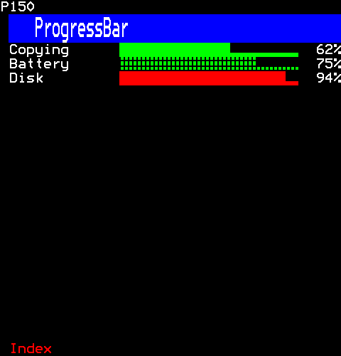

```ts
[
  h(ProgressBar, { key: "copy", label: "Copying", value: 62, max: 100, percent: true }),
  h(ProgressBar, { key: "battery", label: "Battery", value: 3, max: 4, foreground: Colour.Green, separated: true, percent: true }),
  h(ProgressBar, { key: "disk", label: "Disk", value: 94, max: 100, foreground: Colour.Green, thresholds: [[0.9, Colour.Red]], percent: true }),
]
```

## LineGauge

A line gauge: a thin line whose filled part is in one colour and the rest in another. The line changes colour in a cell of its own; with Hold Mosaics that cell shows the last mosaic again (EN 300 706 clause 12.2, Table 26), so the line has no gap.

```ts
import { LineGauge } from "neoteletext-server-ts-ui-components";
```

### Props

| Prop | Type | What it is |
| --- | --- | --- |
| `label` | `string` | What it measures, in a column of its own before the line; no column when absent. |
| `value` (needed) | `number` | How far along, in max's units; the share it makes is kept from 0 to 1. |
| `max` (needed) | `number` | What a full line is; nought or less shows an empty one. |
| `foreground` | `Colour` | The filled part's colour; cyan when absent. |
| `rest` | `Colour` | The rest of the line's colour. |
| `labelCells` | `number` | The label's column, nought or more; LABEL_CELLS when absent. |

### A thin line

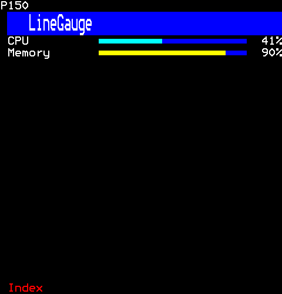

```ts
[
  h(LineGauge, { key: "cpu", label: "CPU", value: 41, max: 100 }),
  h(LineGauge, { key: "memory", label: "Memory", value: 7.2, max: 8, foreground: Colour.Yellow, rest: Colour.Blue }),
]
```

## ProgressList

A progress list: several things going on at once, a progress bar each (progress.ts) with its label and its share, then how fast it goes and how long it has left, estimated from how far it has come since it started. Each says "--" while that is not known: before it started, before any time has passed, while it has not moved. It looks at the clock again each second while someone watches, so the estimates go on as time does.

```ts
import { ProgressList } from "neoteletext-server-ts-ui-components";
```

### Props

| Prop | Type | What it is |
| --- | --- | --- |
| `items` (needed) | `readonly ProgressItem[]` | What is under way, a row each: its bar, its rate and its time left; no more than a page's rows are drawn. |
| `foreground` | `Colour` | Every bar's colour; green when absent. |
| `labelCells` | `number` | Each label's column, as a progress bar's. |

#### ProgressItem

| Prop | Type | What it is |
| --- | --- | --- |
| `label` (needed) | `string` | What it is, before its bar. |
| `value` (needed) | `number` | How far along, in max's units; its rate is worked out from it. |
| `max` (needed) | `number` | What finished is; its time left is worked out to it. |
| `startedMs` | `number` | When it started, by the channel's clock (Services.now); its rate and time left are not known without it. |

### Downloads under way

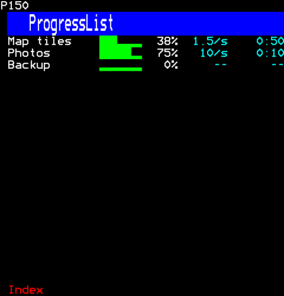

```ts
h(ProgressList, {
  items: [
    { label: "Map tiles", value: 45, max: 120, startedMs: 0 },
    { label: "Photos", value: 300, max: 400, startedMs: 0 },
    { label: "Backup", value: 0, max: 900 },
  ],
})
```

Then the viewer:

```ts
page.runUntil(30_000);
```

## TaskList

A task list: the steps of something being done, each waiting, running, done or failed. Each says which by a mark in the English set's own characters, in its kind's colour (core/look.ts), so it shows without colour too; a running step's mark is a spinner (spinner.ts), which moves while someone watches. A failed step can say why on the row under it.

```ts
import { TaskList } from "neoteletext-server-ts-ui-components";
```

### Props

| Prop | Type | What it is |
| --- | --- | --- |
| `tasks` (needed) | `readonly Task[]` | The steps, in order; no more than a page's rows are drawn. |
| `spinner` | `SpinnerStyle` | A running step's spinner; orbit when absent. |

#### Task

| Prop | Type | What it is |
| --- | --- | --- |
| `label` (needed) | `string` | What the step is, beside its mark. |
| `status` (needed) | `TaskStatus` | Where it is: waiting, running, done or failed. |
| `reason` | `string` | Why a failed step failed, on the row under it. |

### Each state, one failed

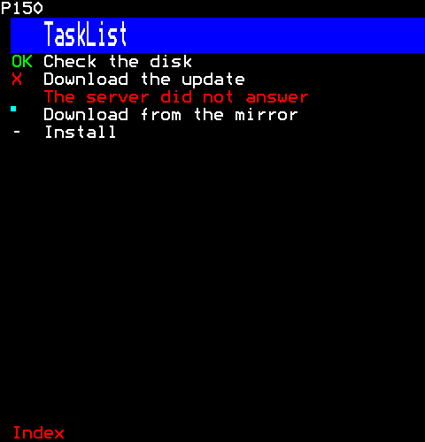

```ts
h(TaskList, {
  tasks: [
    { label: "Check the disk", status: "done" },
    { label: "Download the update", status: "failed", reason: "The server did not answer" },
    { label: "Download from the mirror", status: "running" },
    { label: "Install", status: "pending" },
  ],
})
```

## Spinner

Something is happening: a spinner and what it is doing, moved by a timer of its own. Teletext has no spinner glyphs, so the frames are mosaics: a sixel going round a cell, a block going to and fro, a cell filling and emptying; or dots after the words. Done, it says so and stops. Its words start in one column whatever its style, and once it is done, so a spinner that changes style or finishes does not move them.

```ts
import { Spinner } from "neoteletext-server-ts-ui-components";
```

### Props

| Prop | Type | What it is |
| --- | --- | --- |
| `label` (needed) | `string` | What it is doing, after the frames; after "OK" once it is done. |
| `style` | `SpinnerStyle` | Its frames; orbit when absent. |
| `foreground` | `Colour` | The mosaic frames' colour; cyan when absent. |
| `everyMs` | `number` | Milliseconds a frame. |
| `done` | `boolean` | It has finished: "OK" in green, and the timer stops. |

### Each style

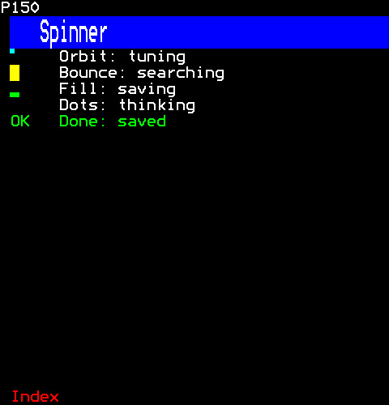

```ts
[
  h(Spinner, { key: "orbit", label: "Orbit: tuning", style: "orbit" }),
  h(Spinner, { key: "bounce", label: "Bounce: searching", style: "bounce", foreground: Colour.Yellow }),
  h(Spinner, { key: "fill", label: "Fill: saving", style: "fill", foreground: Colour.Green }),
  h(Spinner, { key: "dots", label: "Dots: thinking", style: "dots" }),
  h(Spinner, { key: "done", label: "Done: saved", done: true }),
]
```

## Skeleton

A skeleton: where text is still coming, rows of blocks in the shape of its lines, in separated graphics (EN 300 706 clause 12.2) so they read as a placeholder and not as a bar. Told to shimmer, a brighter band moves across them on a timer of its own while someone watches. The band changes colour in a cell of its own; with Hold Mosaics that cell shows the last block again (Table 26), so the line has no gap, as a line gauge's has none (line-gauge.ts).

```ts
import { Skeleton } from "neoteletext-server-ts-ui-components";
```

### Props

| Prop | Type | What it is |
| --- | --- | --- |
| `rows` | `number` | The lines it stands for; three when absent. |
| `widths` | `readonly number[]` | Each line's blocks, used in turn, so lines of text's ragged ends are shown; when absent, lines nearly as wide as the box and a short last one. |
| `shimmer` | `boolean` | A brighter band moves across. |
| `foreground` | `Colour` | The blocks' colour; blue when absent. |
| `band` | `Colour` | The band's colour. |
| `everyMs` | `number` | Milliseconds a step of the band. |

### Ragged lines, and shimmering

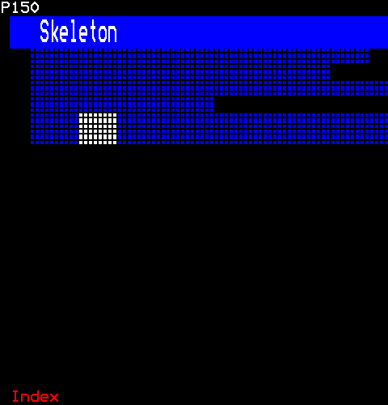

```ts
[
  h(Skeleton, { key: "ragged", rows: 4, widths: [34, 30, 36, 18] }),
  h(Skeleton, { key: "shimmer", rows: 2, shimmer: true, band: Colour.White, foreground: Colour.Blue }),
]
```

Then the viewer:

```ts
page.runUntil(1_000);
```

## Loading

Loading: what is still coming, shown in its place by a spinner (spinner.ts) or, told so, a skeleton of its lines (skeleton.ts). While it loads its children are not mounted, so nothing of them runs, and the keys meant for them are held (held-keys.ts); once it has loaded they are mounted and drawn in its place.

```ts
import { Loading } from "neoteletext-server-ts-ui-components";
```

### Props

| Prop | Type | What it is |
| --- | --- | --- |
| `loading` (needed) | `boolean` | Still coming: the spinner or the skeleton shows, and the children are not mounted. |
| `label` | `string` | What the spinner says; "Loading" when absent. |
| `spinner` | `SpinnerStyle` | The spinner's frames; orbit when absent. |
| `skeleton` | `SkeletonProps` | A skeleton of these props instead of the spinner. |

### A spinner or a skeleton in its place

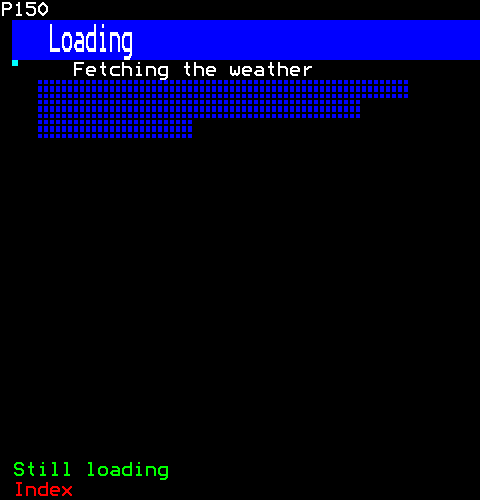

```ts
[
  h(Loading, { key: "weather", loading: true, label: "Fetching the weather" }, h(Notice, { kind: "info", text: "Sunny, 21C" })),
  h(Loading, { key: "news", loading: true, skeleton: { rows: 3, widths: [30, 26, 12] } }, h(Notice, { kind: "info", text: "The headlines" })),
]
```

## MetricCard

A metric card: one figure of a dashboard. Its label after its kind's mark on a chip of the kind's colour, as a notice has (notice.ts), so its health shows without colour too; the figure, in large text or a line; how far it moved since before, its way said by a mark, "+" up, "-" down and "=" not at all, before the amount; and, given its history, a sparkline of it beneath.

```ts
import { MetricCard } from "neoteletext-server-ts-ui-components";
```

### Props

| Prop | Type | What it is |
| --- | --- | --- |
| `label` (needed) | `string` | What it measures, after its kind's mark. |
| `value` (needed) | `number` | The figure, in its kind's colour; "--" when it is no number. |
| `previous` | `number` | What it was before, for its change; no change is shown without it. |
| `kind` | `Kind` | Its health; info when absent. |
| `unit` | `string` | Written after the figure, as "%" or " ms". |
| `decimals` | `number` | Places after the point; none when absent. |
| `big` | `boolean` | The figure in large text rather than a line. |
| `history` | `readonly number[]` | Its values over time, oldest first, drawn beneath as a sparkline. |
| `historyRows` | `number` | The sparkline's rows; one when absent. |

### Large with its history, and on a line

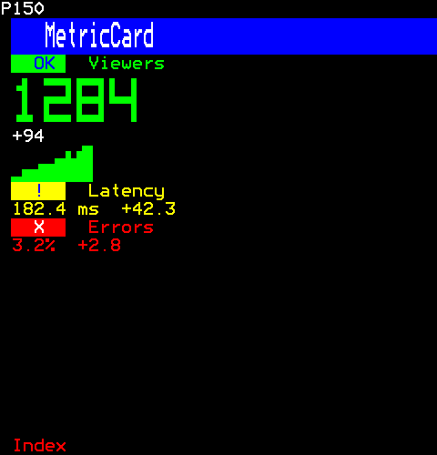

```ts
[
  h(MetricCard, {
    key: "viewers",
    label: "Viewers",
    value: 1284,
    previous: 1190,
    kind: "success",
    big: true,
    history: [610, 640, 700, 690, 760, 820, 900, 880, 950, 1010, 1100, 1060, 1190, 1240, 1284],
    historyRows: 2,
  }),
  h(MetricCard, { key: "latency", label: "Latency", value: 182.4, previous: 140.1, kind: "warning", unit: " ms", decimals: 1 }),
  h(MetricCard, { key: "errors", label: "Errors", value: 3.2, previous: 0.4, kind: "error", unit: "%", decimals: 1 }),
]
```

## Notice

Notices: a line that says what happened, its kind's mark on a chip of its kind's colour (core/look.ts) so it shows without colour too. A notice stays; a toast is one that goes after a few seconds, sent on the bus (core/library-events.ts) to every shelf (toast-shelf.ts) its audience reaches, so a toast for one viewer shows only on their own copy of a page.

```ts
import { Notice } from "neoteletext-server-ts-ui-components";
```

### Props

| Prop | Type | What it is |
| --- | --- | --- |
| `kind` (needed) | `Kind` | What happened: its mark and its colour (core/look.ts). |
| `text` (needed) | `string` | What it says, after the mark, cut to its row. |

### Each kind

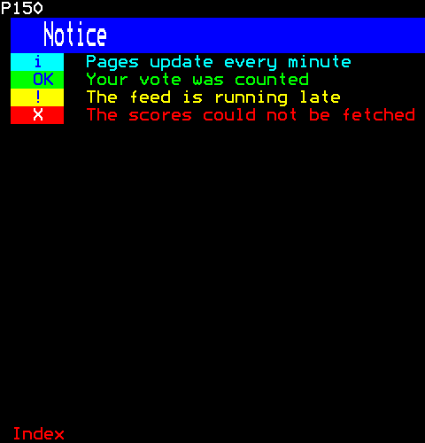

```ts
[
  h(Notice, { key: "info", kind: "info", text: "Pages update every minute" }),
  h(Notice, { key: "success", kind: "success", text: "Your vote was counted" }),
  h(Notice, { key: "warning", kind: "warning", text: "The feed is running late" }),
  h(Notice, { key: "error", kind: "error", text: "The scores could not be fetched" }),
]
```

## ToastShelf

Where toasts show (notice.ts): the newest at the foot, as many as it may show, each going after its time or at a click on it. A toast that can be undone says so, and its undo runs, once, at a click on it or at the undo key, which the shelf hears wherever the keys are (onPageKey). A toast it can no longer show goes at once, and its timer with it, so a burst of toasts leaves no more state or timers than the shelf has rows.

```ts
import { ToastShelf } from "neoteletext-server-ts-ui-components";
```

### Props

| Prop | Type | What it is |
| --- | --- | --- |
| `maxShown` | `number` | The most toasts shown at once; older ones go first. |
| `forMs` | `number` | How long each stays, in milliseconds. |

### A toast that can be undone

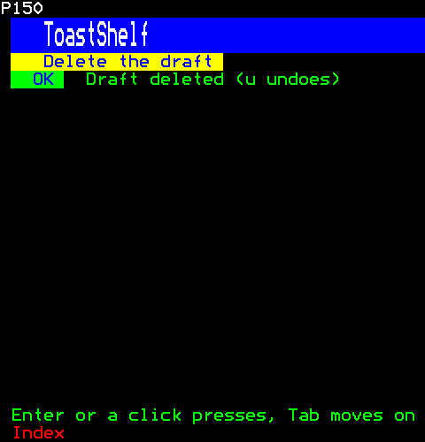

```ts
class DeleteButton extends Component {
           render()        {
    return h(Button, {
      label: "Delete the draft",
      onPress: (session) => {
        this.services.bus.emit("toast", { text: "Draft deleted", kind: "success", undo: () => {} }, { session });
      },
    });
  }
}
return [h(DeleteButton, { key: "delete" }), h(ToastShelf, { key: "toasts", forMs: 6_000 })];
```

Then the viewer:

```ts
page.press(1, Key.Enter);
```

## AudioPlayer

A player for the viewer's stream (core/stream.ts), drawn by player-view.ts, its doings player-actions.ts's. Given tracks, it plays them: a queue of them to choose from and edit, Previous and Next, repeat and shuffle, the next track when one ends, a speed, an A–B loop and a sleep timer, and, when told to, each track from where the viewer left it; without, it works the stream something else started. The keys that reach it seek and set the volume, a keyboard's letters do the rest (player-keys.ts), and the digits, when it takes them, jump to a tenth of the way; a click on the bar seeks there. It looks again twice a second while someone watches. With no tracks and nothing playing it draws nothing, or keeps its rows empty when told to (now-playing.ts). Its state is one viewer's, so each has a copy of its page.

```ts
import { AudioPlayer } from "neoteletext-server-ts-ui-components";
```

**It takes of its page:** a copy of the page for each viewer.

### Props

| Prop | Type | What it is |
| --- | --- | --- |
| `keepRows` | `boolean` | With no tracks, while nothing plays its rows stay, empty, so what is under it does not move. |
| `tracks` | `PlayerViewProps["tracks"]` | The tracks it plays; without, it works whatever stream plays. |
| `shown` | `number` | The rows of tracks shown. |
| `digits` | `boolean` | The digits jump to a tenth of the way through, so the page takes them from page selection. |
| `resume` | `boolean` | Each track is taken up where the viewer last left it: for talks and podcasts, not music. |
| `spectrum` | `number` | A spectrum of what is heard, of this many rows, under the bar. |

### Tracks before playing

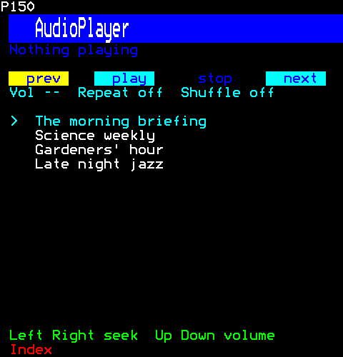

```ts
h(AudioPlayer, {
  tracks: ["The morning briefing", "Science weekly", "Gardeners' hour", "Late night jazz"].map((name) => {
    const samples = new Int16Array(16_000 * 300);
    return { name, source: () => ({ name, rate: 16_000, samples: () => samples, complete: true, failure: null, expected: samples.length }) };
  }),
  shown: 4,
})
```

### Faster, looping, with a sleep timer

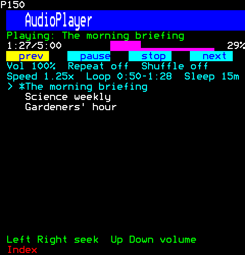

```ts
h(AudioPlayer, {
  tracks: ["The morning briefing", "Science weekly", "Gardeners' hour"].map((name) => {
    const samples = new Int16Array(16_000 * 300);
    return { name, source: () => ({ name, rate: 16_000, samples: () => samples, complete: true, failure: null, expected: samples.length }) };
  }),
  shown: 3,
})
```

Then the viewer:

```ts
page.press(1, "p");
page.press(1, "]");
page.runUntil(40_000);
page.press(1, "l");
page.runUntil(70_000);
page.press(1, "l");
page.press(1, "t");
```

### With a spectrum

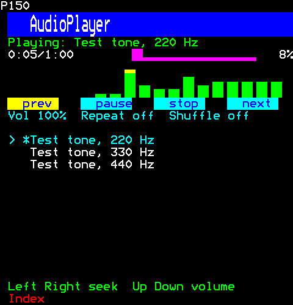

```ts
h(AudioPlayer, {
  tracks: [220, 330, 440].map((hertz) => {
    const name = `Test tone, ${hertz} Hz`;
    const samples = tone(hertz, 60_000, "square", 0.5);
    return { name, source: () => ({ name, rate: RATE, samples: () => samples, complete: true, failure: null, expected: samples.length }) };
  }),
  shown: 3,
  spectrum: 3,
})
```

Then the viewer:

```ts
page.press(1, "p");
page.runUntil(5_000);
```

## NowPlaying

What the viewer is listening to (core/stream.ts): its name, how far it has played of how long, and whether it is waiting, playing, paused or cannot play, looked at again twice a second while someone watches. When nothing plays it draws nothing, as the owner asked, or keeps its rows empty when told to so what is under it does not move; the copy every viewer shares has nobody to look for, and so draws nothing too.

```ts
import { NowPlaying } from "neoteletext-server-ts-ui-components";
```

### Props

| Prop | Type | What it is |
| --- | --- | --- |
| `foreground` | `Colour` | The bar's colour; magenta when absent. |
| `keepRows` | `boolean` | While nothing plays its rows stay, empty, so what is under it does not move. |

### Over a player, paused

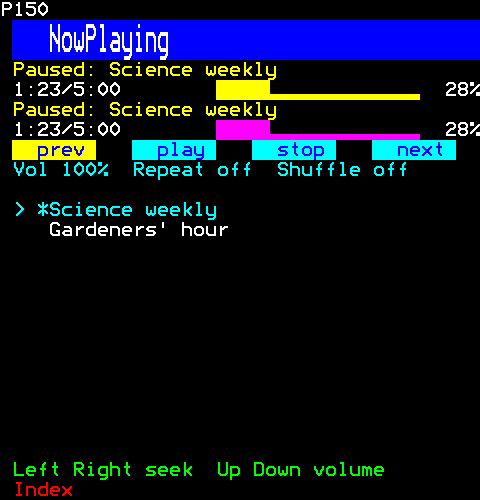

```ts
[
  h(NowPlaying, { key: "now", foreground: Colour.Yellow }),
  h(AudioPlayer, {
    key: "player",
    tracks: ["Science weekly", "Gardeners' hour"].map((name) => {
      const samples = new Int16Array(16_000 * 300);
      return { name, source: () => ({ name, rate: 16_000, samples: () => samples, complete: true, failure: null, expected: samples.length }) };
    }),
    shown: 2,
  }),
]
```

Then the viewer:

```ts
page.press(1, "p");
page.runUntil(83_000);
page.press(1, "p");
page.runUntil(84_000);
```

## ListeningView

A stream as the viewer sees it: what it is and whether it plays, then a bar of how far it has played of how long; with nothing playing, it says so and keeps the bar's row, so what is under it does not move, as it does for a stream that cannot play, which has played nothing to show. It looks at nothing itself; the player that holds it (now-playing.ts, audio-player.ts) says what plays.

```ts
import { ListeningView } from "neoteletext-server-ts-ui-components";
```

### Props

| Prop | Type | What it is |
| --- | --- | --- |
| `listening` (needed) | `Listening \| null` | What plays, or null for nothing. |
| `foreground` | `Colour` | The bar's colour; magenta when absent. |
| `onSeek` | `(fraction: number, session: number) => void` | A click on the bar: how far along it, 0 to 1, to seek there. |

#### Listening

| Prop | Type | What it is |
| --- | --- | --- |
| `name` (needed) | `string` | What it is called, as the viewer sees it. |
| `heardMs` (needed) | `number` | Milliseconds heard, and in all (null while not known). |
| `lengthMs` (needed) | `number \| null` | Its length in milliseconds, or null while it is not known. |
| `state` (needed) | `"waiting" \| "playing" \| "paused" \| "ended" \| "failed"` | What it is doing: waiting to start, playing, paused, played to its end, or unable to play. |
| `failure` (needed) | `string \| null` | Why it cannot play, or null; its state is failed while it is not null. |
| `gain` (needed) | `number` | How loud it plays, 0 to FULL_GAIN. |

### Playing, and failing

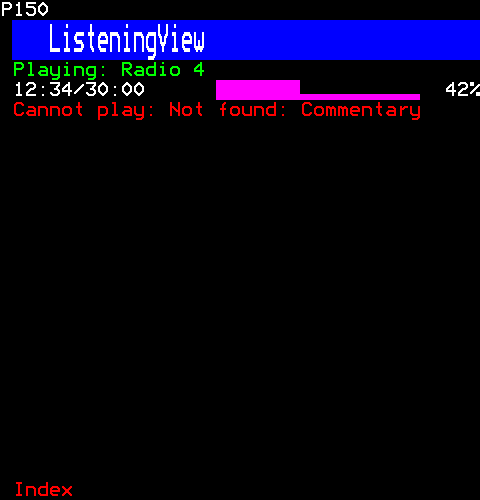

```ts
[
  h(ListeningView, { key: "playing", listening: { name: "Radio 4", heardMs: 754_000, lengthMs: 1_800_000, state: "playing", failure: null, gain: 100 } }),
  h(ListeningView, { key: "failed", listening: { name: "Commentary", heardMs: 0, lengthMs: null, state: "failed", failure: "Not found", gain: 100 } }),
]
```

## PlayQueue

A player's queue (audio-player.ts) as a list to choose from: the tracks in the order queued, the one it plays marked with a star, so it shows without colour; choosing one plays it, and where the choice is, the player is told, for the keys that edit the queue there. The choice follows its track as the queue is edited. It says the list's own keys on the hint row, unless the player that takes more of them says its own.

```ts
import { PlayQueue } from "neoteletext-server-ts-ui-components";
```

### Props

| Prop | Type | What it is |
| --- | --- | --- |
| `tracks` (needed) | `readonly Track[]` | Every track the player has; the queue names them by their place here. |
| `queue` (needed) | `readonly number[]` | The tracks' places in `tracks`, in the order queued. |
| `current` (needed) | `number \| null` | The track the player plays, by its place in `tracks`, or null. |
| `shown` (needed) | `number` | The rows the list shows. |
| `onChoose` (needed) | `(track: number, session: number) => void` | A track chosen, by its place in `tracks`. |
| `onMove` | `(place: number, session: number) => void` | The list's choice moved to `place` in the queue. |
| `hint` | `string` | What the keys do while the list has them, for the hint row: the player's (player-view.ts), which takes keys the list does not; the list's own when absent. |

#### Track

| Prop | Type | What it is |
| --- | --- | --- |
| `name` (needed) | `string` | What it is called, in the queue. |
| `source` (needed) | `() => StreamSource` | Makes its stream, each time it is played. |

#### StreamSource

| Prop | Type | What it is |
| --- | --- | --- |
| `name` (needed) | `string` | What it is, for the page that shows it playing. |
| `rate` (needed) | `SampleRate` | Its sample rate: one the protocol takes (16000 for speech). |
| `complete` (needed) | `boolean` | Whether every sample is known. |
| `failure` (needed) | `string \| null` | Why it cannot play, if it cannot. |
| `expected` (needed) | `number \| null` | Its length in samples when known in advance, or null. |
| `speed` | `number` | How much faster than its samples it plays what it holds: a source stretched to play faster or slower (feedback/time-stretch.ts). 1 when absent. |

### The second track playing

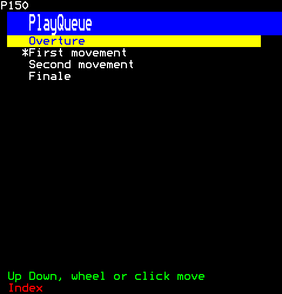

```ts
h(PlayQueue, {
  tracks: ["Overture", "First movement", "Second movement", "Finale"].map((name) => ({
    name,
    source: () => ({ name, rate: 16_000, samples: () => new Int16Array(0), complete: true, failure: null, expected: 0 }),
  })),
  queue: [0, 1, 2, 3],
  current: 1,
  shown: 4,
  onChoose: () => {},
})
```

## PlayerStatus

A player's modes (audio-player.ts) on two rows, each in words, so its state shows without colour: how loud, or muted, and, for a player of tracks, what repeats and whether it shuffles; then its speed, the part it loops and when it sleeps, each only while it is set.

```ts
import { PlayerStatus } from "neoteletext-server-ts-ui-components";
```

### Props

| Prop | Type | What it is |
| --- | --- | --- |
| `gain` (needed) | `number \| null` | How loud, 0 to FULL_GAIN, or null while nothing plays. |
| `muted` (needed) | `boolean` | It is muted: "Muted", in yellow, in place of how loud. |
| `repeat` | `Repeat` | The modes of a player of tracks; absent for one that only shows what plays. |
| `shuffle` | `boolean` | Whether it plays the tracks in a shuffled order; not shown when absent. |
| `speed` | `number` | How fast it plays: 1 is as recorded. |
| `loopFrom` | `number \| null` | The part looped, in milliseconds of the track: from, then to once set. |
| `loopTo` | `number \| null` | Where the loop ends, in milliseconds of the track, or null until it is set. |
| `sleepMinutes` | `number \| null` | The minutes before it sleeps, or null. |

### Every mode set

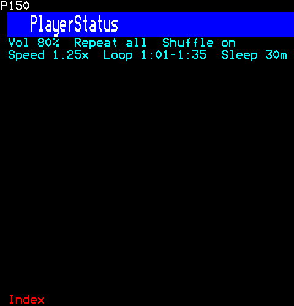

```ts
h(PlayerStatus, { gain: 80, muted: false, repeat: "all", shuffle: true, speed: 1.25, loopFrom: 61_000, loopTo: 95_000, sleepMinutes: 30 })
```

## Transport

A player's transport (audio-player.ts): previous, play or pause, stop and next, as buttons of one width in a row; what cannot be done now is disabled, not hidden. Its buttons say their own keys on the hint row, unless the player that takes more of the keys says what they do there.

```ts
import { Transport } from "neoteletext-server-ts-ui-components";
```

### Props

| Prop | Type | What it is |
| --- | --- | --- |
| `going` (needed) | `boolean` | Whether what plays is going (or getting ready), so the middle button pauses rather than plays. |
| `canPlay` (needed) | `boolean` | Whether there is anything to play or pause. |
| `canStop` (needed) | `boolean` | Whether there is anything to stop; the stop button is disabled when not. |
| `canStep` (needed) | `boolean` | Whether there are tracks to go back and on through. |
| `onPrevious` (needed) | `(session: number) => void` | The prev button pressed; never while canStep is false. |
| `onPlayPause` (needed) | `(session: number) => void` | The play or pause button pressed; never while canPlay is false. |
| `onStop` (needed) | `(session: number) => void` | The stop button pressed; never while canStop is false. |
| `onNext` (needed) | `(session: number) => void` | The next button pressed; never while canStep is false. |
| `hint` | `string` | What the keys do while a button has them, for the hint row: the player's (player-view.ts), which takes keys the buttons do not; the buttons' own when absent. |

### Playing, with no tracks to step through

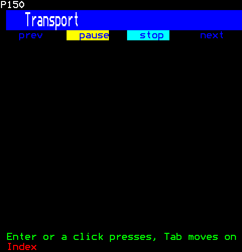

```ts
h(Transport, {
  going: true,
  canPlay: true,
  canStop: true,
  canStep: false,
  onPrevious: () => {},
  onPlayPause: () => {},
  onStop: () => {},
  onNext: () => {},
})
```

## PlayerView

A player as it is drawn (audio-player.ts holds its state): what plays and how far, on a bar a click seeks along, a spectrum of what is heard when it has one, the transport, the modes, and, given tracks, the queue of them. The transport and the queue say the player's keys on the hint row, which the player takes while either has them (player-keys.ts).

```ts
import { PlayerView } from "neoteletext-server-ts-ui-components";
```

### Props

| Prop | Type | What it is |
| --- | --- | --- |
| `listening` (needed) | `ListeningViewProps["listening"]` | What plays, in the track's own time. |
| `foreground` | `ListeningViewProps["foreground"]` | The bar's colour; magenta when absent. |
| `tracks` | `readonly Track[]` | The tracks, or absent for a player of whatever stream plays. |
| `queue` (needed) | `readonly number[]` | The tracks' places in `tracks`, in the order queued. |
| `current` (needed) | `number \| null` | The track it plays, by its place in `tracks`, or null. |
| `shown` (needed) | `number` | The rows the queue shows. |
| `levels` (needed) | `readonly number[] \| null` | The levels of what is heard, for a spectrum of `spectrumRows` rows; none for no spectrum. |
| `spectrumRows` (needed) | `number` | The spectrum's rows, while there are levels. |
| `status` (needed) | `PlayerStatusProps` | The modes, as the status rows say them. |
| `onPrevious` (needed) | `(session: number) => void` | The prev button pressed. |
| `onPlayPause` (needed) | `(session: number) => void` | The play or pause button pressed. |
| `onStop` (needed) | `(session: number) => void` | The stop button pressed. |
| `onNext` (needed) | `(session: number) => void` | The next button pressed. |
| `onSeek` (needed) | `(fraction: number, session: number) => void` | A click on the bar: how far along it, 0 to 1. |
| `onChoose` (needed) | `PlayQueueProps["onChoose"]` | A track chosen in the queue, by its place in `tracks`. |
| `onMove` (needed) | `NonNullable<PlayQueueProps["onMove"]>` | The queue's choice moved to `place` in the queue. |

#### Track

| Prop | Type | What it is |
| --- | --- | --- |
| `name` (needed) | `string` | What it is called, in the queue. |
| `source` (needed) | `() => StreamSource` | Makes its stream, each time it is played. |

#### StreamSource

| Prop | Type | What it is |
| --- | --- | --- |
| `name` (needed) | `string` | What it is, for the page that shows it playing. |
| `rate` (needed) | `SampleRate` | Its sample rate: one the protocol takes (16000 for speech). |
| `complete` (needed) | `boolean` | Whether every sample is known. |
| `failure` (needed) | `string \| null` | Why it cannot play, if it cannot. |
| `expected` (needed) | `number \| null` | Its length in samples when known in advance, or null. |
| `speed` | `number` | How much faster than its samples it plays what it holds: a source stretched to play faster or slower (feedback/time-stretch.ts). 1 when absent. |

### Of a stream, with no tracks

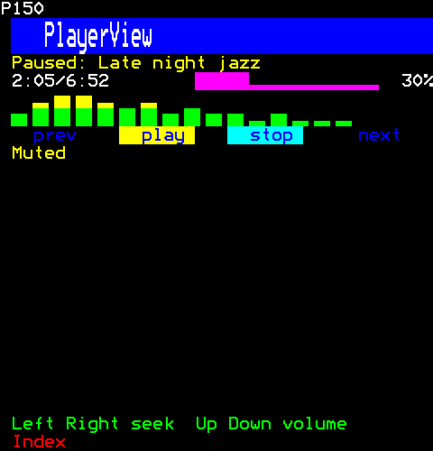

```ts
h(PlayerView, {
  listening: { name: "Late night jazz", heardMs: 125_000, lengthMs: 412_000, state: "paused", failure: null, gain: 60 },
  queue: [],
  current: null,
  shown: 0,
  levels: [0.3, 0.6, 0.9, 0.8, 0.7, 0.5, 0.6, 0.4, 0.5, 0.3, 0.4, 0.2, 0.3, 0.2, 0.1, 0.1],
  spectrumRows: 2,
  status: { gain: 60, muted: true },
  onPrevious: () => {},
  onPlayPause: () => {},
  onStop: () => {},
  onNext: () => {},
  onSeek: () => {},
  onChoose: () => {},
  onMove: () => {},
})
```
