# The frame

Every page's frame, as Ceefax laid it out: a title band in double height, the body, a hint of what the keys do, and the four Fastext prompts in red, green, yellow and cyan. Its rows are components of their own, with a status bar and lists of keys beside them.

- [Frame](#frame)
- [TitleBand](#titleband)
- [HintLine](#hintline)
- [KeyHelp](#keyhelp)
- [PositionLine](#positionline)
- [StatusBar](#statusbar)
- [FastextBar](#fastextbar)

## Frame

Every page's frame, as Ceefax laid it out: row 0 left to the page (the receiver's page number in columns 0 to 7), a title band in double height on rows 1 and 2 that names the sub-page (the browser lists sub-pages by it), the body on rows 3 to 22, a hint of the keys on row 23, and the Fastext prompts on row 24 with their links.

```ts
import { Frame } from "neoteletext-server-ts-ui-components";
```

### Props

| Prop | Type | What it is |
| --- | --- | --- |
| `title` (needed) | `string` | The title band's text: the sub-page's name. |
| `background` (needed) | `Colour` | The title band's colour. |
| `foreground` | `Colour` | The title's colour; white when absent. |
| `prompts` | `Prompts` | The Fastext prompts on row 24, and the links they give the sub-page; none when absent. |
| `hint` | `string` | What the keys do, on row 23; when absent, what the component with the keys says. |
| `index` | `number` | The Index key's page. |
| `bare` | `boolean` | No title band: the body starts on row 1, for a page with its own heading (the front page's emblem). |

### A page with its prompts

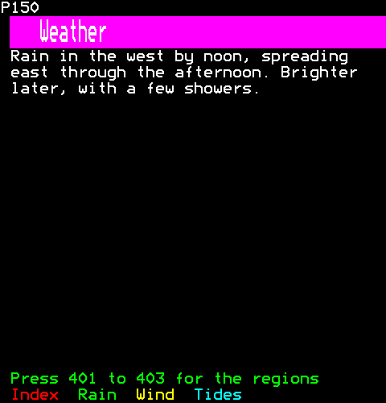

```ts
h(
  Frame,
  {
    title: "Weather",
    background: Colour.Magenta,
    hint: "Press 401 to 403 for the regions",
    prompts: [
      ["Index", 0x100],
      ["Rain", 0x401],
      ["Wind", 0x402],
      ["Tides", 0x403],
    ],
  },
  h(Paragraph, { text: "Rain in the west by noon, spreading east through the afternoon. Brighter later, with a few showers." }),
)
```

### A band in its own colours

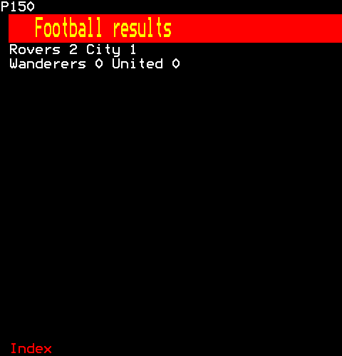

```ts
h(
  Frame,
  { title: "Football results", background: Colour.Red, foreground: Colour.Yellow, prompts: [["Index", 0x100]] },
  h(Text, { text: "Rovers 2 City 1" }),
  h(Text, { text: "Wanderers 0 United 0" }),
)
```

## TitleBand

TitleBand: rows 1 and 2 of the frame, the sub-page's name in double height on a band of its colour.

```ts
import { TitleBand } from "neoteletext-server-ts-ui-components";
```

### Props

| Prop | Type | What it is |
| --- | --- | --- |
| `title` (needed) | `string` | The sub-page's name, in double height, cut to the band. |
| `background` (needed) | `Colour` | The band's colour. |
| `foreground` | `Colour` | The title's colour; white when absent. |

### In a colour

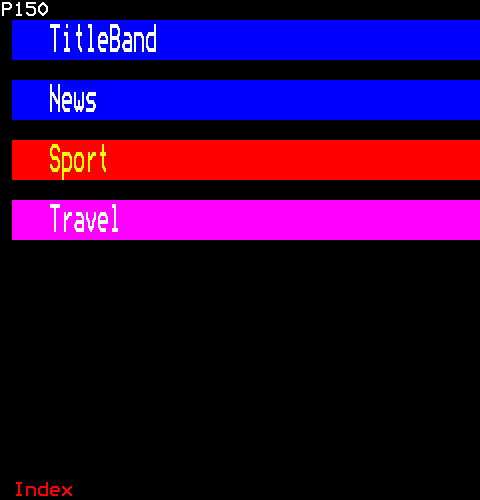

```ts
[
  h(Gap, { key: "1" }),
  h(TitleBand, { key: "news", title: "News", background: Colour.Blue }),
  h(Gap, { key: "2" }),
  h(TitleBand, { key: "sport", title: "Sport", background: Colour.Red, foreground: Colour.Yellow }),
  h(Gap, { key: "3" }),
  h(TitleBand, { key: "travel", title: "Travel", background: Colour.Magenta }),
]
```

## HintLine

HintLine: row 23 of the frame, what the keys or the control under the pointer do. A line of keys shows as many of its entries as fit whole, so no key is shown with its action cut short; a control's words of its own, and an entry too long for the row, are cut.

```ts
import { HintLine } from "neoteletext-server-ts-ui-components";
```

### Props

| Prop | Type | What it is |
| --- | --- | --- |
| `text` | `string` | What the keys do here; when absent, what the component with the keys says (core/component.ts, hint). While the pointer is on a control that says what it does, that is said instead. |
| `foreground` | `Colour` | The hint's colour; green when absent. |

### What the keys do

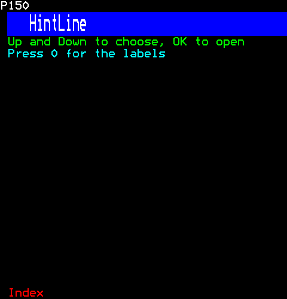

```ts
[
  h(HintLine, { key: "plain", text: "Up and Down to choose, OK to open" }),
  h(HintLine, { key: "cyan", text: "Press 0 for the labels", foreground: Colour.Cyan }),
]
```

## KeyHelp

What the keys do: each key in yellow and its action in white, in one column or two. Given no keys, it lists those of the control that has them (core/key-bindings.ts), so its help follows the focus.

```ts
import { KeyHelp } from "neoteletext-server-ts-ui-components";
```

### Props

| Prop | Type | What it is |
| --- | --- | --- |
| `keys` | `readonly KeyHelpEntry[]` | The keys to list; the focused control's when absent. |
| `columns` | `1 \| 2` | One column, or two side by side; one when absent. |
| `keyCells` | `number` | The cells the keys' column takes. |

### Keys given

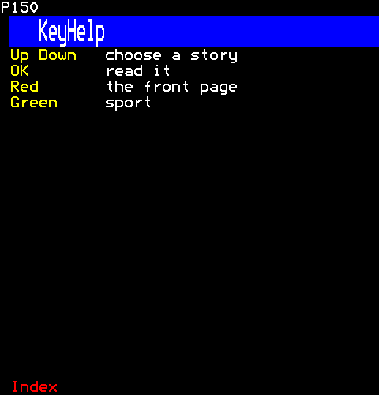

```ts
h(KeyHelp, {
  keys: [
    ["Up Down", "choose a story"],
    ["OK", "read it"],
    ["Red", "the front page"],
    ["Green", "sport"],
  ],
})
```

### In two columns

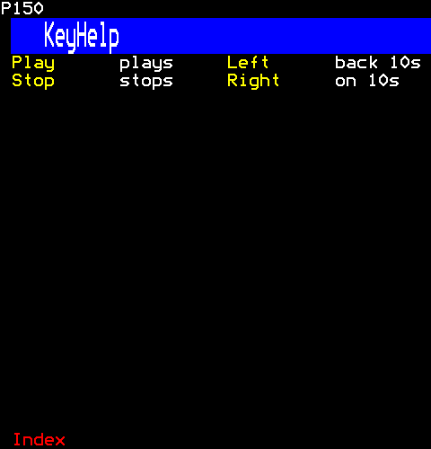

```ts
h(KeyHelp, {
  columns: 2,
  keys: [
    ["Play", "plays"],
    ["Stop", "stops"],
    ["Left", "back 10s"],
    ["Right", "on 10s"],
  ],
})
```

### Following the keys

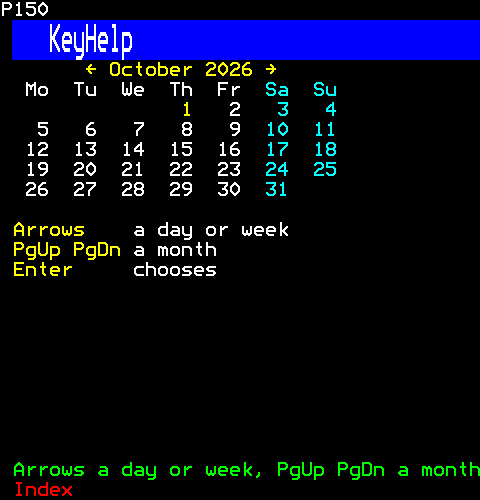

```ts
[h(Calendar, { key: "calendar", year: 2026, month: 9, selectable: true }), h(KeyHelp, { key: "help" })]
```

## PositionLine

PositionLine: where a long list or text is, as "Lines 1-18 of 66".

```ts
import { PositionLine } from "neoteletext-server-ts-ui-components";
```

### Props

| Prop | Type | What it is |
| --- | --- | --- |
| `first` (needed) | `number` | The first shown, from 0; it is written from 1. |
| `shown` (needed) | `number` | How many are shown from the first. |
| `total` (needed) | `number` | How many there are: nothing is drawn while all are shown. |
| `noun` | `string` | What is counted: "Lines" when absent. |

### Where a long list is

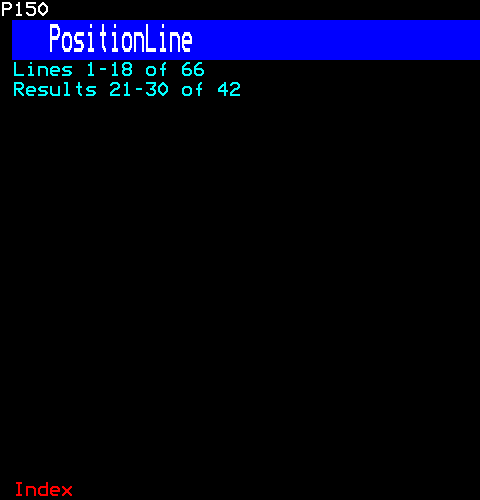

```ts
[
  h(PositionLine, { key: "lines", first: 0, shown: 18, total: 66 }),
  h(PositionLine, { key: "results", first: 20, shown: 10, total: 42, noun: "Results" }),
]
```

## StatusBar

A status bar: a row on a background of its own, its segments each in their colour (a colour's cell is the gap between them), and text on the right, such as the time. An alarm flashes.

```ts
import { StatusBar } from "neoteletext-server-ts-ui-components";
```

### Props

| Prop | Type | What it is |
| --- | --- | --- |
| `segments` (needed) | `readonly Segment[]` | The segments, left to right, each in its colour and cut to the room before the right-hand text. |
| `right` | `string` | Text on the right, in yellow. |
| `background` | `Colour` | The bar's colour; blue when absent. |
| `alarm` | `boolean` | The bar flashes: something is wrong. |

#### Segment

| Prop | Type | What it is |
| --- | --- | --- |
| `text` (needed) | `string` | What it says, cut to the room before the right-hand text. |
| `foreground` | `Colour` | Its colour; white when absent. |

### Segments and the time

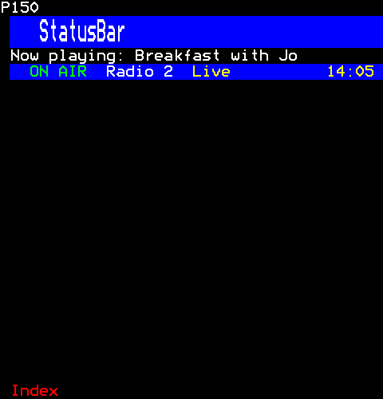

```ts
[
  h(Text, { key: "show", text: "Now playing: Breakfast with Jo" }),
  h(StatusBar, {
    key: "status",
    segments: [{ text: "ON AIR", foreground: Colour.Green }, { text: "Radio 2" }, { text: "Live", foreground: Colour.Yellow }],
    right: "14:05",
  }),
]
```

### An alarm

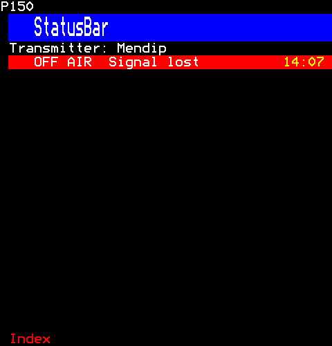

```ts
[
  h(Text, { key: "site", text: "Transmitter: Mendip" }),
  h(StatusBar, { key: "status", segments: [{ text: "OFF AIR" }, { text: "Signal lost" }], right: "14:07", background: Colour.Red, alarm: true }),
]
```

## FastextBar

FastextBar: row 24 of the frame, the four Fastext prompts in their colours, and the pages they link to.

```ts
import { FastextBar } from "neoteletext-server-ts-ui-components";
```

### Props

| Prop | Type | What it is |
| --- | --- | --- |
| `prompts` (needed) | `Prompts` | The prompts, red to cyan, each in its colour: one with no label is not drawn and takes no cells, and past four none is drawn. |

### Four prompts

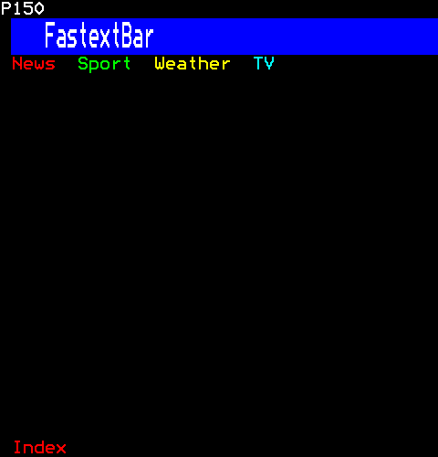

```ts
h(FastextBar, {
  prompts: [
    ["News", 0x101],
    ["Sport", 0x300],
    ["Weather", 0x400],
    ["TV", 0x600],
  ],
})
```
