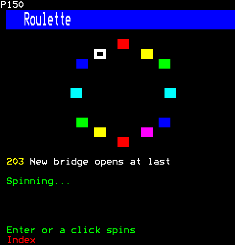
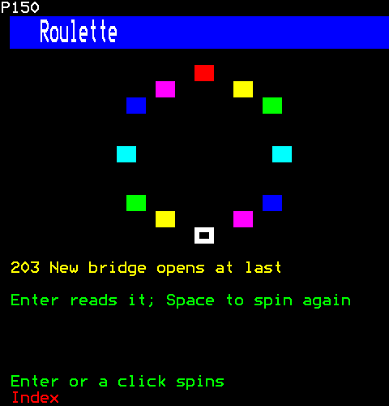
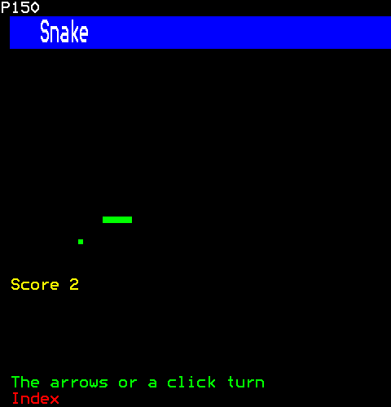
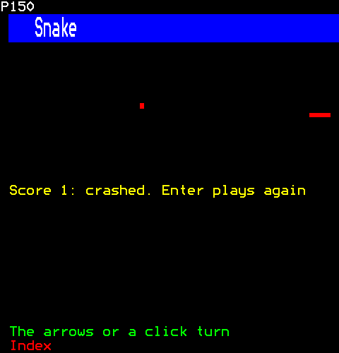

# Games

Games for a page, each viewer playing their own: a roulette wheel that spins down to an article to read, and snake.

- [Roulette](#roulette)
- [Snake](#snake)

## Roulette

A roulette wheel that spins down to a random article, a sound at each step. Enter or a click on the wheel's prompt spins it; when it stops, the article's headline is a link a click follows, as Enter does.

```ts
import { Roulette } from "neottx-server-ts-ui-components";
```

**Keys:** `Enter or a click` spins; `Enter again` reads it.

**It takes of its page:** a copy of the page for each viewer.

### Props

| Prop | Type | What it is |
| --- | --- | --- |
| `articles` (needed) | `readonly Article[]` | What it spins between; the one it stops on is a link to its page. |
| `tick` | `Sound` | Played to the viewer who spun it at each step of the spin. |
| `done` | `Sound` | Played to the viewer who spun it as it stops. |

And the props of [`ControlProps`](common.md#controlprops).

#### Article

| Prop | Type | What it is |
| --- | --- | --- |
| `page` (needed) | `number` | The page it is on, which its headline links to. |
| `title` (needed) | `string` | Its headline. |
| `writer` (needed) | `string` | Who wrote it, in its byline. |
| `date` (needed) | `number` | Milliseconds since the Unix epoch. |
| `blocks` (needed) | `readonly Block[]` | Its text, block by block, as its story's sub-pages show it. |
| `tags` (needed) | `readonly string[]` | Its labels, under its byline. |

#### Block

| Prop | Type | What it is |
| --- | --- | --- |
| `kind` (needed) | `"paragraph" \| "heading" \| "quote" \| "item"` | What it is: a paragraph in white, a heading in yellow, a quotation in cyan, or an item of a list, marked "*". |
| `text` (needed) | `string` | Its text, wrapped to the width. |

#### Sound

| Prop | Type | What it is |
| --- | --- | --- |
| `name` (needed) | `string` | Its name, unique in the channel. |
| `samples` (needed) | `Int16Array` | Its samples, signed 16-bit, at RATE. |

### Spinning



```ts
h(Roulette, {
  articles: ["Storm closes the coast road", "Village wins best-kept prize", "New bridge opens at last", "Library to stay open late"].map(
    (title, index) => ({
      page: 0x201 + index,
      title,
      writer: "News desk",
      date: 1_790_000_000_000,
      blocks: [],
      tags: ["local"],
    }),
  ),
  tick: { name: "tick", samples: tone(1_200, 20) },
})
```

Then the viewer:

```ts
page.press(1, Key.Enter);
page.runUntil(600);
```

### Stopped on an article



```ts
h(Roulette, {
  articles: ["Storm closes the coast road", "Village wins best-kept prize", "New bridge opens at last", "Library to stay open late"].map(
    (title, index) => ({
      page: 0x201 + index,
      title,
      writer: "News desk",
      date: 1_790_000_000_000,
      blocks: [],
      tags: ["local"],
    }),
  ),
})
```

Then the viewer:

```ts
page.press(1, Key.Enter);
page.runUntil(10_000);
```

## Snake

Snake: a game a frame a tick for each viewer on the page. The arrows turn it, or a click on the field turns it toward the click; once it has crashed, Enter or a click plays again, and the line that says so is a control. The field is not one: under the pointer the browser would light the whole field.

```ts
import { Snake } from "neottx-server-ts-ui-components";
```

**Keys:** `The arrows or a click` turn; `Enter` plays again.

**It takes of its page:** a copy of the page for each viewer.

### Props

| Prop | Type | What it is |
| --- | --- | --- |
| `everyMs` (needed) | `number` | Milliseconds a frame. |
| `rows` (needed) | `number` | The field's rows; the score's row is under them. |
| `eat` | `Sound` | Played to the viewer whose snake it is as it eats. |
| `crash` | `Sound` | Played to the viewer whose snake it is as it crashes. |

And the props of [`ControlProps`](common.md#controlprops).

#### Sound

| Prop | Type | What it is |
| --- | --- | --- |
| `name` (needed) | `string` | Its name, unique in the channel. |
| `samples` (needed) | `Int16Array` | Its samples, signed 16-bit, at RATE. |

### Mid-game



```ts
h(Snake, { everyMs: 150, rows: 14 })
```

Then the viewer:

```ts
page.runUntil(4_000);
page.press(1, Key.Down);
page.runUntil(5_500);
page.press(1, Key.Left);
page.runUntil(8_000);
```

### Crashed



```ts
h(Snake, { everyMs: 150, rows: 10 })
```

Then the viewer:

```ts
page.runUntil(30_000);
```
