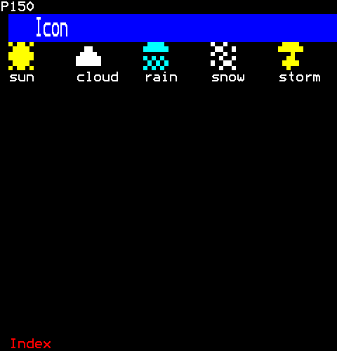
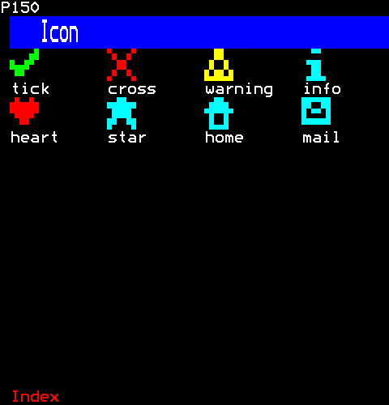
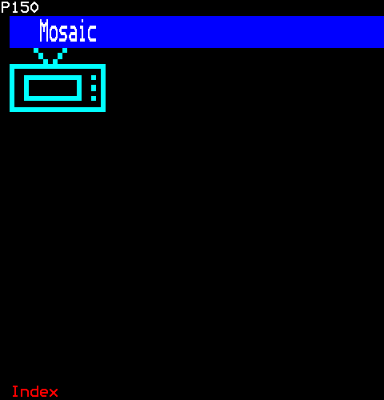
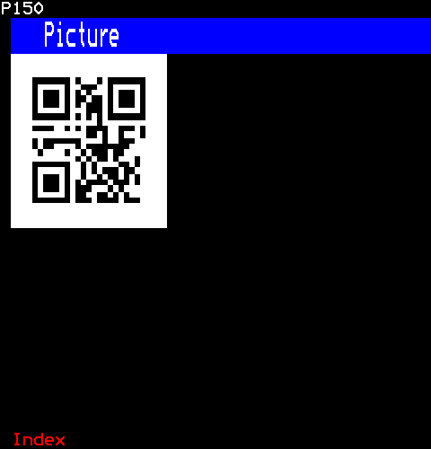
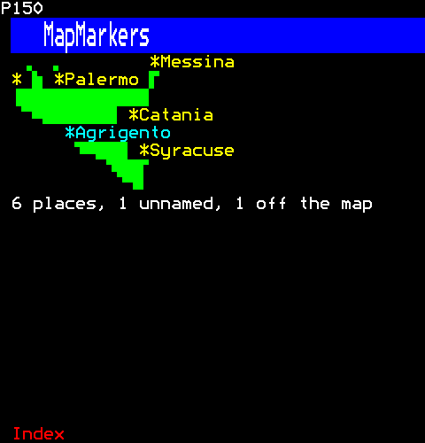
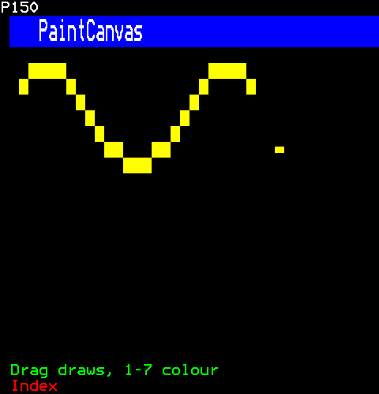
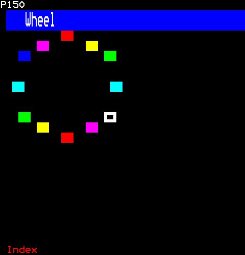
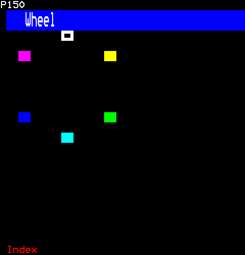
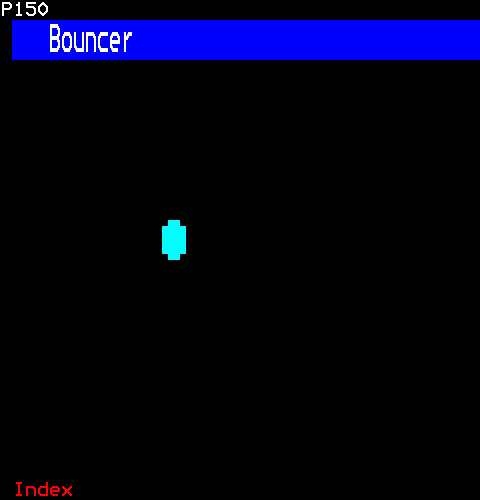

# Graphics

Pictures in mosaic sixels: icons, bitmaps of your own, pictures and QR codes made by the engine's tools, a map with its places marked, a canvas to paint on, and things that move.

- [Icon](#icon)
- [Mosaic](#mosaic)
- [Picture](#picture)
- [MapMarkers](#mapmarkers)
- [PaintCanvas](#paintcanvas)
- [Wheel](#wheel)
- [Bouncer](#bouncer)

## Icon

Icons in mosaic sixels, three cells across and two rows down (six by six sixels), as a teletext weather map's suns and clouds were: the weather, marks for notices, and a few everyday things. Each is drawn in its own colour, or the one given; its colour's cell is the gap before it.

```ts
import { Icon } from "neottx-server-ts-ui-components";
```

### Props

| Prop | Type | What it is |
| --- | --- | --- |
| `name` (needed) | `IconName` | Which icon it draws. |
| `foreground` | `Colour` | Its colour; the icon's own in ICONS when absent. |

### The weather



```ts
h(
  Columns,
  {},
  h(Rows, { key: "sun" }, h(Icon, { name: "sun" }), h(Text, { text: "sun" })),
  h(Rows, { key: "cloud" }, h(Icon, { name: "cloud" }), h(Text, { text: "cloud" })),
  h(Rows, { key: "rain" }, h(Icon, { name: "rain" }), h(Text, { text: "rain" })),
  h(Rows, { key: "snow" }, h(Icon, { name: "snow" }), h(Text, { text: "snow" })),
  h(Rows, { key: "storm" }, h(Icon, { name: "storm" }), h(Text, { text: "storm" })),
)
```

### Marks and everyday things, in a colour given



```ts
[
  h(
    Columns,
    { key: "marks" },
    h(Rows, { key: "tick" }, h(Icon, { name: "tick" }), h(Text, { text: "tick" })),
    h(Rows, { key: "cross" }, h(Icon, { name: "cross" }), h(Text, { text: "cross" })),
    h(Rows, { key: "warning" }, h(Icon, { name: "warning" }), h(Text, { text: "warning" })),
    h(Rows, { key: "info" }, h(Icon, { name: "info" }), h(Text, { text: "info" })),
  ),
  h(
    Columns,
    { key: "things" },
    h(Rows, { key: "heart" }, h(Icon, { name: "heart", foreground: Colour.Red }), h(Text, { text: "heart" })),
    h(Rows, { key: "star" }, h(Icon, { name: "star", foreground: Colour.Cyan }), h(Text, { text: "star" })),
    h(Rows, { key: "home" }, h(Icon, { name: "home", foreground: Colour.Cyan }), h(Text, { text: "home" })),
    h(Rows, { key: "mail" }, h(Icon, { name: "mail", foreground: Colour.Cyan }), h(Text, { text: "mail" })),
  ),
]
```

## Mosaic

Bitmaps of sixels, written as rows of text, drawn in mosaic graphics.

```ts
import { Mosaic } from "neottx-server-ts-ui-components";
```

### Props

| Prop | Type | What it is |
| --- | --- | --- |
| `bitmap` (needed) | `Bitmap` | Its sixels, a row of text each, "#" set; a page's at most. |
| `foreground` | `Colour` | Its colour; white when absent. |

### A bitmap of your own



```ts
h(Mosaic, {
  // A television, "#" for each sixel set.
  bitmap: [
    "     #     #",
    "      #   #",
    "       # #",
    "####################",
    "#                  #",
    "#  ############  # #",
    "#  #          #    #",
    "#  #          #  # #",
    "#  #          #    #",
    "#  ############  # #",
    "#                  #",
    "####################",
  ],
  foreground: Colour.Cyan,
})
```

## Picture

A picture or a QR code made by the engine's tools, as TTI rows placed in a box.

```ts
import { Picture } from "neottx-server-ts-ui-components";
```

### Props

| Prop | Type | What it is |
| --- | --- | --- |
| `tti` (needed) | `string` | A page in TTI, such as the engine's converter or `neottx qr` writes. |
| `firstRow` | `number` | The first of its rows to show. |

### A QR code from the engine



```ts
h(Picture, {
  // What `neottx qr --page 150 HTTPS://NEWS.EXAMPLE/150 qr.tti` wrote: its code is on rows 2 to 11.
  tti: [
    "PN,15000",
    "OL,2,\u001BW\u007F\u007F\u007F\u007F\u007F\u007F\u007F\u007F\u007F\u007F\u007F\u007F\u007F\u007F5",
    "OL,3,\u001BW\u007F\u007Fcssk;/{cssk\u007F5",
    "OL,4,\u001BW\u007F\u007Fj jjb&kj jj\u007F5",
    "OL,5,\u001BW\u007F\u007Frssz{xjrssz\u007F5",
    "OL,6,\u001BW\u007F\u007Fl,/.np4\u007F(nz\u007F5",
    "OL,7,\u001BW\u007F\u007Fv|\u007F{fd 4x?\u007F\u007F5",
    "OL,8,\u001BW\u007F\u007Fh,lj5ug#49\u007F\u007F5",
    'OL,9,\u001BW\u007F\u007Fjpzj"x,98}\u007F\u007F5',
    "OL,10,\u001BW\u007F\u007F|||~|~||}|\u007F\u007F5",
    "OL,11,\u001BW//////////////%",
  ].join("\n"),
  firstRow: 2,
})
```

## MapMarkers

Places marked on a map: the map a bitmap of sixels drawn in one colour (mosaic.ts) or a picture's TTI rows (picture.ts), the caller's, and each place a mark with its name beside it, put by its latitude and longitude within the map's bounds, the map taken as a plain grid of degrees (equirectangular). A mark and its name are text over the map: the text's colour takes the cell before them, and the cell after them sets the map's own colour again, so a mark covers its name's cells and two more (EN 300 706 clause 12.2). A name goes to the right of its mark, else to its left, else is left off, so that no two marks' cells overlap and none covers an attribute of the map's other than a colour, which it could not set again; a place with no such room, or below the box, is crowded out. A place outside the bounds is not drawn, and the row under the map says how many were left out, and how many are marked without their names.

```ts
import { MapMarkers } from "neottx-server-ts-ui-components";
```

### Props

| Prop | Type | What it is |
| --- | --- | --- |
| `map` (needed) | `MapBackground` | What the places are marked on: a bitmap in a colour, or a picture's TTI rows. |
| `bounds` (needed) | `MapBounds` | The degrees the map spans; a place outside them is left out, and bounds that make no map leave every place out. |
| `places` (needed) | `readonly MapPlace[]` | The places to mark; those crowded out or outside the bounds, and those marked without their names, are counted on the row under the map. |
| `nameCells` | `number` | The most cells a place's name takes. |

#### MapBounds

| Prop | Type | What it is |
| --- | --- | --- |
| `north` (needed) | `number` | The latitude of its top edge, in degrees; more than south. |
| `south` (needed) | `number` | The latitude of its bottom edge, in degrees. |
| `west` (needed) | `number` | The longitude of its left edge, in degrees. |
| `east` (needed) | `number` | The longitude of its right edge, in degrees; more than west. |

#### MapPlace

| Prop | Type | What it is |
| --- | --- | --- |
| `name` (needed) | `string` | What it is called, beside its mark: cut to nameCells, or left off where there is no room. |
| `latitude` (needed) | `number` | Degrees north; south is below nought. |
| `longitude` (needed) | `number` | Degrees east; west is below nought. |
| `foreground` | `Colour` | Its mark's and its name's colour. |

### Towns of Sicily



```ts
h(MapMarkers, {
  map: {
    // The island, a sixel to about ten kilometres: west to east 12.35 to 15.75 degrees, north to south 38.35 to 36.6.
    bitmap: [
      "",
      "                            #",
      "   #    #                ###",
      "  ### ###             ######",
      " ##########  ##############",
      " ##########################",
      " #########################",
      " #########################",
      " #########################",
      "  #######################",
      "    #####################",
      "      ##################",
      "        ################",
      "         ################",
      "          ###############",
      "            #############",
      "             #############",
      "                ##########",
      "                  ########",
      "                   ######",
      "                    #####",
      "                     ####",
      "                       ##",
      "",
    ],
    foreground: Colour.Green,
  },
  bounds: { north: 38.35, south: 36.6, west: 12.35, east: 15.75 },
  places: [
    { name: "Palermo", latitude: 38.12, longitude: 13.36 },
    { name: "Messina", latitude: 38.19, longitude: 15.55 },
    { name: "Catania", latitude: 37.5, longitude: 15.09 },
    { name: "Syracuse", latitude: 37.08, longitude: 15.29 },
    { name: "Agrigento", latitude: 37.31, longitude: 13.58, foreground: Colour.Cyan },
    { name: "Trapani", latitude: 38.02, longitude: 12.51 },
    { name: "Malta", latitude: 35.9, longitude: 14.51 },
  ],
})
```

## PaintCanvas

A canvas a viewer draws on with the pointer held down. Its surface is not a control: the browser's hover look would recolour all of it, and its pressed look turn all of it round, for as long as a stroke lasts. A stroke is a drag; and every move over the page comes, a button held or not (INPUT.md section 9.8), so `brush` can show where the brush will fall before a press. The surface follows the canvas's columns and rows as they change, keeping what is painted where the two overlap.

```ts
import { PaintCanvas } from "neottx-server-ts-ui-components";
```

**Keys:** `Drag` draws; `1-7` colour; `Backspace` clears.

**It takes of its page:** the digits, a copy of the page for each viewer.

### Props

| Prop | Type | What it is |
| --- | --- | --- |
| `columns` (needed) | `number` | The canvas's size in cells; its colour takes the first column. |
| `rows` (needed) | `number` | The canvas's rows. |
| `foreground` | `Colour` | The colour it paints in to begin with, until the keys 1 to 7 choose another; yellow when absent. |
| `brush` | `boolean` | The cell the brush will paint shows as the pointer passes over the surface, before a press: its middle row of sixels turned round. The mark stays where the pointer last was on it, since a move off it goes to what is drawn there. |

And the props of [`ControlProps`](common.md#controlprops).

### A stroke painted, the brush over it



```ts
h(PaintCanvas, { columns: 30, rows: 8, foreground: Colour.Yellow, brush: true })
```

Then the viewer:

```ts
// A wave, a cell at a time: the pointer pressed, dragged and let go.
page.mouse(1, "press", 0, 2, 5);
for (let column = 3; column <= 26; column += 1) {
  page.move(1, 1, column, 7 - Math.round(3 * Math.sin(column / 3)));
}
page.mouse(1, "release", 0, 26, 9);
page.move(1, 0, 29, 9);
```

## Wheel

A roulette wheel: a ring of coloured blocks, one lit. The ring is round on the cell's shape (core/mosaics.ts), as a pie is, and the same each side of its middle both ways. The lit segment is white and hollow, a ring of sixels where the others are solid, so it is told by its shape as well as its colour (core/look.ts).

```ts
import { Wheel } from "neottx-server-ts-ui-components";
```

### Props

| Prop | Type | What it is |
| --- | --- | --- |
| `lit` (needed) | `number` | The segment lit, which turns as the wheel spins. |
| `segments` | `number` | The blocks round it, a whole number up to MOST_SEGMENTS; 12 when absent. |

### A segment lit



```ts
h(Wheel, { lit: 4 })
```

### Fewer segments



```ts
h(Wheel, { lit: 0, segments: 6 })
```

## Bouncer

A sprite that moves: a ball bouncing round its box, a frame a tick.

```ts
import { Bouncer } from "neottx-server-ts-ui-components";
```

### Props

| Prop | Type | What it is |
| --- | --- | --- |
| `everyMs` (needed) | `number` | Milliseconds a frame. |

### A ball mid-bounce



```ts
h(Bouncer, { everyMs: 100 })
```

Then the viewer:

```ts
page.runUntil(2_300);
```
