# Input

The controls a viewer sets with a remote or a keyboard: fields to type in, by a keyboard, by digits to a template or by a phone's keypad; buttons and actions; boxes, radios and switches; numbers, sliders and selects.

- [Control](#control)
- [ValueControl](#valuecontrol)
- [Field](#field)
- [TextField](#textfield)
- [SegmentField](#segmentfield)
- [MultiTapField](#multitapfield)
- [Autocomplete](#autocomplete)
- [Button](#button)
- [Action](#action)
- [Checkbox](#checkbox)
- [CheckboxGroup](#checkboxgroup)
- [RadioGroup](#radiogroup)
- [Switch](#switch)
- [Slider](#slider)
- [NumberInput](#numberinput)
- [Select](#select)

## Control

What every control has in common: a label in a column of its own, a state that cannot be used (disabled), one look while it has the keys (core/look.ts), optional sounds, a hint of its keys for the frame's row 23, and what it needs of its page: a copy for each viewer unless it is shared, so one viewer's ticks are never everyone's. It sends activate and cancel up the tree (core/component-events.ts); a control with a value is a ValueControl (value-control.ts).

```ts
import { Control } from "neoteletext-server-ts-ui-components";
```

### Props

It takes no props of its own.

### Its label, hint and disabled look, shown inside a TextField

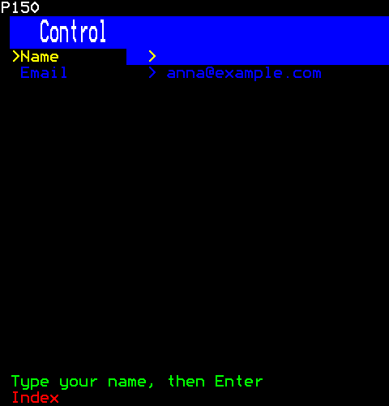

```ts
[
  h(TextField, { key: "name", label: "Name", longest: 20, hint: "Type your name, then Enter" }),
  h(TextField, { key: "email", label: "Email", longest: 20, disabled: true, initial: "anna@example.com" }),
]
```

## ValueControl

A control with a value (control.ts): the value kept by its parent (`value`) or by the control itself (`initial`), checked as it changes, and each change sent up the tree (core/component-events.ts) as change or invalid as well as to onChange.

```ts
import { ValueControl } from "neoteletext-server-ts-ui-components";
```

### Props

It takes no props of its own.

### A value checked, shown inside a TextField

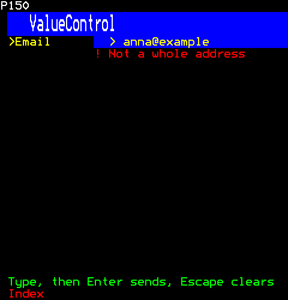

```ts
h(TextField, { label: "Email", longest: 24, initial: "anna@example", validate: (text) => (text.includes(".") ? null : "Not a whole address") })
```

## Field

A form's field: its label on the left and its control on the right. A group of fields goes in a Panel (layout/panel.ts) with the group's name; Tab goes from control to control in the order they are drawn (core/mount.ts).

```ts
import { Field } from "neoteletext-server-ts-ui-components";
```

### Props

| Prop | Type | What it is |
| --- | --- | --- |
| `label` (needed) | `string` | What the field is, in its column, cut to the column. |
| `labelCells` | `number` | The cells the label's column takes; a control's own label column (core/look.ts, LABEL_CELLS) when absent, so a field's controls line up with labelled ones. |
| `note` | `string` | A word under the label, as help: what is wanted, or that it must be given. |

### Labels and notes

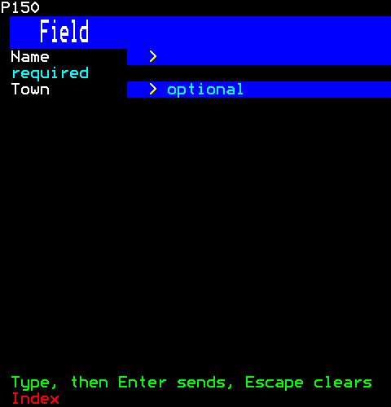

```ts
[
  h(Field, { key: "name", label: "Name", note: "required" }, h(TextField, { longest: 20 })),
  h(Field, { key: "town", label: "Town" }, h(TextField, { longest: 20, placeholder: "optional" })),
]
```

## TextField

A line to type on, which shows what is typed (the receiver draws none of it, the engine's E.134): the cursor stands after it, and only while the field has the keys, since a page has one cursor (INPUT.md section 7.1). It may have a label, a placeholder while it is empty, its characters masked (each shows as `*`), a check whose complaint shows under it, and it may be disabled. Enter sends submit up the tree; Escape clears, or sends cancel when it is clear. Its band is a control, so the browser shows it can be clicked, and a click there gives it the keys.

```ts
import { TextField } from "neoteletext-server-ts-ui-components";
```

**Keys:** `Type, then Enter` sends; `Escape` clears.

**It takes of its page:** the digits, a copy of the page for each viewer.

### Props

| Prop | Type | What it is |
| --- | --- | --- |
| `longest` (needed) | `number` | The most characters it takes. |
| `onSubmit` | `(text: string, session: number) => void` | Called with the text, trimmed, as Enter sends it: never when it is blank or fails validate. |
| `background` | `Colour` | Its band's colour; blue when absent, black while disabled. |
| `placeholder` | `string` | What the empty field shows while it does not have the keys. |
| `masked` | `boolean` | Each character shows as `*`: a password. |
| `keep` | `boolean` | Enter leaves the text there rather than clearing it. |

And the props of [`ValueProps`](common.md#valueprops).

### A placeholder, shown while it does not have the keys

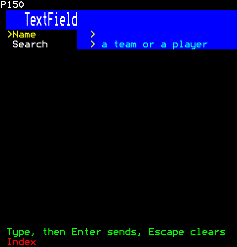

```ts
[
  h(TextField, { key: "name", label: "Name", longest: 20 }),
  h(TextField, { key: "search", label: "Search", longest: 24, placeholder: "a team or a player" }),
]
```

### Masked, typed in

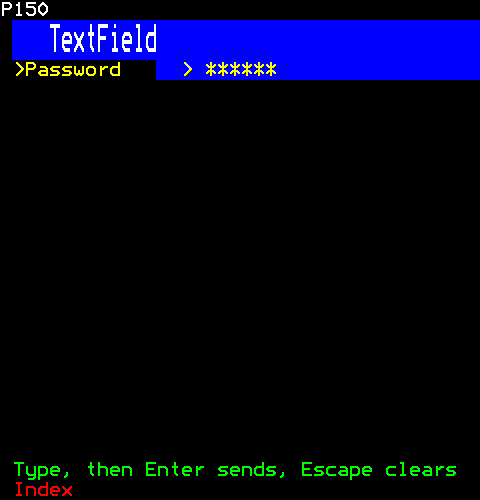

```ts
h(TextField, { label: "Password", longest: 16, masked: true })
```

Then the viewer:

```ts
page.typeKeys(1, "secret");
```

## SegmentField

Digits to a template, for a PIN, a date, a time or a code: each `9` of the template is a slot for a digit and every other character stands as it is ("99/99/9999", "99:99", "9999"). Digits, from the remote's keys or typed, fill the slots from the cursor on and pass over what stands between them; Backspace clears the slot before the cursor and goes back to it; Left and Right move from slot to slot, and a digit there replaces the one it has. An empty slot shows a fill character, so the field's width shows before anything is typed, and the cursor's slot a block, a mark under it too. Each segment, the slots between two separators, may be checked as it is filled (a month 1 to 12); a complaint shows under the field in red, as a text field's does. Enter sends activate with the template filled in, and only when every slot is filled and nothing is wrong; otherwise it is refused. Concealed, a filled slot shows `*`, so a PIN is never in the page sent to the receiver. Escape clears, or sends cancel when it is clear.

```ts
import { SegmentField } from "neoteletext-server-ts-ui-components";
```

**Keys:** `Digits` fill; `Left Right` move; `Enter` sends.

**It takes of its page:** the digits, a copy of the page for each viewer.

### Props

| Prop | Type | What it is |
| --- | --- | --- |
| `template` (needed) | `string` | Where the digits go: each `9` a slot, every other character standing as it is. |
| `check` | `(segment: number, digits: string) => string \| null` | What is wrong with segment `segment` (from 0, left to right) now that its slots are all filled with `digits`, or null. |
| `conceal` | `boolean` | A filled slot shows `*`, not its digit: a PIN. |
| `background` | `Colour` | Its band's colour; blue when absent, black while disabled. |
| `onSubmit` | `(filled: string, session: number) => void` | Enter with every slot filled and nothing wrong: the template filled in. |

And the props of [`ValueProps`](common.md#valueprops).

### A date part-filled

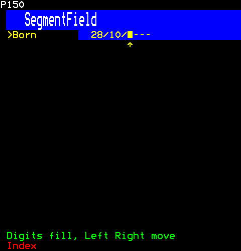

```ts
h(SegmentField, { label: "Born", template: "99/99/9999" })
```

Then the viewer:

```ts
page.typeKeys(1, "2810");
```

### A month that cannot be

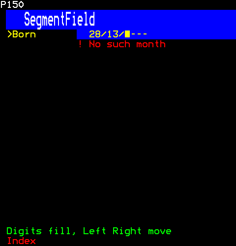

```ts
h(SegmentField, { label: "Born", template: "99/99/9999", check: (segment, digits) => (segment === 1 && Number(digits) > 12 ? "No such month" : null) })
```

Then the viewer:

```ts
page.typeKeys(1, "2813");
```

### A concealed PIN

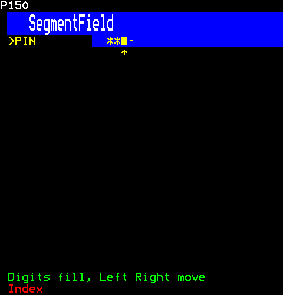

```ts
h(SegmentField, { label: "PIN", template: "9999", conceal: true })
```

Then the viewer:

```ts
page.typeKeys(1, "47");
```

## MultiTapField

Text typed with the remote's digit keys, as on a phone's keypad: each key has its letters (2 abc to 9 wxyz, 1 punctuation, 0 a space), and pressing it again soon after goes on to its next letter, round to the first. Another key, Enter or a pause takes the letter; a key with one character types it at once. The yellow key, or `#` as a phone's keypad has it, changes between small letters and capitals. Typing from a keyboard or a phone goes in as it is. The server draws the text, the letter being chosen, a block for the cursor and, under them, the case and the chosen key's letters. Backspace takes back the letter being chosen, or else the last; Enter sends submit up the tree; Escape clears, or sends cancel when it is clear.

```ts
import { MultiTapField } from "neoteletext-server-ts-ui-components";
```

**Keys:** `Digit keys` type letters; `yellow` ABC.

**It takes of its page:** the digits, the coloured keys, a copy of the page for each viewer.

### Props

| Prop | Type | What it is |
| --- | --- | --- |
| `longest` | `number` | The most characters it takes; LONGEST when absent. |
| `onSubmit` | `(text: string, session: number) => void` | Called with the text, trimmed, as Enter sends it: never when it is blank or fails validate. |
| `background` | `Colour` | Its band's colour; blue when absent, black while disabled. |
| `keep` | `boolean` | Enter leaves the text there rather than clearing it. |

And the props of [`ValueProps`](common.md#valueprops).

### Mid-letter

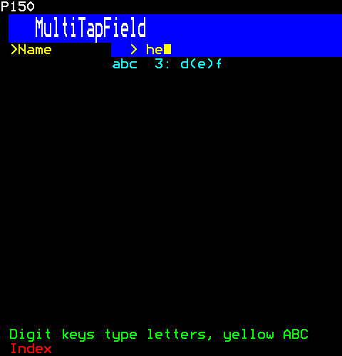

```ts
h(MultiTapField, { label: "Name" })
```

Then the viewer:

```ts
page.typeKeys(1, "4433");
```

### In capitals

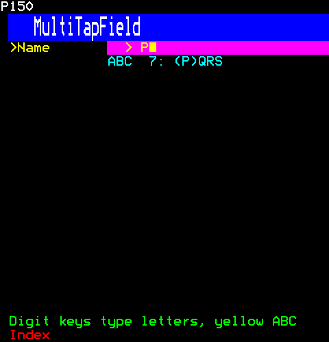

```ts
h(MultiTapField, { label: "Name", background: Colour.Magenta })
```

Then the viewer:

```ts
page.press(1, Key.Yellow);
page.typeKeys(1, "7");
```

## Autocomplete

A text field that suggests: the items that match what is typed show under it, the first chosen; Up and Down choose another, Tab completes the field to it, Enter takes it. With every item shown while nothing is typed, it is a combo box. Its value is the item taken; its field keeps the keys, and what it does not take comes here.

```ts
import { Autocomplete } from "neoteletext-server-ts-ui-components";
```

**It takes of its page:** a copy of the page for each viewer.

### Props

| Prop | Type | What it is |
| --- | --- | --- |
| `items` (needed) | `readonly string[]` | What it suggests from, matched to what is typed whatever its case. |
| `placeholder` | `string` | What the empty field shows while it does not have the keys. |
| `shown` (needed) | `number` | The most suggestions shown. |
| `anywhere` | `boolean` | Matches anywhere in an item, not only at its start. |
| `showAll` | `boolean` | Every item shows while nothing is typed: a combo box. |
| `empty` | `string` | What it says when nothing matches. |
| `longest` | `number` | The most characters typed. |

And the props of [`ValueProps`](common.md#valueprops).

### Suggesting as it is typed

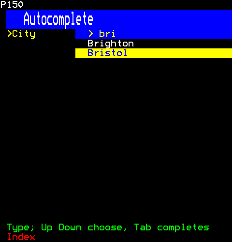

```ts
h(Autocomplete, { label: "City", items: ["Belfast", "Birmingham", "Brighton", "Bristol", "Cardiff", "Leeds"], shown: 4 })
```

Then the viewer:

```ts
page.typeKeys(1, "bri");
page.press(1, Key.Down);
```

### A combo box

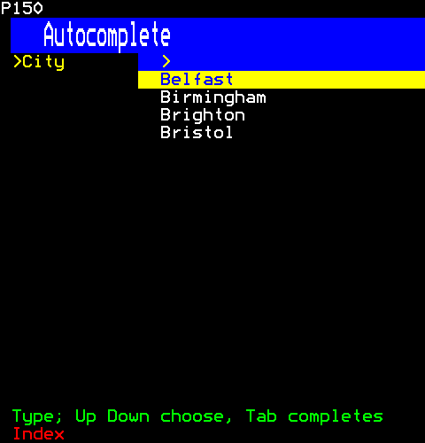

```ts
h(Autocomplete, { label: "City", items: ["Belfast", "Birmingham", "Brighton", "Bristol", "Cardiff", "Leeds"], shown: 4, showAll: true })
```

## Button

A button: its label on a band, pressed with Enter, Space or a click. It sends activate up the tree (core/component-events.ts) and calls onPress. It fits its label with a cell of padding each side unless told its width or its padding, so buttons stacked together can be one width. Its band is a control (core/controls.ts), which the browser lights as the pointer passes, and only a click on it presses: a stack gives the button the whole row, and the cells after the band are not the button's to show. A disabled button declares none.

```ts
import { Button } from "neoteletext-server-ts-ui-components";
```

**Keys:** `Enter or a click` presses; `Tab` moves on.

**It takes of its page:** a copy of the page for each viewer.

### Props

| Prop | Type | What it is |
| --- | --- | --- |
| `label` (needed) | `string` | What it says on its band, cut to the band. |
| `onPress` (needed) | `(session: number) => void` | Called as it is pressed: Enter, Space or a click on its band, and never while disabled. |
| `background` | `Colour` | Its band's colour while it does not have the keys, its label inked to read on it; cyan when absent. |
| `width` | `number` | Its whole width in cells, the label centred in it; fitted to the label and its padding when absent. |
| `paddingLeft` | `number` | Spaces before the label inside the band, when it fits its label: one when absent. |
| `paddingRight` | `number` | Spaces after the label inside the band, when it fits its label: one when absent. |

And the props of [`ControlProps`](common.md#controlprops).

### With the keys, plain and disabled

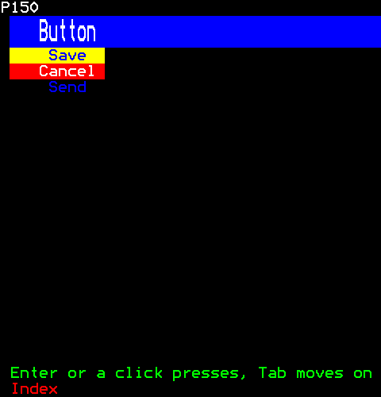

```ts
[
  h(Button, { key: "save", label: "Save", onPress: () => {}, width: 12 }),
  h(Button, { key: "cancel", label: "Cancel", onPress: () => {}, width: 12, background: Colour.Red }),
  h(Button, { key: "send", label: "Send", onPress: () => {}, width: 12, disabled: true }),
]
```

## Action

An action: a line of text a click acts on, as PageLink is one that goes to a page. Its text is a control (core/controls.ts), which the browser shows as pressable and lights in the page's rollover colours as the pointer passes, and only a click on the text acts. It does not take the keys: what it does is also a key of the component it belongs to (a quiz's coloured keys, a wizard's red and green), so it adds the pointer without changing where the keys go. Disabled, it is dim and declares nothing.

```ts
import { Action } from "neoteletext-server-ts-ui-components";
```

### Props

| Prop | Type | What it is |
| --- | --- | --- |
| `text` (needed) | `string` | What it says, cut to its box. |
| `onPress` (needed) | `(session: number) => void` | Called as the text is clicked; never while disabled. |
| `foreground` | `Colour` | The text's colour; white when absent. |
| `disabled` | `boolean` | Dim, and a click on it does nothing. |
| `centre` | `boolean` | Centred in its box. |
| `hint` | `string` | What a click does, for the frame's hint row while the pointer is on it. |

### Enabled and disabled

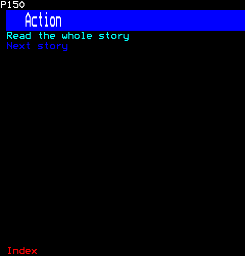

```ts
[
  h(Action, { key: "more", text: "Read the whole story", foreground: Colour.Cyan, onPress: () => {} }),
  h(Action, { key: "next", text: "Next story", disabled: true, onPress: () => {} }),
]
```

## Checkbox

A check box. Teletext has no box character, so a box is a chip (core/ canvas.ts): a white band holding "x" when ticked, "-" when mixed, nothing when not, in its middle, so the state shows without colour. It is pressed with Enter, Space or a click; a box and its text are one control, and a click ticks only there. A group of boxes (checkbox-group.ts) draws each with drawBox.

```ts
import { Checkbox } from "neoteletext-server-ts-ui-components";
```

**Keys:** `Enter, Space or a click` ticks.

**It takes of its page:** a copy of the page for each viewer.

### Props

| Prop | Type | What it is |
| --- | --- | --- |
| `label` (needed) | `string` | The text beside the box, cut to its row. |

And the props of [`ValueProps`](common.md#valueprops).

### Ticked, not, and mixed

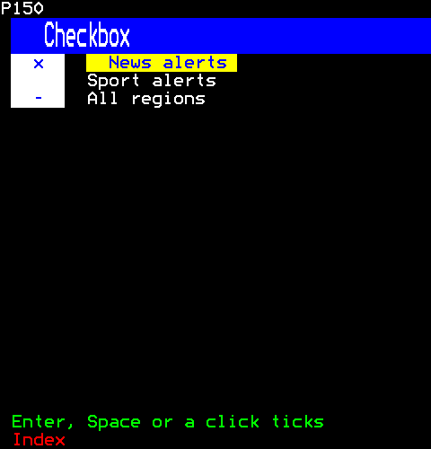

```ts
[
  h(Checkbox, { key: "news", label: "News alerts" }),
  h(Checkbox, { key: "sport", label: "Sport alerts" }),
  h(Checkbox, { key: "all", label: "All regions", initial: "mixed" }),
]
```

Then the viewer:

```ts
page.press(1, Key.Enter);
```

## CheckboxGroup

A group of check boxes (checkbox.ts), any of them ticked: a multiple choice. Up and Down choose a box, or the arrows across two columns, and Enter, Space or a click ticks it. Its value is the ticked boxes' places, in order.

```ts
import { CheckboxGroup } from "neoteletext-server-ts-ui-components";
```

**Keys:** `Arrows` choose; `Enter or Space` ticks.

**It takes of its page:** a copy of the page for each viewer.

### Props

| Prop | Type | What it is |
| --- | --- | --- |
| `items` (needed) | `readonly string[]` | Each box's text, in order; the value holds the ticked ones' places. |
| `disabledItems` | `readonly number[]` | Items that cannot be changed. |
| `columns` | `1 \| 2` | Two columns, across then down. |

And the props of [`ValueProps`](common.md#valueprops).

### Two columns, one not to be changed

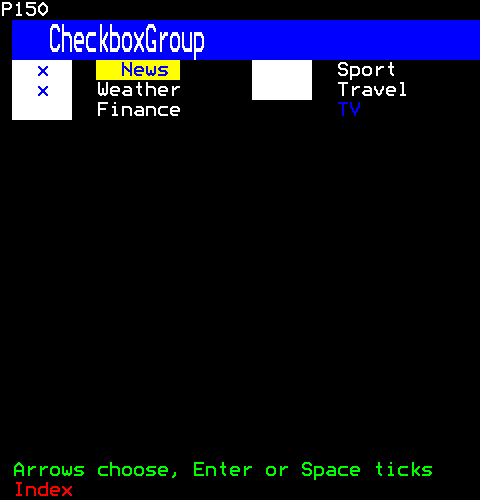

```ts
h(CheckboxGroup, { items: ["News", "Sport", "Weather", "Travel", "Finance", "TV"], columns: 2, initial: [0, 2], disabledItems: [5] })
```

## RadioGroup

A radio group: one of several, "(*)" for the one chosen and "( )" for the rest, so it shows without colour; down a column or across a row, after its label, the options that do not fit on the row going on under the first, so every option shows. Up and Down (Left and Right across) move the choice itself, as radio buttons do; a click on an option chooses it. Each option's mark and text is a control.

```ts
import { RadioGroup } from "neoteletext-server-ts-ui-components";
```

**Keys:** `Up Down` choose.

**It takes of its page:** a copy of the page for each viewer.

### Props

| Prop | Type | What it is |
| --- | --- | --- |
| `items` (needed) | `readonly string[]` | The options, in order; the value is the chosen one's place. |
| `across` | `boolean` | The options across after the label, wrapped onto the rows under as the row is filled, Left and Right moving the choice; down a column when absent. |

And the props of [`ValueProps`](common.md#valueprops).

### Down a column

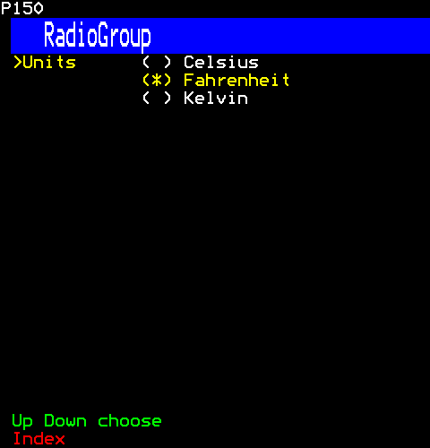

```ts
h(RadioGroup, { label: "Units", items: ["Celsius", "Fahrenheit", "Kelvin"] })
```

Then the viewer:

```ts
page.press(1, Key.Down);
```

### Across a row

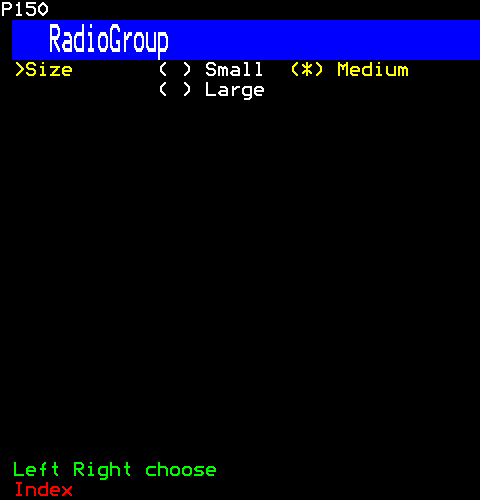

```ts
h(RadioGroup, { label: "Size", items: ["Small", "Medium", "Large"], across: true, initial: 1 })
```

## Switch

A switch: a setting on or off, its label, then a chip saying ON on green or OFF on red, so the word says it as well as the colour. Enter, Space or a click on the chip, its control, turns it over.

```ts
import { Switch } from "neoteletext-server-ts-ui-components";
```

**Keys:** `Enter, Space or a click` turns it over.

**It takes of its page:** a copy of the page for each viewer.

### Props

| Prop | Type | What it is |
| --- | --- | --- |
| `label` (needed) | `string` | What it sets, in a column of its own: SWITCH_LABEL_CELLS wide unless labelCells says. |

And the props of [`ValueProps`](common.md#valueprops).

### On and off

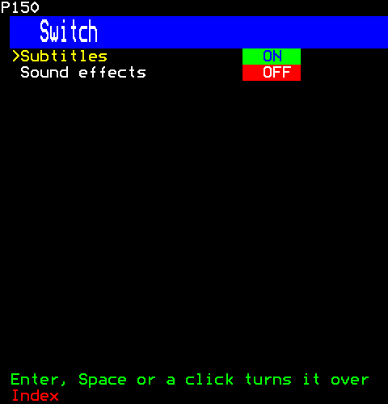

```ts
[h(Switch, { key: "subtitles", label: "Subtitles", initial: true }), h(Switch, { key: "sound", label: "Sound effects" })]
```

## Slider

A slider: a value in a range, set by a knob on a track of mosaic sixels, two to a cell, so the knob moves half a cell at a time. Left and Right step, Page Up and Page Down step ten times, Home and End go to the ends, and the pointer sets it where the track is pressed or dragged. The track is its control, since a press anywhere on it moves the knob there, and the browser holds its pressed look while the knob is dragged; a move with no button held is not its. The wheel over it steps it, up for more. Filled, the track is thicker up to the knob. The value is in a column of its own after the track, as wide whatever its unit, so sliders stacked together line up; the label alone marks the keys, and the track keeps its colour.

```ts
import { Slider } from "neoteletext-server-ts-ui-components";
```

**Keys:** `Left Right or the wheel` step; `PgUp PgDn` more; `the knob` drags.

**It takes of its page:** a copy of the page for each viewer.

### Props

| Prop | Type | What it is |
| --- | --- | --- |
| `label` (needed) | `string` | What it is, in a column of its own before the track. |
| `min` (needed) | `number` | The track's left end, and its value when it is given none. |
| `max` (needed) | `number` | The track's right end. |
| `step` | `number` | What Left, Right and the wheel move it by, every value a whole number of steps from min; 1 when absent or not more than nought. |
| `foreground` | `Colour` | The track's colour; cyan when absent. |
| `filled` | `boolean` | The track is thicker up to the knob. |
| `unit` | `string` | What follows the value: "%", "dB". |
| `valueCells` | `number` | The value's text cells after the track, the unit's included: the widest of min and max with the unit, and no fewer than VALUE_TEXT, when absent. Sliders given the same line up. |

And the props of [`ValueProps`](common.md#valueprops).

### Moved

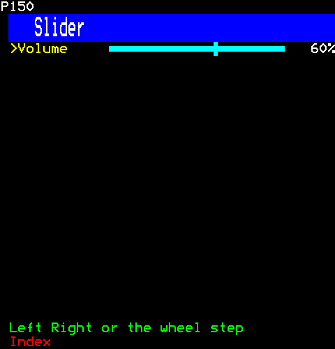

```ts
h(Slider, { label: "Volume", min: 0, max: 100, step: 5, initial: 50, unit: "%" })
```

Then the viewer:

```ts
page.press(1, Key.Right);
page.press(1, Key.Right);
```

### Filled, and in a colour of its own

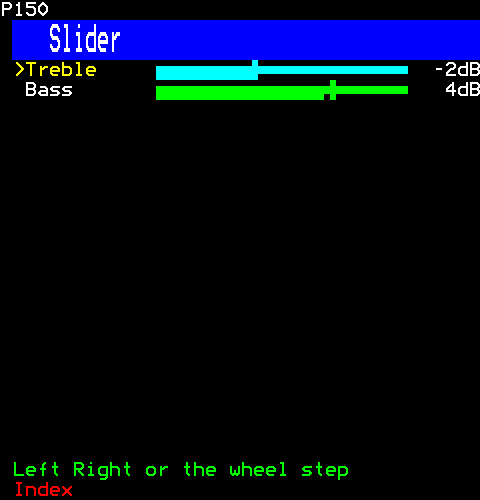

```ts
[
  h(Slider, { key: "treble", label: "Treble", min: -10, max: 10, initial: -2, unit: "dB", filled: true }),
  h(Slider, { key: "bass", label: "Bass", min: -10, max: 10, initial: 4, unit: "dB", filled: true, foreground: Colour.Green }),
]
```

## NumberInput

A number to set: its label, a "-" chip, the number, a "+" chip. Up and Down (or Left and Right), the wheel (up for more) or a click on a chip, each a control, step it; digits typed replace it (the page takes the digits), Backspace takes one back; a number out of range says so in red, on the row under it as a text field's check does, until it is put right, and is sent as invalid rather than as a change.

```ts
import { NumberInput } from "neoteletext-server-ts-ui-components";
```

**Keys:** `Up Down or the wheel` step; `digits` type; `Backspace` rubs out.

**It takes of its page:** the digits, a copy of the page for each viewer.

### Props

| Prop | Type | What it is |
| --- | --- | --- |
| `label` (needed) | `string` | What it is, in a column of its own before the chips. |
| `min` (needed) | `number` | The least whole number it takes, and its value when it is given none. |
| `max` (needed) | `number` | The most it takes. |
| `step` | `number` | What Up, Down, the wheel and the chips move it by, kept within min and max; 1 when absent, or when not a whole number more than nought. |

And the props of [`ValueProps`](common.md#valueprops).

### Stepped

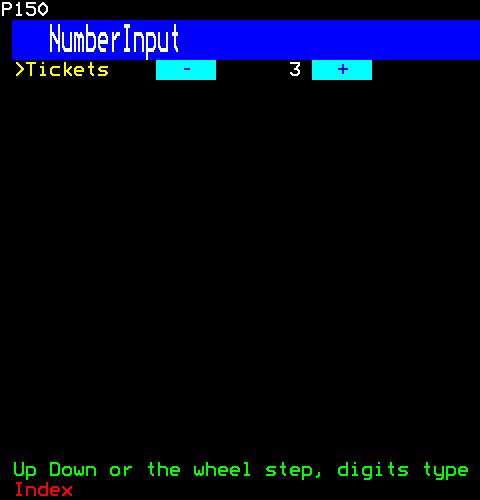

```ts
h(NumberInput, { label: "Tickets", min: 1, max: 8, initial: 2 })
```

Then the viewer:

```ts
page.press(1, Key.Up);
```

### Out of range

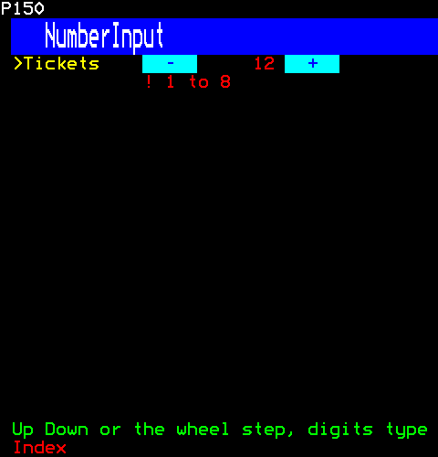

```ts
h(NumberInput, { label: "Tickets", min: 1, max: 8, initial: 2 })
```

Then the viewer:

```ts
page.typeKeys(1, "12");
```

## Select

A select: one of a list, shown in a field between arrows. Shut, Left and Right turn through the items, as a receiver's menus do; Enter opens the list under the field, where Up and Down choose, Enter takes and Escape shuts. A click on an arrow turns, on the field opens or shuts, on an item takes; each is a control, and open, the arrow on the right is not drawn and is none. Teletext cannot draw over what is below, so the open list pushes it down.

```ts
import { Select } from "neoteletext-server-ts-ui-components";
```

**Keys:** `Left Right` turn; `Enter` opens.

**It takes of its page:** a copy of the page for each viewer.

### Props

| Prop | Type | What it is |
| --- | --- | --- |
| `label` (needed) | `string` | What it is, in a column of its own before the field. |
| `items` (needed) | `readonly string[]` | What it chooses from; the value is the chosen one's place. |
| `shown` | `number` | The most items the open list shows. |

And the props of [`ValueProps`](common.md#valueprops).

### Shut

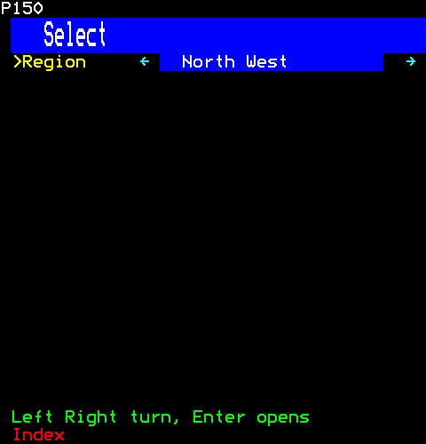

```ts
h(Select, { label: "Region", items: ["London", "North West", "Scotland", "Wales"], initial: 1 })
```

### Open

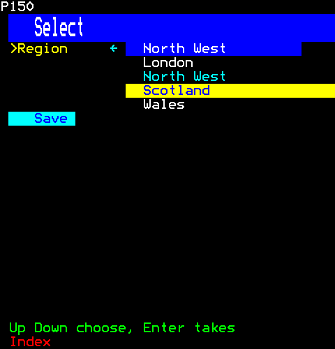

```ts
[
  h(Select, { key: "region", label: "Region", items: ["London", "North West", "Scotland", "Wales"], initial: 1 }),
  h(Button, { key: "save", label: "Save", onPress: () => {} }),
]
```

Then the viewer:

```ts
page.press(1, Key.Enter);
page.press(1, Key.Down);
```
