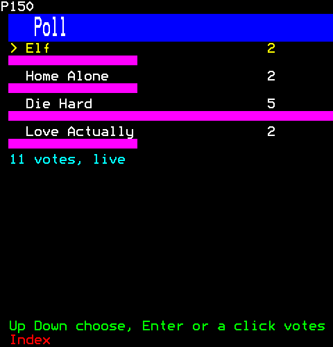
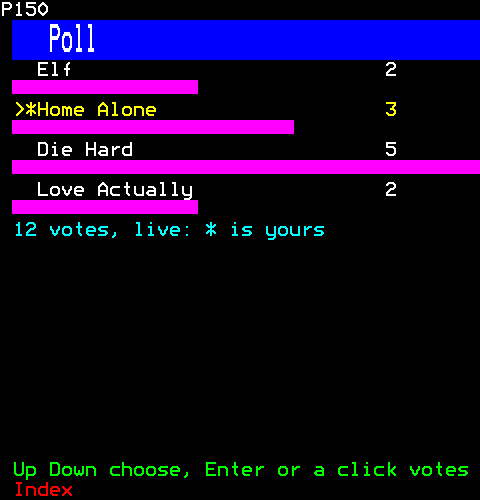
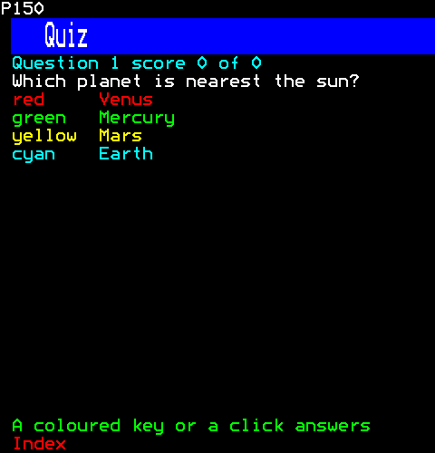
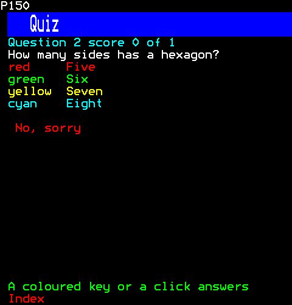
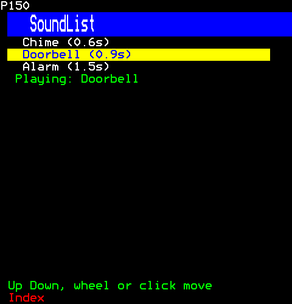

# Interactive

What viewers take part in: a poll whose votes every viewer sees as they come, kept in a tally the channel holds; a quiz answered with the coloured keys; and sounds to play.

- [Poll](#poll)
- [Quiz](#quiz)
- [SoundList](#soundlist)

## Poll

A live poll: every viewer's copy hears each vote through the bus. Up and Down choose and Enter votes, or a click on an option votes for it: each option is an action (input/action.ts), a control the browser lights.

```ts
import { Poll } from "neoteletext-server-ts-ui-components";
```

**Keys:** `Up Down` choose; `Enter or a click` votes.

**It takes of its page:** a copy of the page for each viewer.

### Props

| Prop | Type | What it is |
| --- | --- | --- |
| `tally` (needed) | `Tally` | The votes, kept by the page that makes the poll and told to every viewer's copy through the bus. |

And the props of [`ControlProps`](common.md#controlprops).

### Votes coming in



```ts
// A channel makes its tally once, beside its pages, so every viewer's copy of the poll counts the same votes.
const tally = new Tally("Best Christmas film", ["Elf", "Home Alone", "Die Hard", "Love Actually"]);
[0, 2, 1, 2, 3, 2, 0, 2, 1, 3, 2].forEach((option, viewer) => {
  tally.vote(100 + viewer, option);
});
return h(Poll, { tally });
```

### Your vote cast



```ts
const tally = new Tally("Best Christmas film", ["Elf", "Home Alone", "Die Hard", "Love Actually"]);
[0, 2, 1, 2, 3, 2, 0, 2, 1, 3, 2].forEach((option, viewer) => {
  tally.vote(100 + viewer, option);
});
return h(Poll, { tally });
```

Then the viewer:

```ts
page.press(1, Key.Down);
page.press(1, Key.Enter);
```

## Quiz

A quiz answered with the four coloured keys, or a click on an answer (each an action, input/action.ts, a control the browser lights), its answer concealed until Reveal.

```ts
import { Quiz } from "neoteletext-server-ts-ui-components";
```

**Keys:** `A coloured key or a click` answers; `Reveal` shows.

**It takes of its page:** the coloured keys, a copy of the page for each viewer.

### Props

| Prop | Type | What it is |
| --- | --- | --- |
| `questions` (needed) | `readonly Question[]` | The questions, asked in turn and round again after the last; nothing shows when there are none. |
| `right` | `Sound` | Played to the viewer as they answer rightly. |
| `wrong` | `Sound` | Played to the viewer as they answer wrongly. |

And the props of [`ControlProps`](common.md#controlprops).

#### Question

| Prop | Type | What it is |
| --- | --- | --- |
| `question` (needed) | `string` | What it asks. |
| `answers` (needed) | `readonly [string, string, string, string]` | Its four answers, for the red, green, yellow and cyan keys in turn. |
| `right` (needed) | `number` | The right answer's place, 0 to 3. |

#### Sound

| Prop | Type | What it is |
| --- | --- | --- |
| `name` (needed) | `string` | Its name, unique in the channel. |
| `samples` (needed) | `Int16Array` | Its samples, signed 16-bit, at RATE. |

### A question



```ts
h(Quiz, {
  questions: [
    { question: "Which planet is nearest the sun?", answers: ["Venus", "Mercury", "Mars", "Earth"], right: 1 },
    { question: "How many sides has a hexagon?", answers: ["Five", "Six", "Seven", "Eight"], right: 1 },
  ],
})
```

### After a wrong answer



```ts
h(Quiz, {
  questions: [
    { question: "Which planet is nearest the sun?", answers: ["Venus", "Mercury", "Mars", "Earth"], right: 1 },
    { question: "How many sides has a hexagon?", answers: ["Five", "Six", "Seven", "Eight"], right: 1 },
  ],
})
```

Then the viewer:

```ts
page.press(1, Key.Red);
```

## SoundList

A list of sounds: choosing one plays it to the viewer.

```ts
import { SoundList } from "neoteletext-server-ts-ui-components";
```

### Props

| Prop | Type | What it is |
| --- | --- | --- |
| `sounds` (needed) | `readonly Sound[]` | The sounds to choose from, each listed by its name and its length in seconds. |
| `shown` (needed) | `number` | The rows the list shows. |

#### Sound

| Prop | Type | What it is |
| --- | --- | --- |
| `name` (needed) | `string` | Its name, unique in the channel. |
| `samples` (needed) | `Int16Array` | Its samples, signed 16-bit, at RATE. |

### One playing



```ts
h(SoundList, {
  sounds: [
    { name: "Chime", samples: tone(880, 600) },
    { name: "Doorbell", samples: tone(660, 900, "square", 0.4) },
    { name: "Alarm", samples: tone(440, 1_500, "triangle") },
  ],
  shown: 3,
})
```

Then the viewer:

```ts
page.press(1, Key.Down);
page.press(1, Key.Enter);
```
