# Layout

Where components go on the page: stacked in rows, side by side in columns, in a grid, at a fixed place, or over one another; framed in panels, divided by rules, and reached in two presses by jump labels.

- [Rows](#rows)
- [Columns](#columns)
- [Centred](#centred)
- [Gap](#gap)
- [Grid](#grid)
- [At](#at)
- [Layers](#layers)
- [Panel](#panel)
- [JoinedPanels](#joinedpanels)
- [Rule](#rule)
- [JumpLabels](#jumplabels)

## Rows

Rows: the default stack (core/component.ts), named; the other layouts have a file each in this folder.

```ts
import { Rows } from "neottx-server-ts-ui-components";
```

### Props

Its props are its base's.

### A footer pushed to the bottom

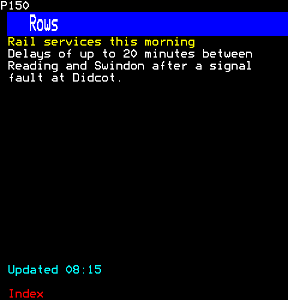

```ts
h(
  Rows,
  { grow: 1 },
  h(Text, { text: "Rail services this morning", foreground: Colour.Yellow }),
  h(Paragraph, { text: "Delays of up to 20 minutes between Reading and Swindon after a signal fault at Didcot." }),
  h(Gap, { grow: 1 }),
  h(Text, { text: "Updated 08:15", foreground: Colour.Cyan }),
)
```

## Columns

Columns: children side by side, of given widths or a share of what is left.

```ts
import { Columns } from "neottx-server-ts-ui-components";
```

### Props

| Prop | Type | What it is |
| --- | --- | --- |
| `widths` | `readonly (number \| null)[]` | The columns' widths in cells; one without a width shares what is left. |

### A fixed column and a shared one

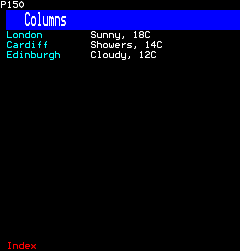

```ts
h(
  Columns,
  { widths: [14, null] },
  h(
    Rows,
    {},
    h(Text, { text: "London", foreground: Colour.Cyan }),
    h(Text, { text: "Cardiff", foreground: Colour.Cyan }),
    h(Text, { text: "Edinburgh", foreground: Colour.Cyan }),
  ),
  h(Rows, {}, h(Text, { text: "Sunny, 18C" }), h(Text, { text: "Showers, 14C" }), h(Text, { text: "Cloudy, 12C" })),
)
```

### Two even columns

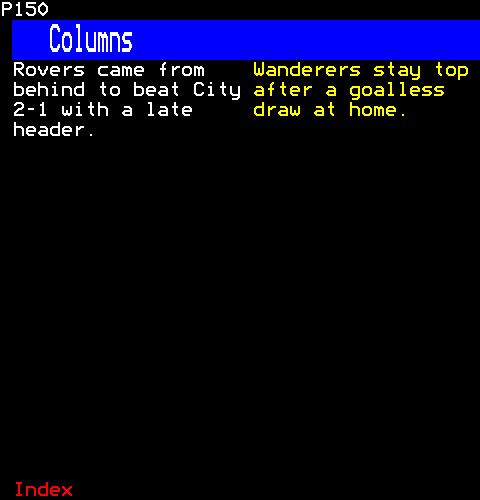

```ts
h(
  Columns,
  {},
  h(Paragraph, { text: "Rovers came from behind to beat City 2-1 with a late header.", foreground: Colour.White }),
  h(Paragraph, { text: "Wanderers stay top after a goalless draw at home.", foreground: Colour.Yellow }),
)
```

## Centred

Centred: a stack whose children are each in the middle of the width.

```ts
import { Centred } from "neottx-server-ts-ui-components";
```

### Props

Its props are its base's.

### A question and its buttons

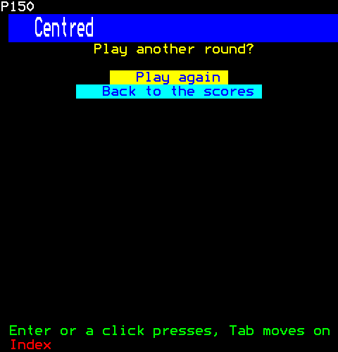

```ts
h(
  Centred,
  {},
  h(Text, { text: "Play another round?", foreground: Colour.Yellow }),
  h(Gap, {}),
  h(Button, { label: "Play again", onPress: () => {} }),
  h(Button, { label: "Back to the scores", onPress: () => {} }),
)
```

## Gap

Gap: empty rows between components.

```ts
import { Gap } from "neottx-server-ts-ui-components";
```

### Props

| Prop | Type | What it is |
| --- | --- | --- |
| `rows` | `number` | One when absent. |

### Space between sections

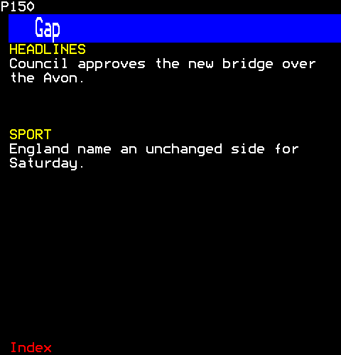

```ts
[
  h(Text, { key: "first", text: "HEADLINES", foreground: Colour.Yellow }),
  h(Paragraph, { key: "news", text: "Council approves the new bridge over the Avon." }),
  h(Gap, { key: "gap", rows: 3 }),
  h(Text, { key: "second", text: "SPORT", foreground: Colour.Yellow }),
  h(Paragraph, { key: "sport", text: "England name an unchanged side for Saturday." }),
]
```

## Grid

A grid: children left to right, then down, a cell each.

```ts
import { Grid } from "neottx-server-ts-ui-components";
```

### Props

| Prop | Type | What it is |
| --- | --- | --- |
| `columns` (needed) | `number` | The columns across, each the box's width over them in whole cells; one at least. |

### An index in two columns

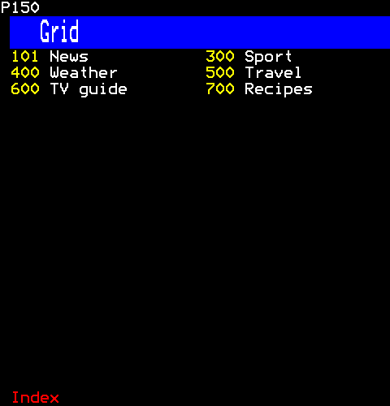

```ts
h(
  Grid,
  { columns: 2 },
  h(PageLink, { page: 0x101, label: "News" }),
  h(PageLink, { page: 0x300, label: "Sport" }),
  h(PageLink, { page: 0x400, label: "Weather" }),
  h(PageLink, { page: 0x500, label: "Travel" }),
  h(PageLink, { page: 0x600, label: "TV guide" }),
  h(PageLink, { page: 0x700, label: "Recipes" }),
)
```

## At

At: a place given by row and column inside the parent's box, cut to it.

```ts
import { At } from "neottx-server-ts-ui-components";
```

### Props

| Prop | Type | What it is |
| --- | --- | --- |
| `row` (needed) | `number` | Rows down from the top of the parent's box, cut to it. |
| `column` (needed) | `number` | Cells in from the left of the parent's box, cut to it. |
| `rows` | `number` | The place's rows; when absent, the rest of the box below, and it is as tall as what is placed. |
| `columns` | `number` | The place's cells across; when absent, the rest of the box to the right. |

### Text at a fixed place

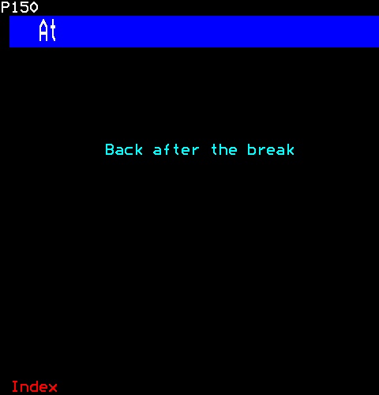

```ts
h(At, { row: 6, column: 10 }, h(Text, { text: "Back after the break", foreground: Colour.Cyan }))
```

## Layers

Layers: children drawn over one another in the same box.

```ts
import { Layers } from "neottx-server-ts-ui-components";
```

### Props

Its props are its base's.

### A badge over a story

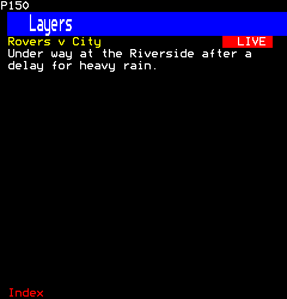

```ts
h(
  Layers,
  {},
  h(
    Rows,
    {},
    h(Text, { text: "Rovers v City", foreground: Colour.Yellow }),
    h(Paragraph, { text: "Under way at the Riverside after a delay for heavy rain." }),
  ),
  h(At, { row: 0, column: 29 }, h(Badges, { badges: [{ text: "LIVE", flash: true }] })),
)
```

## Panel

A panel: its children inside a frame, with a title. Teletext has no box drawing characters, so the frame is drawn either as a line of mosaic sixels round the children or as a background of its own colour behind them. Either way each row inside spends cells on attributes (Table 26): a mosaic colour and the edge on the left, a mosaic colour and the edge on the right, or a background's colour and New Background.

```ts
import { Panel } from "neottx-server-ts-ui-components";
```

### Props

| Prop | Type | What it is |
| --- | --- | --- |
| `title` | `string` | Its title: in the top line, or on the band's first row. |
| `style` | `PanelStyle` | A line round the children or a background behind them; a line when absent. |
| `foreground` | `Colour` | The line's colour, or the background's. |
| `titleForeground` | `Colour` | The title's colour; when absent, yellow on a line and white on a band. |

### A line with a title

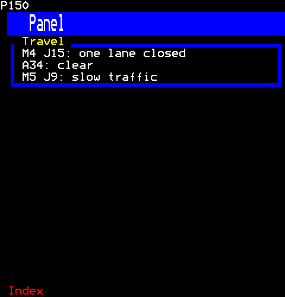

```ts
h(Panel, { title: "Travel" }, h(Text, { text: "M4 J15: one lane closed" }), h(Text, { text: "A34: clear" }), h(Text, { text: "M5 J9: slow traffic" }))
```

### A band in a colour

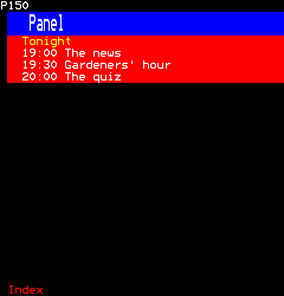

```ts
h(
  Panel,
  { title: "Tonight", style: "band", foreground: Colour.Red, titleForeground: Colour.Yellow },
  h(Text, { text: "19:00 The news" }),
  h(Text, { text: "19:30 Gardeners' hour" }),
  h(Text, { text: "20:00 The quiz" }),
)
```

## JoinedPanels

Joined panels: panes side by side in one line frame (panel.ts), each border between two drawn once and shared, as a terminal's box drawing joins adjacent boxes. The frame's top runs along the bottom of its first row and a divider down the left half of its cell, so where they meet the sixels already join: no junction character is needed. A divider spends two cells on each row, its mosaic colour and its line; each pane's title sits in the top line over it. Pane widths are as Columns' (columns.ts): given, or a share of what is left.

```ts
import { JoinedPanels } from "neottx-server-ts-ui-components";
```

### Props

| Prop | Type | What it is |
| --- | --- | --- |
| `titles` | `readonly (string \| null)[]` | Each pane's title, in the top line over it. |
| `widths` | `readonly (number \| null)[]` | Each pane's width in cells, its divider not counted; one without a width shares what is left. |
| `foreground` | `Colour` | The line's colour. |
| `titleForeground` | `Colour` | The titles' colour; yellow when absent. |

### Two panes

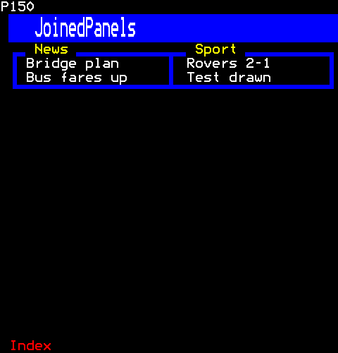

```ts
h(
  JoinedPanels,
  { titles: ["News", "Sport"] },
  h(Rows, {}, h(Text, { text: "Bridge plan" }), h(Text, { text: "Bus fares up" })),
  h(Rows, {}, h(Text, { text: "Rovers 2-1" }), h(Text, { text: "Test drawn" })),
)
```

### Three panes of given widths

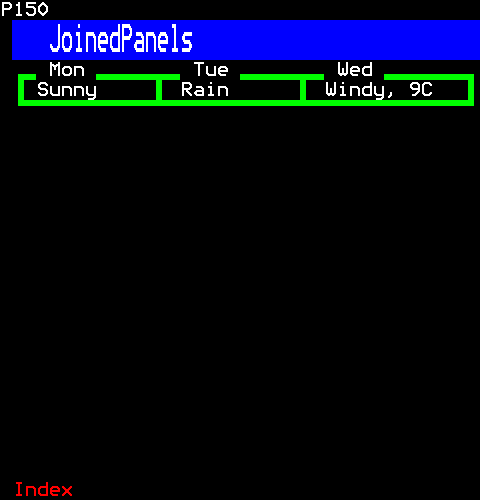

```ts
h(
  JoinedPanels,
  { titles: ["Mon", "Tue", "Wed"], widths: [10, 10, null], foreground: Colour.Green, titleForeground: Colour.White },
  h(Text, { text: "Sunny" }),
  h(Text, { text: "Rain" }),
  h(Text, { text: "Windy, 9C" }),
)
```

## Rule

A rule across its box, to divide a page: a line of mosaic sixels, thin, bold, double, dotted or dashed, with a title in it if it has one. Every style is contiguous mosaics, so each line starts in the cell after its colour's: Separated Graphics would cost a cell of its own (EN 300 706 Table 26), and its gapped sixels turn a dot's row into fine dashes.

```ts
import { Rule } from "neottx-server-ts-ui-components";
```

### Props

| Prop | Type | What it is |
| --- | --- | --- |
| `style` | `RuleStyle` | The line's look: thin, bold, double, dotted or dashed; thin when absent. |
| `foreground` | `Colour` | The line's colour; blue when absent. |
| `title` | `string` | A title in the line, after three cells of it. |
| `titleForeground` | `Colour` | The title's colour; yellow when absent. |

### Each style

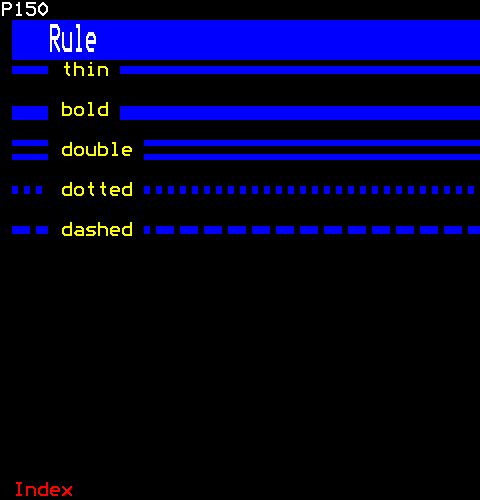

```ts
[
  h(Rule, { key: "thin", style: "thin", title: "thin" }),
  h(Gap, { key: "1" }),
  h(Rule, { key: "bold", style: "bold", title: "bold" }),
  h(Gap, { key: "2" }),
  h(Rule, { key: "double", style: "double", title: "double" }),
  h(Gap, { key: "3" }),
  h(Rule, { key: "dotted", style: "dotted", title: "dotted" }),
  h(Gap, { key: "4" }),
  h(Rule, { key: "dashed", style: "dashed", title: "dashed" }),
]
```

### In a colour, between sections

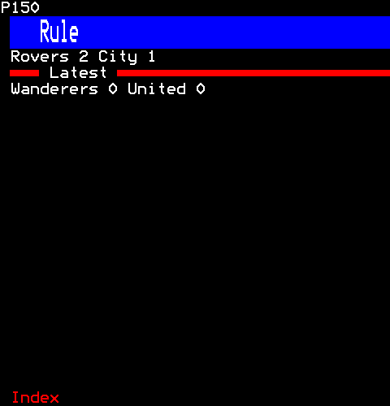

```ts
[
  h(Text, { key: "top", text: "Rovers 2 City 1" }),
  h(Rule, { key: "rule", foreground: Colour.Red, title: "Latest", titleForeground: Colour.White }),
  h(Text, { key: "bottom", text: "Wanderers 0 United 0" }),
]
```

## JumpLabels

Jump labels: a key (0 by default) puts a digit on each control under it, on a chip at its first cell, and the digit gives that control the keys; Escape, or any other key, takes the labels away. A remote reaches any control in two presses, however far it is by Tab or the arrows. It takes the keys before the control that has them (onKeyCapture), so a field that takes digits does not keep them while the labels are up, and the page takes the digits from page selection. Only the first nine controls are labelled: one digit each.

```ts
import { JumpLabels } from "neottx-server-ts-ui-components";
```

**It takes of its page:** the digits.

### Props

| Prop | Type | What it is |
| --- | --- | --- |
| `trigger` | `string` | The key that shows the labels. |

### The labels up

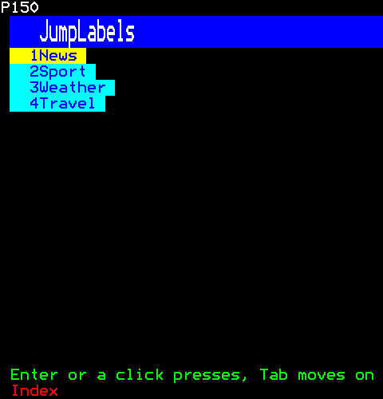

```ts
h(
  JumpLabels,
  {},
  h(Button, { label: "News", onPress: () => {} }),
  h(Button, { label: "Sport", onPress: () => {} }),
  h(Button, { label: "Weather", onPress: () => {} }),
  h(Button, { label: "Travel", onPress: () => {} }),
)
```

Then the viewer:

```ts
page.press(1, "0");
```

### After 3 is pressed

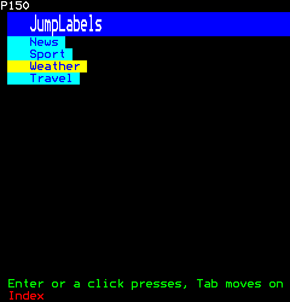

```ts
h(
  JumpLabels,
  {},
  h(Button, { label: "News", onPress: () => {} }),
  h(Button, { label: "Sport", onPress: () => {} }),
  h(Button, { label: "Weather", onPress: () => {} }),
  h(Button, { label: "Travel", onPress: () => {} }),
)
```

Then the viewer:

```ts
page.press(1, "0");
page.press(1, "3");
```
