# Lists

Lists to choose from, by the arrows, a digit, a coloured key or what is typed; tables to read and sort; a log that follows what happens; and the rows and scroll bar every list is built from.

- [ChoiceList](#choicelist)
- [FilterList](#filterlist)
- [DataTable](#datatable)
- [ItemText](#itemtext)
- [ListRow](#listrow)
- [ListRows](#listrows)
- [LogView](#logview)
- [NumberedRows](#numberedrows)
- [ScrollBar](#scrollbar)
- [ScrollingText](#scrollingtext)
- [Table](#table)
- [ToggleList](#togglelist)

## ChoiceList

A list to choose from: the chosen item on the band while the list has the keys (core/look.ts), moved with the keys (core/list-cursor.ts), the wheel, the scroll bar or a click, and chosen with Enter, Space or a click, which sends activate up the tree. Its items are anything: each row is a ListRow (list-row.ts), holding the item's text or what `render` makes of it, a control the browser lights as the pointer passes, and the pointer coming onto a row is told to the list's user (onHover); a row may say what it is on the hint row meanwhile (itemHint). Told to pick by key, the rows shown are numbered and a digit chooses one, or the first four are lettered for the coloured keys (R G Y C), each in its key's colour, and a coloured key chooses one (key-picks.ts).

```ts
import { ChoiceList } from "neoteletext-server-ts-ui-components";
```

**Keys:** `Up Down, wheel or click` move; `Enter` chooses.

**It takes of its page:** a copy of the page for each viewer.

### Props

| Prop | Type | What it is |
| --- | --- | --- |
| `items` (needed) | `readonly T[]` | The items, in order: as many as fit `shown` at once, scrolled to keep the chosen one in view. |
| `render` | `(item: T, look: RowLook, index: number) => Child` | What an item's row holds, drawn to the row's look: its text when absent. |
| `text` | `(item: T, index: number) => string` | An item's text, for the default row: the item itself when it is text. |
| `shown` (needed) | `number` | The rows it shows. |
| `itemRows` | `number` | Rows each item takes: 1, or 2 for headlines. |
| `onChoose` (needed) | `(index: number, session: number) => void` | Enter on an item, or a click on it. |
| `onMove` | `(index: number, session: number) => void` | The chosen item moved: for showing what it is beside the list. |
| `onHover` | `(index: number \| null, session: number) => void` | The pointer came onto an item's row, or left it (null): for showing what it is before it is chosen. Moving from one row to the next is a leave, then an enter. |
| `itemHint` | `(item: T, index: number) => string \| null` | What the hint row says of an item while the pointer is on its row, such as who wrote it; null for the list's own hint. |
| `initial` | `number` | The item chosen to begin with. |
| `empty` | `string` | What an empty list says; "nothing to choose" when absent. |
| `itemKey` | `(item: T) => string` | What tells one item from another, so the chosen item stays chosen as items come and go: a live list. |
| `pick` | `KeyPick` | The rows shown chosen by a digit, numbered 1 to 9, or by a coloured key, lettered in its colour; the page then takes those keys. Digits show on rows drawn as text; letters show on every row, before its band. |

And the props of [`ControlProps`](common.md#controlprops).

#### RowLook

| Prop | Type | What it is |
| --- | --- | --- |
| `chosen` (needed) | `boolean` | It is the list's chosen row: on the band while the list has the keys, marked otherwise. |
| `focused` (needed) | `boolean` | The list has the keys. |
| `disabled` (needed) | `boolean` | It cannot be pressed: drawn dimmed, and never on the band. |
| `band` (needed) | `boolean` | On a band: the chosen row of the list with the keys. |
| `foreground` (needed) | `Colour` | The foreground to draw in, to read on the band or off it. |

### More than fit, scrolled

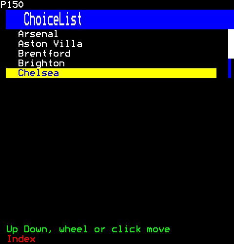

```ts
h(ChoiceList, {
  items: ["Arsenal", "Aston Villa", "Brentford", "Brighton", "Chelsea", "Everton", "Fulham", "Liverpool"],
  shown: 5,
  onChoose: () => {},
})
```

Then the viewer:

```ts
page.press(1, Key.PageDown);
```

### Picked by digits

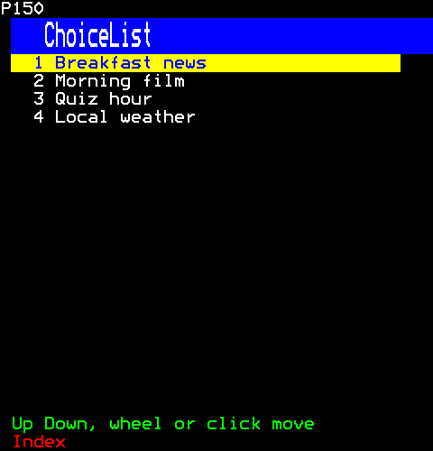

```ts
h(ChoiceList, { items: ["Breakfast news", "Morning film", "Quiz hour", "Local weather"], shown: 4, pick: "digits", onChoose: () => {} })
```

### Picked by the coloured keys

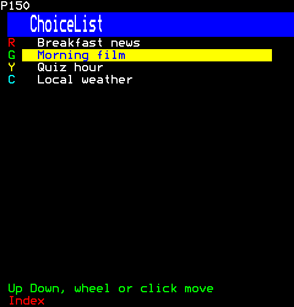

```ts
h(ChoiceList, { items: ["Breakfast news", "Morning film", "Quiz hour", "Local weather"], shown: 4, pick: "colours", onChoose: () => {} })
```

Then the viewer:

```ts
page.press(1, Key.Down);
```

## FilterList

A list that narrows as the viewer types (choice-list.ts under a line of what is typed): the items whose text holds what is typed, those that begin with it first, then those that hold it as a run, then those that hold its letters in order, as fuzzy finders rank them; case aside. Backspace rubs a letter out, Escape clears what is typed. Choosing an item says its place in the items given, not in the list narrowed. What is typed changing takes the choice to the top row, the best match, so Enter after typing chooses what the typing found; the list is made anew for it, its keys kept.

```ts
import { FilterList } from "neoteletext-server-ts-ui-components";
```

### Props

| Prop | Type | What it is |
| --- | --- | --- |
| `items` (needed) | `readonly T[]` | The items to narrow: an item chosen is said by its place here. |
| `text` (needed) | `(item: T) => string` | An item's text, which what is typed is found in. |
| `shown` (needed) | `number` | The rows of items shown, under the typed line. |
| `prompt` | `string` | What the typed line says while nothing is typed. |
| `empty` | `string` | What it says when nothing matches; "nothing matches" when absent. |
| `onChoose` (needed) | `(index: number, session: number) => void` | An item chosen: its place in `items`. |
| `autoFocus` | `boolean` | Its list takes the keys when it arrives. |

### Before anything is typed

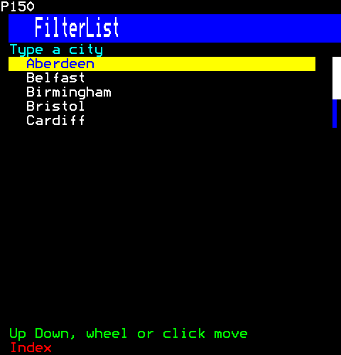

```ts
h(FilterList        , {
  items: ["Aberdeen", "Belfast", "Birmingham", "Bristol", "Cardiff", "Edinburgh", "Glasgow", "Leeds"],
  text: (city) => city,
  shown: 5,
  prompt: "Type a city",
  onChoose: () => {},
})
```

### Narrowed by what is typed

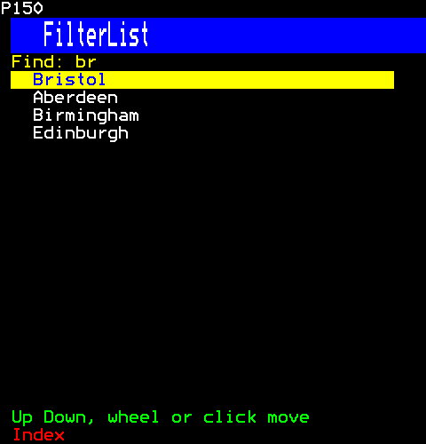

```ts
h(FilterList        , {
  items: ["Aberdeen", "Belfast", "Birmingham", "Bristol", "Cardiff", "Edinburgh", "Glasgow", "Leeds"],
  text: (city) => city,
  shown: 5,
  prompt: "Type a city",
  onChoose: () => {},
})
```

Then the viewer:

```ts
page.typeKeys(1, "br");
```

## DataTable

A table of rows and columns under a heading: each column starts with its colour's cell, which is the gap between columns; the heading is on a band of a colour apart from the frame's title band above it; the chosen row is on the band while the table has the keys (core/look.ts); rows may alternate their foreground; more rows than fit scroll beside a scroll bar. A column is sorted by its digit (the page takes the digits) or a click on its heading, and again the other way. A row that can be chosen is a control, and the pointer coming onto it is told to the table's user (onHover).

```ts
import { DataTable } from "neoteletext-server-ts-ui-components";
```

**Keys:** `Up Down` scroll.

**It takes of its page:** a copy of the page for each viewer.

### Props

| Prop | Type | What it is |
| --- | --- | --- |
| `columns` (needed) | `readonly TableColumn[]` | The columns, left to right: a row's cells are in their order. |
| `rows` (needed) | `readonly (readonly string[])[]` | The rows, each its cells in the columns' order. |
| `shown` (needed) | `number` | The body's rows shown at once. |
| `selectable` | `boolean` | A row can be chosen, and Enter, Space or a click chooses it. |
| `sortable` | `boolean` | A column's digit, 1 to 9, or a click on its heading sorts by it, and again the other way; the page then takes the digits. |
| `striped` | `boolean` | Rows alternate white and cyan. |
| `headingBackground` | `Colour` | The heading's band colour; cyan when absent, apart from the frame's blue title band directly above it. A page whose title band is cyan gives it another, so the heading does not run into the title. |
| `empty` | `string` | What an empty table says; "no rows" when absent. |
| `onChoose` | `(row: readonly string[], session: number) => void` | A row chosen by Enter, Space or a click, only while selectable. |
| `onHover` | `(row: readonly string[] \| null, session: number) => void` | The pointer came onto a row that can be chosen, or left it (null). Moving from one row to the next is a leave, then an enter. |
| `rowKey` | `(row: readonly string[]) => string` | What tells one row from another, so the chosen row stays chosen as rows come and go: a live table. |

And the props of [`ControlProps`](common.md#controlprops).

#### TableColumn

| Prop | Type | What it is |
| --- | --- | --- |
| `title` (needed) | `string` | Its heading, on the heading's band, cut to its width. |
| `width` (needed) | `number` | Its cells, its colour's cell included. |
| `align` | `"left" \| "right"` | Where its cells' text sits; left when absent. |
| `foreground` | `Colour` | Its cells' colour where the row is not chosen or striped; white when absent. |

### Striped

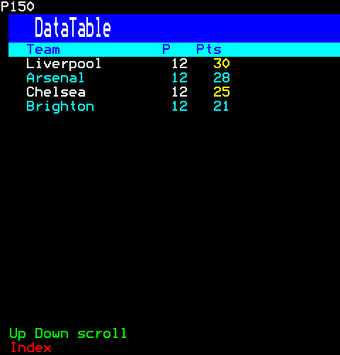

```ts
h(DataTable, {
  columns: [
    { title: "Team", width: 16 },
    { title: "P", width: 4, align: "right" },
    { title: "Pts", width: 5, align: "right", foreground: Colour.Yellow },
  ],
  rows: [
    ["Liverpool", "12", "30"],
    ["Arsenal", "12", "28"],
    ["Chelsea", "12", "25"],
    ["Brighton", "12", "21"],
  ],
  shown: 4,
  striped: true,
})
```

### Sorted, a row chosen

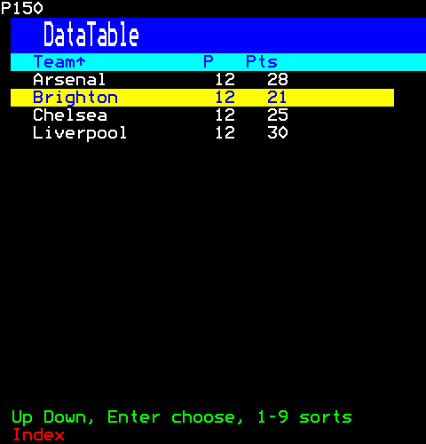

```ts
h(DataTable, {
  columns: [
    { title: "Team", width: 16 },
    { title: "P", width: 4, align: "right" },
    { title: "Pts", width: 5, align: "right" },
  ],
  rows: [
    ["Liverpool", "12", "30"],
    ["Arsenal", "12", "28"],
    ["Chelsea", "12", "25"],
    ["Brighton", "12", "21"],
  ],
  shown: 4,
  sortable: true,
  selectable: true,
  onChoose: () => {},
})
```

Then the viewer:

```ts
page.typeKeys(1, "1");
page.press(1, Key.Down);
```

## ItemText

The text a list's row holds by default (list-rows.ts): wrapped over the row's rows at word boundaries, the last cut with an ellipsis. Its leading spaces are kept, on every line: they stand for a mark the row does not have, a tree's leaf's or a toggle list's unstarred item's, so its text lines up with its siblings' after theirs.

```ts
import { ItemText } from "neoteletext-server-ts-ui-components";
```

### Props

| Prop | Type | What it is |
| --- | --- | --- |
| `text` (needed) | `string` | The text, wrapped over its rows at word boundaries, the last cut with an ellipsis. |
| `foreground` (needed) | `Colour` | Its colour: the row's look's. |
| `rows` | `number` | Rows to wrap it over: 1 when absent. |

### Wrapped over two rows

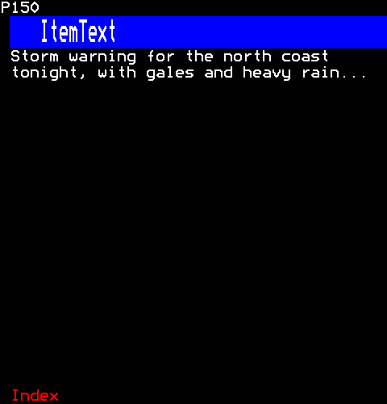

```ts
h(ItemText, {
  text: "Storm warning for the north coast tonight, with gales and heavy rain spreading south by the morning",
  foreground: Colour.White,
  rows: 2,
})
```

## ListRow

A list's row as a component: the band, the mark and the colours every list's row has in each state (core/look.ts), and whatever the row holds, laid out from ITEM_TEXT: a line of text by default, or any components a list's user gives it. A row that can be pressed declares its band's cells as a control (core/controls.ts), which the browser lights as the pointer passes, and only a click there presses it: not one on its indent, a tree's guides or a control's label column. The pointer coming onto the band and leaving it (HOVER) is told to the list, for showing what the row is before it is chosen, and a row may say what it is on the hint row while the pointer is on it. ListRows is a list's rows, as many as are shown from its top, each one a ListRow, so every list chooses, highlights, takes clicks and hears the pointer alike.

```ts
import { ListRow } from "neoteletext-server-ts-ui-components";
```

### Props

| Prop | Type | What it is |
| --- | --- | --- |
| `chosen` (needed) | `boolean` | It is the list's chosen row: on the band while the list has the keys, marked otherwise. |
| `focused` (needed) | `boolean` | The list has the keys. |
| `disabled` | `boolean` | It cannot be pressed: drawn dimmed, never on the band, and a click does nothing. |
| `foreground` | `Colour` | Its foreground off the band, LABEL when absent. |
| `rows` | `number` | Rows it takes: 1 when absent. |
| `indent` | `number` | Cells before the row's band and mark: a tree's depth, a control's label column. |
| `before` | `Child` | What those cells hold: a tree's guide lines. |
| `content` (needed) | `(look: RowLook) => Child` | What it holds, drawn to its look. |
| `onPress` | `(session: number) => void` | A click on its band; without it, the band is no control. |
| `onHover` | `(entered: boolean, session: number) => void` | The pointer came onto its band, or left it (`entered` false). |
| `hint` | `string` | What the hint row says while the pointer is on it: what the row is. |

#### RowLook

| Prop | Type | What it is |
| --- | --- | --- |
| `chosen` (needed) | `boolean` | It is the list's chosen row: on the band while the list has the keys, marked otherwise. |
| `focused` (needed) | `boolean` | The list has the keys. |
| `disabled` (needed) | `boolean` | It cannot be pressed: drawn dimmed, and never on the band. |
| `band` (needed) | `boolean` | On a band: the chosen row of the list with the keys. |
| `foreground` (needed) | `Colour` | The foreground to draw in, to read on the band or off it. |

### Chosen and not

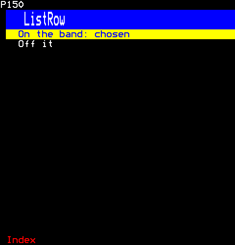

```ts
[
  h(ListRow, {
    key: "chosen",
    chosen: true,
    focused: true,
    content: (look) => h(ItemText, { text: "On the band: chosen", foreground: look.foreground }),
  }),
  h(ListRow, { key: "plain", chosen: false, focused: true, content: (look) => h(ItemText, { text: "Off it", foreground: look.foreground }) }),
]
```

## ListRows

A list's rows: as many of its items as are shown from its top, each a ListRow (list-row.ts) holding the item's text or what the list's user makes of it, so every list chooses, highlights, takes clicks and hears the pointer alike.

```ts
import { ListRows } from "neoteletext-server-ts-ui-components";
```

### Props

| Prop | Type | What it is |
| --- | --- | --- |
| `items` (needed) | `readonly T[]` | The list's items, all of them; those from `top` are shown. |
| `indent` | `(item: T, index: number) => number` | Cells before each row's band, and what they hold. |
| `before` | `(item: T, index: number) => Child` | What the cells before an item's band hold: a tree's guide lines. |
| `top` | `number` | The first item shown. |
| `shown` (needed) | `number` | How many items are shown from the top. |
| `chosen` (needed) | `number \| null` | The chosen item, or null for none. |
| `focused` (needed) | `boolean` | The list has the keys: the chosen item is on the band. |
| `itemRows` | `number` | Rows each item takes. |
| `empty` | `string` | What an empty list says. |
| `render` | `(item: T, look: RowLook, index: number) => Child` | What an item's row holds: its text in its look by default. |
| `text` | `(item: T, index: number) => string` | An item's text, for the default row: the item itself when it is text. |
| `disabled` | `(item: T, index: number) => boolean` | Whether an item cannot be picked: drawn dimmed, and a click on it does nothing. |
| `foreground` | `(item: T, index: number) => Colour \| undefined` | An item's foreground off the band. |
| `onPick` (needed) | `(index: number, session: number) => void` | A click on an item's band: its place in `items`. |
| `onHover` | `(index: number \| null, session: number) => void` | The pointer came onto an item's row, or left it (null). Moving from one row to the next is a leave, then an enter. |
| `itemHint` | `(item: T, index: number) => string \| null` | What the hint row says of an item while the pointer is on its row, or null for the list's own hint. |

#### RowLook

| Prop | Type | What it is |
| --- | --- | --- |
| `chosen` (needed) | `boolean` | It is the list's chosen row: on the band while the list has the keys, marked otherwise. |
| `focused` (needed) | `boolean` | The list has the keys. |
| `disabled` (needed) | `boolean` | It cannot be pressed: drawn dimmed, and never on the band. |
| `band` (needed) | `boolean` | On a band: the chosen row of the list with the keys. |
| `foreground` (needed) | `Colour` | The foreground to draw in, to read on the band or off it. |

### Two-row items, the second chosen

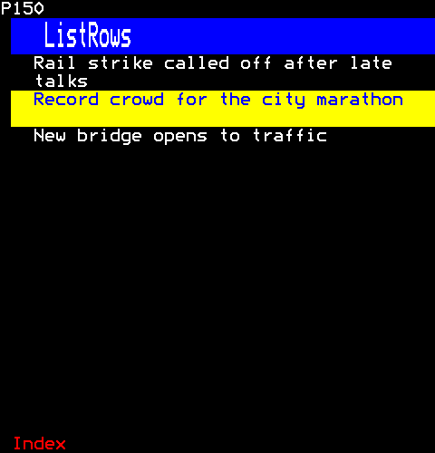

```ts
h(ListRows, {
  items: ["Rail strike called off after late talks", "Record crowd for the city marathon", "New bridge opens to traffic"],
  shown: 3,
  itemRows: 2,
  chosen: 1,
  focused: true,
  onPick: () => {},
})
```

## LogView

A log: entries as they come, the newest at the bottom, each with its time and its level's tag in the level's colour. It follows the newest until the viewer scrolls back, and says so; End, or a click on the PAUSED badge, follows again.

```ts
import { LogView } from "neoteletext-server-ts-ui-components";
```

**Keys:** `Up PgUp` scroll back; `End or a click on PAUSED` follows.

**It takes of its page:** a copy of the page for each viewer.

### Props

| Prop | Type | What it is |
| --- | --- | --- |
| `entries` (needed) | `readonly LogEntry[]` | The entries, oldest first: the newest is at the bottom while it follows. |
| `shown` (needed) | `number` | The entries shown at once. |
| `empty` | `string` | What it says before any entry; "no entries yet" when absent. |

And the props of [`ControlProps`](common.md#controlprops).

#### LogEntry

| Prop | Type | What it is |
| --- | --- | --- |
| `at` (needed) | `number` | Milliseconds since the Unix epoch. |
| `level` (needed) | `LogLevel` | How much it matters: its tag and its colour; one the log does not know is drawn as info. |
| `text` (needed) | `string` | What happened, cut to its row. |

### Following the newest

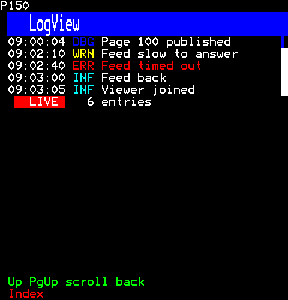

```ts
h(LogView, {
  shown: 5,
  entries: [
    { at: Date.UTC(2026, 9, 28, 9, 0, 1), level: "info", text: "Channel started" },
    { at: Date.UTC(2026, 9, 28, 9, 0, 4), level: "debug", text: "Page 100 published" },
    { at: Date.UTC(2026, 9, 28, 9, 2, 10), level: "warning", text: "Feed slow to answer" },
    { at: Date.UTC(2026, 9, 28, 9, 2, 40), level: "error", text: "Feed timed out" },
    { at: Date.UTC(2026, 9, 28, 9, 3, 0), level: "info", text: "Feed back" },
    { at: Date.UTC(2026, 9, 28, 9, 3, 5), level: "info", text: "Viewer joined" },
  ],
})
```

### Scrolled back, paused

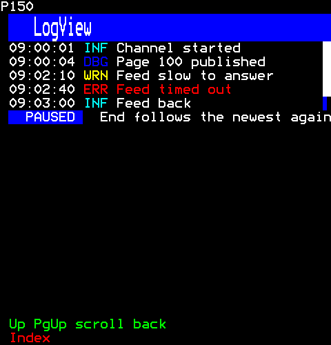

```ts
h(LogView, {
  shown: 5,
  entries: [
    { at: Date.UTC(2026, 9, 28, 9, 0, 1), level: "info", text: "Channel started" },
    { at: Date.UTC(2026, 9, 28, 9, 0, 4), level: "debug", text: "Page 100 published" },
    { at: Date.UTC(2026, 9, 28, 9, 2, 10), level: "warning", text: "Feed slow to answer" },
    { at: Date.UTC(2026, 9, 28, 9, 2, 40), level: "error", text: "Feed timed out" },
    { at: Date.UTC(2026, 9, 28, 9, 3, 0), level: "info", text: "Feed back" },
    { at: Date.UTC(2026, 9, 28, 9, 3, 5), level: "info", text: "Viewer joined" },
  ],
})
```

Then the viewer:

```ts
page.press(1, Key.Up);
```

## NumberedRows

Rows of page numbers, as an index page lists them: the number in yellow, what is there, a figure on the right; a click on a row goes to its page, and each row from its number is a control.

```ts
import { NumberedRows } from "neoteletext-server-ts-ui-components";
```

### Props

| Prop | Type | What it is |
| --- | --- | --- |
| `entries` (needed) | `readonly NumberedRow[]` | The rows, from the top: each a page a click goes to. |
| `empty` | `string` | What it says when there are none; "nothing listed" when absent. |

#### NumberedRow

| Prop | Type | What it is |
| --- | --- | --- |
| `page` (needed) | `number` | The page a click on it goes to, its number first in yellow. |
| `label` (needed) | `string` | What it is, cut to the room before the figure. |
| `figure` | `number \| string` | What it says on the right, in cyan; nothing when absent. |
| `foreground` | `Colour` | The label's colour; white when absent. |

### An index

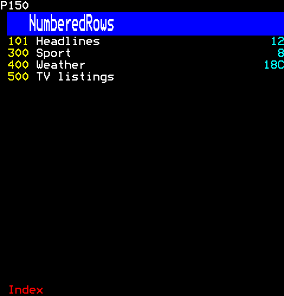

```ts
h(NumberedRows, {
  entries: [
    { page: 0x101, label: "Headlines", figure: 12 },
    { page: 0x300, label: "Sport", figure: 8 },
    { page: 0x400, label: "Weather", figure: "18C" },
    { page: 0x500, label: "TV listings" },
  ],
})
```

## ScrollBar

A scroll bar of whole cells that tells its parent where to go, as React's controlled components do: the lists, the menu, the tree and ScrollingText (scrolling-text.ts) scroll beside one.

```ts
import { ScrollBar } from "neoteletext-server-ts-ui-components";
```

### Props

| Prop | Type | What it is |
| --- | --- | --- |
| `top` (needed) | `number` | The first item shown, from 0. |
| `total` (needed) | `number` | The items there are: nothing is drawn while all of them show. |
| `shown` (needed) | `number` | The items shown at once: a press above or below the block scrolls one fewer. |
| `onScroll` (needed) | `(top: number) => void` | Where the viewer moved it: the first item to show. |
| `disabled` | `boolean` | What it scrolls cannot be used: it is drawn, but takes nothing and declares nothing. |

### Beside lines of its own

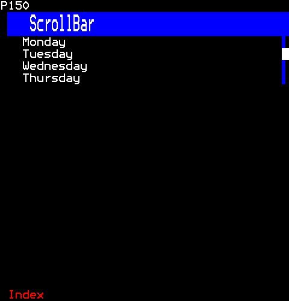

```ts
h(
  Columns,
  { widths: [null, BAR_CELLS], height: 4 },
  h(ListRows, { items: ["Monday", "Tuesday", "Wednesday", "Thursday"], shown: 4, chosen: null, focused: false, onPick: () => {} }),
  h(ScrollBar, { top: 3, total: 12, shown: 4, onScroll: () => {} }),
)
```

## ScrollingText

Lines that scroll in their box beside a scroll bar (scroll.ts), moved with the keys (core/list-cursor.ts), the wheel and the bar.

```ts
import { ScrollingText } from "neoteletext-server-ts-ui-components";
```

**Keys:** `PgDn PgUp arrows Home End` scroll; `wheel or the bar` too.

**It takes of its page:** a copy of the page for each viewer.

### Props

| Prop | Type | What it is |
| --- | --- | --- |
| `lines` (needed) | `readonly Line[]` | The lines to read, a row each. |
| `shown` (needed) | `number` | The rows it shows at once. |
| `empty` | `string` | What it says when there are no lines; "nothing to read" when absent. |

And the props of [`ControlProps`](common.md#controlprops).

#### Line

| Prop | Type | What it is |
| --- | --- | --- |
| `foreground` (needed) | `Colour` | Its colour. |
| `text` (needed) | `string` | Its text: one row of it. |

### A page down

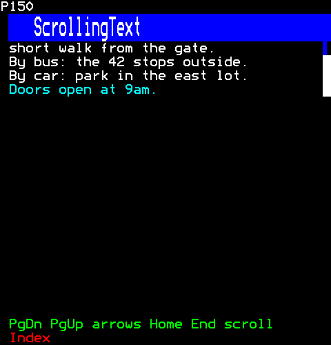

```ts
h(ScrollingText, {
  shown: 4,
  lines: [
    { foreground: Colour.Yellow, text: "Getting there" },
    { foreground: Colour.White, text: "By train: the station is a" },
    { foreground: Colour.White, text: "short walk from the gate." },
    { foreground: Colour.White, text: "By bus: the 42 stops outside." },
    { foreground: Colour.White, text: "By car: park in the east lot." },
    { foreground: Colour.Cyan, text: "Doors open at 9am." },
  ],
})
```

Then the viewer:

```ts
page.press(1, Key.PageDown);
```

## Table

A table of labels and their values, in two columns.

```ts
import { Table } from "neoteletext-server-ts-ui-components";
```

### Props

| Prop | Type | What it is |
| --- | --- | --- |
| `rows` (needed) | `readonly (readonly [label: string, value: string])[]` | Each row's label and its value. |
| `labelCells` | `number` | The labels' column, kept within the box; half the box when absent or no number. |
| `labelForeground` | `Colour` | The labels' colour; white when absent. |
| `valueForeground` | `Colour` | The values' colour; cyan when absent. |
| `empty` | `string` | What an empty table says; "nothing to show" when absent. |

### Labels and values

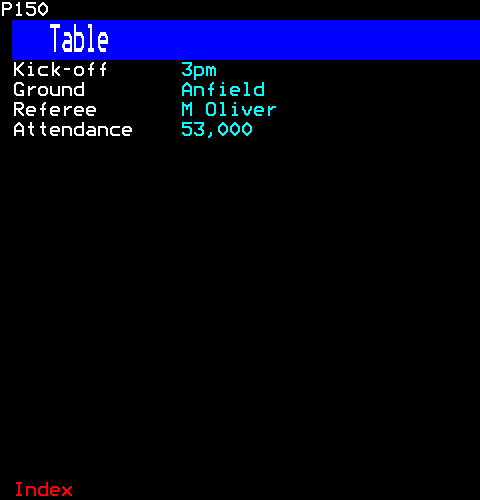

```ts
h(Table, {
  labelCells: 14,
  rows: [
    ["Kick-off", "3pm"],
    ["Ground", "Anfield"],
    ["Referee", "M Oliver"],
    ["Attendance", "53,000"],
  ],
})
```

## ToggleList

A list whose items are switched on and off, each marked with a star: Up and Down choose (core/list-cursor.ts), Enter, Space or a click switches one. Its value is the items on. Its rows are ListRows (list-row.ts), controls the browser lights as the pointer passes; the pointer coming onto one is told to the list's user (onHover).

```ts
import { ToggleList } from "neoteletext-server-ts-ui-components";
```

**Keys:** `Up Down` choose; `Enter or a click` stars.

**It takes of its page:** a copy of the page for each viewer.

### Props

| Prop | Type | What it is |
| --- | --- | --- |
| `items` (needed) | `readonly string[]` | The items, all shown, each starred while it is on. |
| `empty` | `string` | What an empty list says; "nothing to star" when absent. |
| `onHover` | `(index: number \| null, session: number) => void` | The pointer came onto an item's row, or left it (null): for showing what it is before it is chosen. Moving from one row to the next is a leave, then an enter. |

And the props of [`ValueProps`](common.md#valueprops).

### Some starred

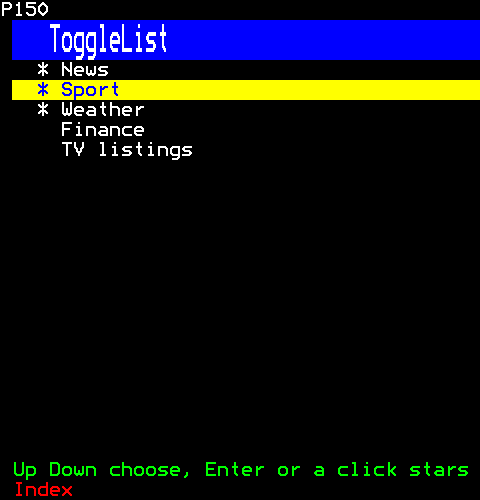

```ts
h(ToggleList, { items: ["News", "Sport", "Weather", "Finance", "TV listings"], initial: [0, 2] })
```

Then the viewer:

```ts
page.press(1, Key.Down);
page.press(1, Key.Enter);
```
