# Navigation

The ways about a channel: tabs, menus and trees to choose where to go, sections that open and shut, the way back up, the pages of a run, and a finder that goes to a page by its name.

- [Breadcrumbs](#breadcrumbs)
- [Collapsible](#collapsible)
- [Menu](#menu)
- [PageFinder](#pagefinder)
- [Pagination](#pagination)
- [TabStrip](#tabstrip)
- [TabView](#tabview)
- [Tree](#tree)

## Breadcrumbs

Breadcrumbs: the way down to where the viewer is, each step with a page or an action a control they can click back to: a page goes there, an action does what it says, such as a menu going back to that level. The English set has the right arrow (EN 300 706 Table 36), so the steps are joined by it, or by a slash.

```ts
import { Breadcrumbs } from "neottx-server-ts-ui-components";
```

### Props

| Prop | Type | What it is |
| --- | --- | --- |
| `trail` (needed) | `readonly Crumb[]` | The steps, from the top down to where the viewer is: the last in white, the rest in cyan. |
| `separator` | `"arrow" \| "slash"` | What joins the steps: a right arrow or a slash; the arrow when absent. |

#### Crumb

| Prop | Type | What it is |
| --- | --- | --- |
| `label` (needed) | `string` | What the step is, cut to the room left on the row. |
| `page` | `number` | The page a click on it goes to, when it has no onPress. |
| `onPress` | `(session: number) => void` | What a click on it does, in place of going to its page. |

### The way down

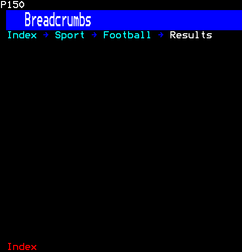

```ts
h(Breadcrumbs, {
  trail: [{ label: "Index", page: 0x100 }, { label: "Sport", page: 0x300 }, { label: "Football", page: 0x302 }, { label: "Results" }],
})
```

### Joined by slashes

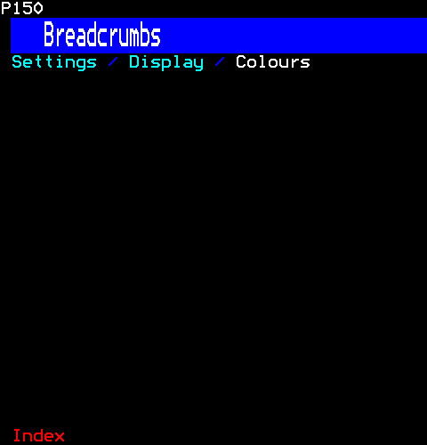

```ts
h(Breadcrumbs, {
  separator: "slash",
  trail: [{ label: "Settings", onPress: () => {} }, { label: "Display", onPress: () => {} }, { label: "Colours" }],
})
```

## Collapsible

Collapsible sections: each a heading on a band, its content under it while it is open, indented so its text starts under the heading's. Up and Down choose a heading, Enter, Space or a click opens or shuts it; as an accordion, opening one shuts the others. Each heading's band is a control. Its value is the sections open.

```ts
import { Collapsible } from "neottx-server-ts-ui-components";
```

**Keys:** `Up Down` choose a heading; `Enter` opens or shuts.

**It takes of its page:** a copy of the page for each viewer.

### Props

| Prop | Type | What it is |
| --- | --- | --- |
| `titles` (needed) | `readonly string[]` | Each section's heading; the children are their contents, in order. |
| `accordion` | `boolean` | Opening one shuts the others. |
| `background` | `Colour` | The headings' band colour while not chosen; blue when absent. |

And the props of [`ValueProps`](common.md#valueprops).

### One section open

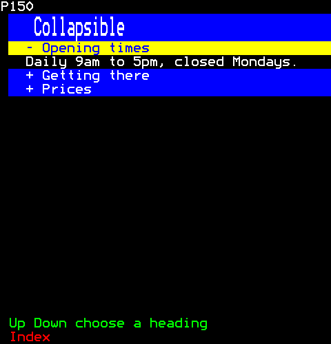

```ts
h(
  Collapsible,
  { titles: ["Opening times", "Getting there", "Prices"], initial: [0] },
  h(Text, { text: "Daily 9am to 5pm, closed Mondays." }),
  h(Text, { text: "Bus 42 stops at the gate." }),
  h(Text, { text: "Adults 8, children free." }),
)
```

### An accordion, the second opened

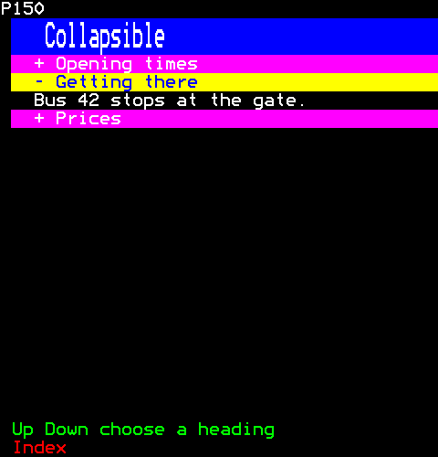

```ts
h(
  Collapsible,
  { titles: ["Opening times", "Getting there", "Prices"], accordion: true, initial: [0], background: Colour.Magenta },
  h(Text, { text: "Daily 9am to 5pm, closed Mondays." }),
  h(Text, { text: "Bus 42 stops at the gate." }),
  h(Text, { text: "Adults 8, children free." }),
)
```

Then the viewer:

```ts
page.press(1, Key.Down);
page.press(1, Key.Enter);
```

## Menu

A menu: choices with their shortcuts, rules between groups, choices that cannot be made yet, and choices that open a menu of their own. Up and Down move past rules and what cannot be chosen (core/list-cursor.ts), Enter, Space or Right chooses or opens, Left or Escape goes back, a click chooses, and a click on a menu's name in the way down goes back to it; numbered, the digits choose as an index page's do, so the page takes them. The pointer coming onto a choice is told to the menu's user (onHover). More choices than fit scroll beside a scroll bar, and with the wheel.

```ts
import { Menu } from "neottx-server-ts-ui-components";
```

**Keys:** `Up Down` move; `Enter or its number` chooses; `Left` goes back.

**It takes of its page:** the digits, a copy of the page for each viewer.

### Props

| Prop | Type | What it is |
| --- | --- | --- |
| `items` (needed) | `readonly MenuItem[]` | The top menu's choices. |
| `title` | `string` | The top menu's name, shown over its items with the way down to a menu opened. |
| `numbered` | `boolean` | Each choice has its number, which chooses it. |
| `shown` | `number` | The choices shown at once. |
| `empty` | `string` | What an empty menu says; "no choices" when absent. |
| `onChoose` (needed) | `(path: readonly string[], session: number) => void` | A choice made: the labels from the top menu down to it. |
| `onHover` | `(path: readonly string[] \| null, session: number) => void` | The pointer came onto a choice, or left it (null): the labels from the top menu down to it. Moving from one choice to the next is a leave, then an enter. |
| `itemKey` | `(item: MenuItem) => string` | What tells one choice from another, so the chosen one stays chosen as the open menu's choices come and go. |

And the props of [`ControlProps`](common.md#controlprops).

#### MenuItem

| Prop | Type | What it is |
| --- | --- | --- |
| `label` (needed) | `string` | What it says, and its step in the path of labels onChoose is given. |
| `shortcut` | `string` | What it says on the right: a key, a page. |
| `disabled` | `boolean` | It cannot be chosen, and is drawn in the disabled look. |
| `rule` | `boolean` | A rule, not a choice. |
| `items` | `readonly MenuItem[]` | A menu it opens. |

### Numbered, with a rule and a choice not yet open

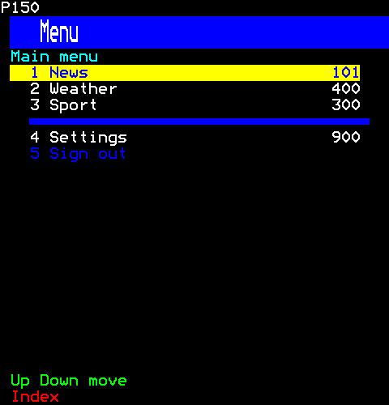

```ts
h(Menu, {
  title: "Main menu",
  numbered: true,
  items: [
    { label: "News", shortcut: "101" },
    { label: "Weather", shortcut: "400" },
    { label: "Sport", shortcut: "300" },
    { label: "", rule: true },
    { label: "Settings", shortcut: "900" },
    { label: "Sign out", disabled: true },
  ],
  onChoose: () => {},
})
```

### A submenu open

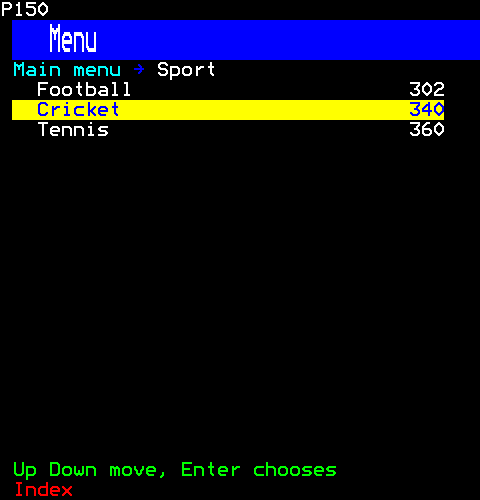

```ts
h(Menu, {
  title: "Main menu",
  items: [
    { label: "News", items: [{ label: "Headlines" }, { label: "World" }, { label: "Business" }] },
    {
      label: "Sport",
      items: [
        { label: "Football", shortcut: "302" },
        { label: "Cricket", shortcut: "340" },
        { label: "Tennis", shortcut: "360" },
      ],
    },
    { label: "Weather" },
  ],
  onChoose: () => {},
})
```

Then the viewer:

```ts
page.press(1, Key.Down);
page.press(1, Key.Right);
page.press(1, Key.Down);
```

### More than fit, scrolled

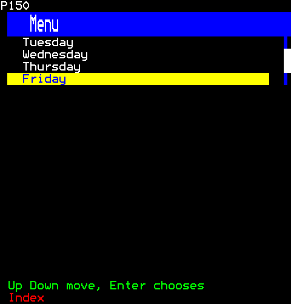

```ts
h(Menu, {
  shown: 4,
  items: ["Monday", "Tuesday", "Wednesday", "Thursday", "Friday", "Saturday", "Sunday"].map((label) => ({ label })),
  onChoose: () => {},
})
```

Then the viewer:

```ts
for (let step = 0; step < 4; step += 1) {
  page.press(1, Key.Down);
}
```

## PageFinder

A page finder: the channel's pages by name, narrowed as the viewer types a word of one (lists/filter-list.ts), and Enter goes there. A remote's digits still go to page selection, as on any page; letters, from a keyboard or a phone, find a page by what it is called.

```ts
import { PageFinder } from "neottx-server-ts-ui-components";
```

### Props

| Prop | Type | What it is |
| --- | --- | --- |
| `pages` (needed) | `readonly FoundPage[]` | The pages to find, each listed by its number and title. |
| `shown` (needed) | `number` | The rows of pages shown. |
| `autoFocus` | `boolean` | It takes the keys when it arrives. |

#### FoundPage

| Prop | Type | What it is |
| --- | --- | --- |
| `page` (needed) | `number` | Its number, hexadecimal as teletext's are: 0x100 is page 100. |
| `title` (needed) | `string` | Its title, after its number. |

### Before anything is typed

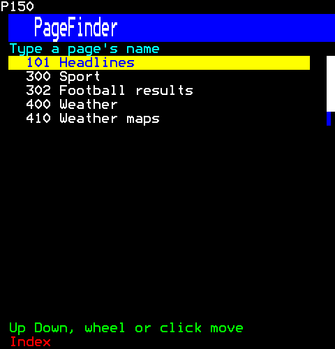

```ts
h(PageFinder, {
  shown: 5,
  pages: [
    { page: 0x101, title: "Headlines" },
    { page: 0x300, title: "Sport" },
    { page: 0x302, title: "Football results" },
    { page: 0x400, title: "Weather" },
    { page: 0x410, title: "Weather maps" },
    { page: 0x500, title: "TV listings" },
  ],
})
```

### With a word typed

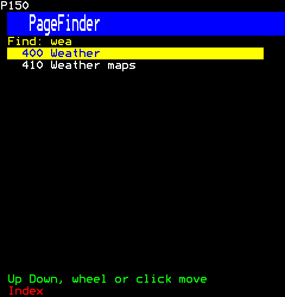

```ts
h(PageFinder, {
  shown: 5,
  pages: [
    { page: 0x101, title: "Headlines" },
    { page: 0x300, title: "Sport" },
    { page: 0x302, title: "Football results" },
    { page: 0x400, title: "Weather" },
    { page: 0x410, title: "Weather maps" },
    { page: 0x500, title: "TV listings" },
  ],
})
```

Then the viewer:

```ts
page.typeKeys(1, "wea");
```

## Pagination

Pagination: which of a run of pages is shown, and the way to the others. Three looks: the numbers round the current one ("← 1 .. 4 5 6 .. 20 →", the current on a band), a count ("← Page 5 of 20 →"), and a row of mosaic dots, the current one large. Left and Right, Home and End, or a click move it; each number, arrow or dot that goes somewhere is a control.

```ts
import { Pagination } from "neottx-server-ts-ui-components";
```

**Keys:** `Left Right, Home End or a click` turn the page.

**It takes of its page:** a copy of the page for each viewer.

### Props

| Prop | Type | What it is |
| --- | --- | --- |
| `count` (needed) | `number` | How many pages there are. |
| `style` | `PaginationStyle` | Its look: the numbers round the current page, a count, or a row of dots; the numbers when absent. |

And the props of [`ValueProps`](common.md#valueprops).

### Numbers round the current page

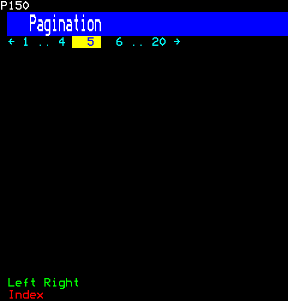

```ts
h(Pagination, { count: 20, initial: 4 })
```

### A count and dots

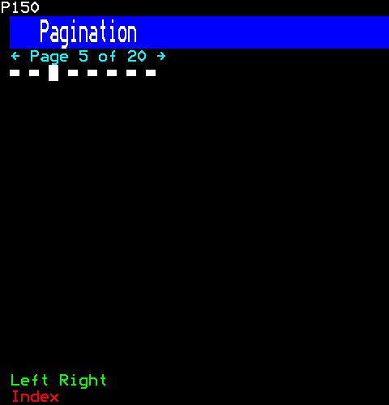

```ts
[
  h(Pagination, { key: "count", count: 20, initial: 4, style: "count" }),
  h(Pagination, { key: "dots", count: 8, initial: 2, style: "dots" }),
]
```

## TabStrip

Tabs: named views, one shown at a time. The strip names them in a row; the view shows the chosen one's content under it. Four looks: chips on backgrounds of their own, Fastext's four colours (the coloured keys choose, so the page takes them), numbers (the digits choose, so the page takes them), and an underline under the chosen name. Every tab takes the same cells whether it is chosen or not, as a chip does (core/canvas.ts), so choosing one never moves the others, and each is a control there.

```ts
import { TabStrip } from "neottx-server-ts-ui-components";
```

### Props

| Prop | Type | What it is |
| --- | --- | --- |
| `tabs` (needed) | `readonly string[]` | The tabs' names, left to right; from the first that does not fit, none is drawn, so the tabs shown are always the first, in order. |
| `active` (needed) | `number` | The chosen tab, by its place in `tabs`. |
| `style` | `TabStyle` | Its look; chips when absent. |
| `focused` | `boolean` | The strip is the one with the keys: the chosen tab on the band. |
| `disabled` | `boolean` | Its tabs cannot be chosen: they declare no controls. |
| `onChange` (needed) | `(index: number, session: number) => void` | A click on a tab: its place in `tabs`. |

### Each style

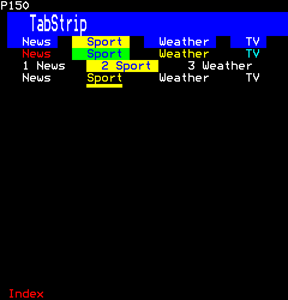

```ts
[
  h(TabStrip, { key: "chips", style: "chips", tabs: ["News", "Sport", "Weather", "TV"], active: 1, onChange: () => {} }),
  h(TabStrip, { key: "fastext", style: "fastext", tabs: ["News", "Sport", "Weather", "TV"], active: 1, onChange: () => {} }),
  h(TabStrip, { key: "numbered", style: "numbered", tabs: ["News", "Sport", "Weather", "TV"], active: 1, onChange: () => {} }),
  h(TabStrip, { key: "underline", style: "underline", tabs: ["News", "Sport", "Weather", "TV"], active: 1, onChange: () => {} }),
]
```

## TabView

Tabs and the chosen one's content (tabs.ts): its children are the views, one for each tab. Left and Right, a click, or the style's keys choose.

```ts
import { TabView } from "neottx-server-ts-ui-components";
```

**Keys:** `Left Right or a click` choose a tab.

**It takes of its page:** a copy of the page for each viewer.

### Props

| Prop | Type | What it is |
| --- | --- | --- |
| `tabs` (needed) | `readonly string[]` | The tabs' names, left to right; the children are their views, in order. |
| `style` | `TabStyle` | Its look, and the keys that choose a tab; chips when absent. |

And the props of [`ValueProps`](common.md#valueprops).

### Chips, the second tab chosen

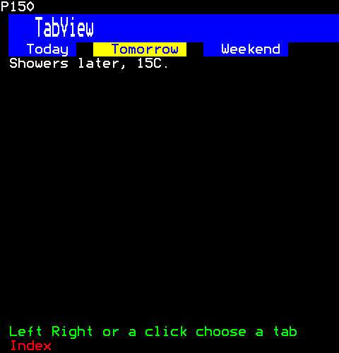

```ts
h(
  TabView,
  { tabs: ["Today", "Tomorrow", "Weekend"] },
  h(Text, { text: "Sunny spells, 18C." }),
  h(Text, { text: "Showers later, 15C." }),
  h(Text, { text: "Dry and bright, 20C." }),
)
```

Then the viewer:

```ts
page.press(1, Key.Right);
```

### Fastext, chosen by the yellow key

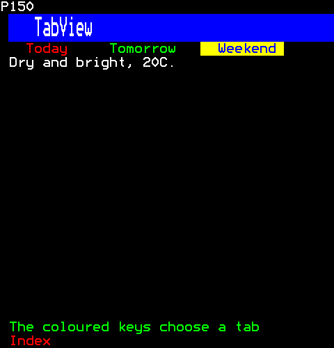

```ts
h(
  TabView,
  { tabs: ["Today", "Tomorrow", "Weekend"], style: "fastext" },
  h(Text, { text: "Sunny spells, 18C." }),
  h(Text, { text: "Showers later, 15C." }),
  h(Text, { text: "Dry and bright, 20C." }),
)
```

Then the viewer:

```ts
page.press(1, Key.Yellow);
```

### Numbered, chosen by its digit

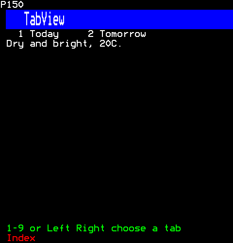

```ts
h(
  TabView,
  { tabs: ["Today", "Tomorrow", "Weekend"], style: "numbered" },
  h(Text, { text: "Sunny spells, 18C." }),
  h(Text, { text: "Showers later, 15C." }),
  h(Text, { text: "Dry and bright, 20C." }),
)
```

Then the viewer:

```ts
page.typeKeys(1, "3");
```

## Tree

A tree: items that open to show the items under them. "+" marks one that is shut, "-" one that is open, and one with no items under it, none or an empty list, is a leaf. With guides, thin lines join each item to its parent's mark and the top items to each other, as a tree view's do. Up and Down move (core/list-cursor.ts), Right opens, Left shuts or goes to the parent, Enter or Space opens or shuts one with children and chooses one without, a click does as Enter does, and the pointer coming onto an item is told to the tree's user (onHover). More than fit scroll beside a scroll bar, and with the wheel.

```ts
import { Tree } from "neottx-server-ts-ui-components";
```

**Keys:** `Up Down` move; `Right` opens; `Left` shuts; `Enter` chooses.

**It takes of its page:** a copy of the page for each viewer.

### Props

| Prop | Type | What it is |
| --- | --- | --- |
| `nodes` (needed) | `readonly TreeNode[]` | The top items, each with the items under it. |
| `guides` | `boolean` | Mosaic lines join the items. |
| `shown` (needed) | `number` | The rows it shows. |
| `open` | `readonly string[]` | Items opened to begin with, by label. |
| `empty` | `string` | What an empty tree says; "nothing here" when absent. |
| `onChoose` | `(node: TreeNode, session: number) => void` | An item without children chosen, by Enter, Space or a click; one with a page then goes there. |
| `onHover` | `(node: TreeNode \| null, session: number) => void` | The pointer came onto an item, or left it (null): for showing what it is before it is chosen. Moving from one item to the next is a leave, then an enter. |

And the props of [`ControlProps`](common.md#controlprops).

#### TreeNode

| Prop | Type | What it is |
| --- | --- | --- |
| `label` (needed) | `string` | What it says. |
| `children` | `readonly TreeNode[]` | The items under it, shown while it is open; none for one that is chosen rather than opened. |
| `page` | `number` | A page it goes to when chosen. |

### Shut

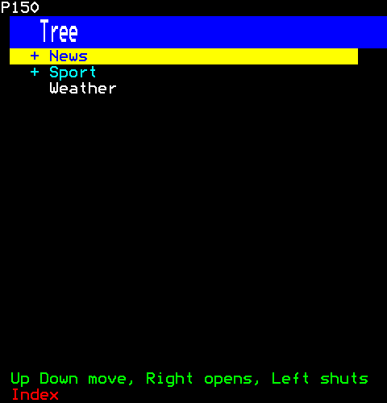

```ts
h(Tree, {
  shown: 6,
  nodes: [
    { label: "News", children: [{ label: "UK" }, { label: "World" }] },
    { label: "Sport", children: [{ label: "Football" }, { label: "Cricket" }] },
    { label: "Weather" },
  ],
})
```

### Opened, with guides

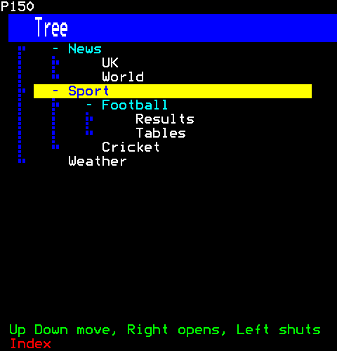

```ts
h(Tree, {
  shown: 10,
  guides: true,
  open: ["News", "Sport", "Football"],
  nodes: [
    { label: "News", children: [{ label: "UK" }, { label: "World" }] },
    {
      label: "Sport",
      children: [{ label: "Football", children: [{ label: "Results" }, { label: "Tables" }] }, { label: "Cricket" }],
    },
    { label: "Weather" },
  ],
})
```

Then the viewer:

```ts
page.press(1, Key.Down);
page.press(1, Key.Down);
page.press(1, Key.Down);
```
