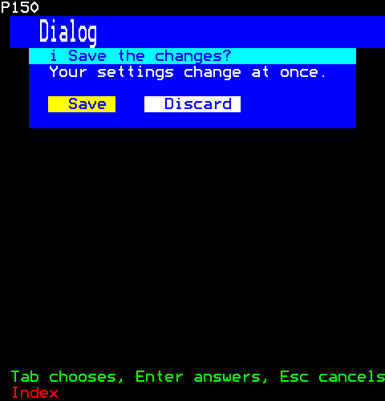
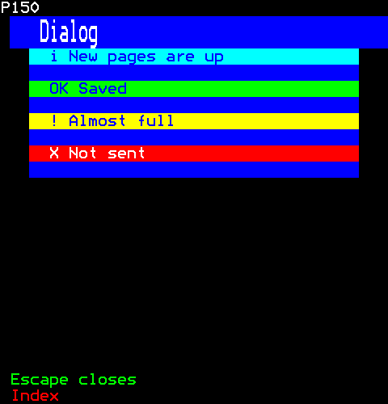
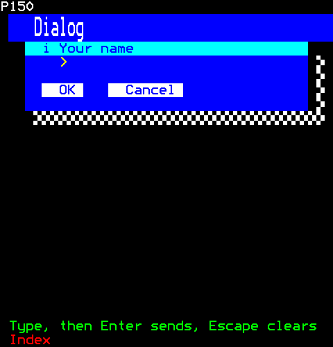
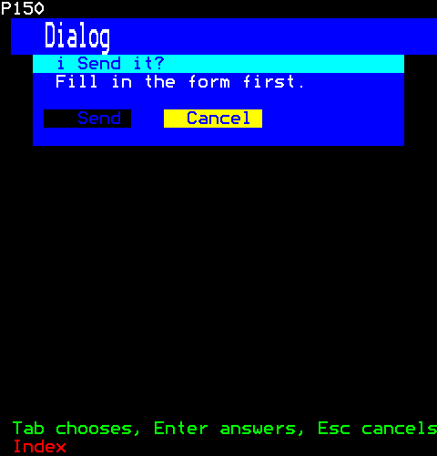
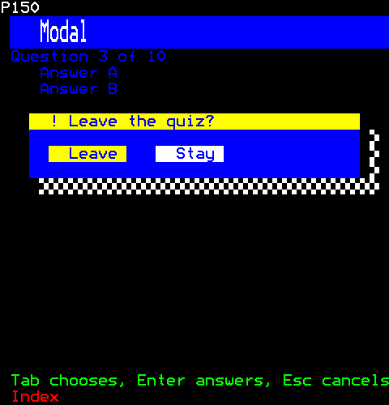
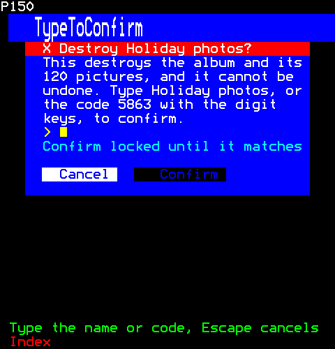
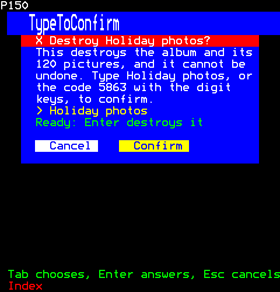

# Overlays

What stands over a page: a dialog that keeps the keys until it is answered, a modal that lays one over a page and dims it, and a dialog that asks for a name before it destroys anything.

- [Dialog](#dialog)
- [Modal](#modal)
- [TypeToConfirm](#typetoconfirm)

## Dialog

Dialogs: a question over the page, which keeps the keys until it is answered. Teletext draws a row from its first cell, so a dialog covers the whole of each row it is on: spaces in its margins and, between them, a background of its own with its title on a band of its kind's colour, its message, its children (a field, a spinner) and its buttons. Left, Right and Tab choose a button, Enter answers with it, Escape answers with none; a click on a button answers with it. A modal (modal.ts) lays one over a page.

```ts
import { Dialog } from "neoteletext-server-ts-ui-components";
```

**Keys:** `Tab` chooses; `Enter` answers; `Esc` cancels.

**It takes of its page:** a copy of the page for each viewer.

### Props

| Prop | Type | What it is |
| --- | --- | --- |
| `title` (needed) | `string` | What it asks, on a band of its kind's colour, cut to the band. |
| `message` | `string` | What it says under the title, wrapped to its width; none when absent. |
| `kind` | `Kind` | Its title band's colours (core/look.ts); info when absent. |
| `buttons` | `readonly string[]` | The buttons, left to right; none for a dialog that only says something is happening. |
| `initial` | `number` | The button chosen to begin with. |
| `disabledButtons` | `readonly number[]` | Buttons, by place, that cannot be pressed now: drawn in the disabled look (core/look.ts), and Enter or a click on one answers nothing. |
| `inset` | `number` | The cells of margin either side. |
| `shadow` | `boolean` | A drop shadow (drop-shadow.ts): a stipple to its right and a row beneath, so it stands off the page. |
| `childFirst` | `boolean` | Its children have the keys first: a field to type in. |
| `onAnswer` | `(button: number \| null, session: number) => void` | The button pressed, or null for Escape. |

And the props of [`ControlProps`](common.md#controlprops).

### A question



```ts
h(Dialog, { title: "Save the changes?", message: "Your settings change at once.", buttons: ["Save", "Discard"] })
```

### Each kind



```ts
[
  h(Dialog, { key: "info", title: "New pages are up", kind: "info" }),
  h(Dialog, { key: "success", title: "Saved", kind: "success" }),
  h(Dialog, { key: "warning", title: "Almost full", kind: "warning" }),
  h(Dialog, { key: "error", title: "Not sent", kind: "error" }),
]
```

### With a shadow and a field



```ts
h(
  Dialog,
  { title: "Your name", buttons: ["OK", "Cancel"], shadow: true, childFirst: true },
  h(TextField, { longest: 20, placeholder: "type it here", autoFocus: true }),
)
```

### A button that cannot be pressed yet



```ts
h(Dialog, { title: "Send it?", message: "Fill in the form first.", buttons: ["Send", "Cancel"], disabledButtons: [0], initial: 1 })
```

## Modal

A modal: a page with a dialog (dialog.ts) over it, and between them a shield (shield.ts), so while the dialog is up no click or turn of the wheel reaches the page under it, and a scrim (scrim.ts), so the page shows dimmed behind it: the top of the look's elevations (core/look.ts).

```ts
import { Modal } from "neoteletext-server-ts-ui-components";
```

### Props

| Prop | Type | What it is |
| --- | --- | --- |
| `dialog` (needed) | `Element \| null` | The dialog over the page, or null while there is none. |
| `row` | `number` | The row its top is on, in the content's box. |
| `scrim` | `boolean` | The page under the dialog dimmed; true when absent. |

### Over a dimmed page



```ts
h(
  Modal,
  { dialog: h(Dialog, { title: "Leave the quiz?", buttons: ["Leave", "Stay"], kind: "warning", shadow: true }), row: 4 },
  h(Text, { text: "Question 3 of 10", foreground: Colour.Yellow }),
  h(Button, { label: "Answer A", onPress: () => {} }),
  h(Button, { label: "Answer B", onPress: () => {} }),
)
```

## TypeToConfirm

A dialog (dialog.ts) before something is destroyed: it says what will be, and Confirm acts only once the viewer has typed its name or, for a viewer with only a remote, the code of digits it shows, a new one each time it opens, so neither a slip nor a habit destroys anything. Cancel is the button chosen to begin with, so Enter with nothing typed cancels; Escape cancels too. Confirm refused says why under the line typed on (confirm-entry.ts). The dialog's own answers are its to send: what comes up the tree is an activate with the name when it is confirmed, a cancel when it is not.

```ts
import { TypeToConfirm } from "neoteletext-server-ts-ui-components";
```

**It takes of its page:** a copy of the page for each viewer.

### Props

| Prop | Type | What it is |
| --- | --- | --- |
| `name` (needed) | `string` | The name of what is destroyed, which the viewer types to confirm; cut to NAME_LONGEST. |
| `destroys` (needed) | `string` | What is destroyed, in words: "the page and its 12 sub-pages". |
| `title` | `string` | The dialog's title; "Destroy" and the name when absent. |
| `onConfirm` (needed) | `(session: number) => void` | Called as Confirm, or Enter on the line, is taken: only once what is typed is the name or the code. |
| `onCancel` | `(session: number) => void` | Called as Cancel or Escape answers it, and nothing is destroyed. |

And the props of [`ControlProps`](common.md#controlprops).

### Before deleting



```ts
h(TypeToConfirm, { name: "Holiday photos", destroys: "the album and its 120 pictures", onConfirm: () => {} })
```

### With the name typed



```ts
h(TypeToConfirm, { name: "Holiday photos", destroys: "the album and its 120 pictures", onConfirm: () => {} })
```

Then the viewer:

```ts
page.typeKeys(1, "Holiday photos");
page.press(1, Key.Right);
```
