# Text

Words on the page: a line in a colour, wrapped paragraphs and runs of mixed styles, the teletext sizes and effects, and the pieces of a news service, from headlines and bylines to badges, tickers and large letters.

- [Text](#text)
- [Paragraph](#paragraph)
- [RichText](#richtext)
- [Band](#band)
- [Badges](#badges)
- [BigText](#bigtext)
- [Headline](#headline)
- [Byline](#byline)
- [LinesBlock](#linesblock)
- [PageLink](#pagelink)
- [Newsflash](#newsflash)
- [Ticker](#ticker)
- [DoubleHeight](#doubleheight)
- [DoubleWidth](#doublewidth)
- [Flashing](#flashing)
- [Concealed](#concealed)
- [Placeholder](#placeholder)

## Text

Text: one line of text in a colour, and the props of the styled lines (double height and width, flashing, concealed) that have a file each.

```ts
import { Text } from "neottx-server-ts-ui-components";
```

### Props

| Prop | Type | What it is |
| --- | --- | --- |
| `text` (needed) | `string` | The line, cut with a mark at the box's edge. |
| `foreground` | `Colour` | Its colour; white when absent. |
| `centre` | `boolean` | Centred in its box. |

### In colours

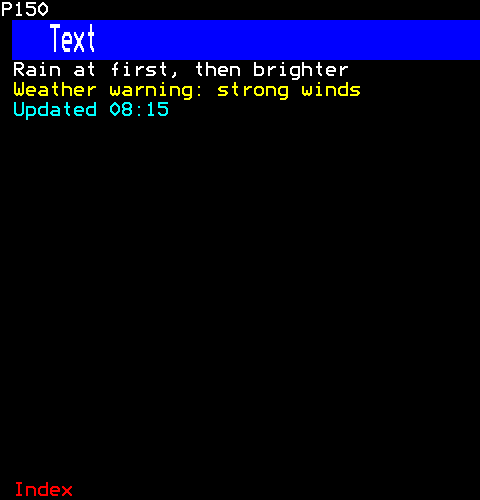

```ts
[
  h(Text, { key: "white", text: "Rain at first, then brighter" }),
  h(Text, { key: "yellow", text: "Weather warning: strong winds", foreground: Colour.Yellow }),
  h(Text, { key: "cyan", text: "Updated 08:15", foreground: Colour.Cyan }),
]
```

### Centred

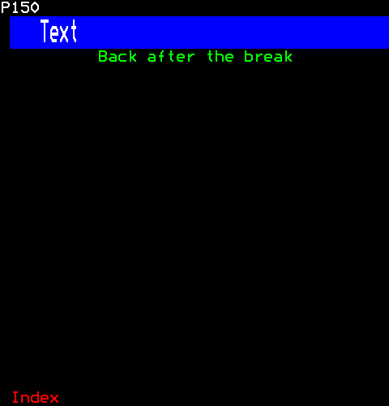

```ts
h(Text, { text: "Back after the break", foreground: Colour.Green, centre: true })
```

## Paragraph

Paragraph: text wrapped to its box, a line a row.

```ts
import { Paragraph } from "neottx-server-ts-ui-components";
```

### Props

| Prop | Type | What it is |
| --- | --- | --- |
| `text` (needed) | `string` | The text, wrapped to the box's width. |
| `foreground` | `Colour` | Its colour; white when absent. |
| `lines` | `number` | At most this many lines; the last cut with an ellipsis. |

### Wrapped

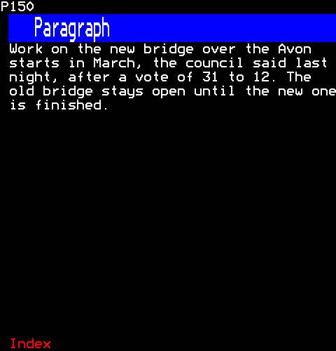

```ts
h(Paragraph, {
  text: "Work on the new bridge over the Avon starts in March, the council said last night, after a vote of 31 to 12. The old bridge stays open until the new one is finished.",
})
```

### At most two lines

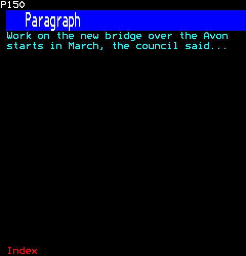

```ts
h(Paragraph, {
  text: "Work on the new bridge over the Avon starts in March, the council said last night, after a vote of 31 to 12.",
  foreground: Colour.Cyan,
  lines: 2,
})
```

## RichText

Text in runs of their own styles, wrapped. A teletext row changes style only with spacing attributes, each taking a cell (EN 300 706 clause 12.2), so a change of style between words takes the space between them, and a change that needs more than one attribute (a background needs its colour, New Background and the ink) takes more cells, counted when the line is broken.

```ts
import { RichText } from "neottx-server-ts-ui-components";
```

### Props

| Prop | Type | What it is |
| --- | --- | --- |
| `runs` (needed) | `readonly Run[]` | The text, in runs of their own styles, wrapped to the box. |
| `lines` | `number` | At most this many lines. |

#### Run

| Prop | Type | What it is |
| --- | --- | --- |
| `text` (needed) | `string` | What it says, in its style. |

And the props of [`RunStyle`](common.md#runstyle).

### Runs of styles

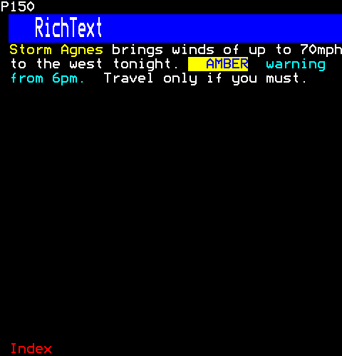

```ts
h(RichText, {
  runs: [
    { text: "Storm Agnes", foreground: Colour.Yellow },
    { text: "brings winds of up to 70mph to the west tonight." },
    { text: "AMBER", foreground: Colour.Blue, background: Colour.Yellow },
    { text: "warning from 6pm.", foreground: Colour.Cyan },
    { text: "Travel only if you must.", flash: true },
  ],
})
```

## Band

Band: a row of text on a background of its own colour.

```ts
import { Band } from "neottx-server-ts-ui-components";
```

### Props

| Prop | Type | What it is |
| --- | --- | --- |
| `text` (needed) | `string` | Its text, cut to the row. |
| `background` | `Colour` | The band's colour; blue when absent. |
| `foreground` | `Colour` | The text's colour; white when absent. |

### Section headings

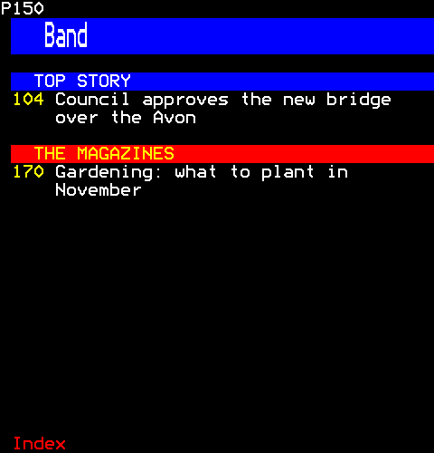

```ts
[
  h(Gap, { key: "space" }),
  h(Band, { key: "top", text: "TOP STORY" }),
  h(Headline, { key: "story", page: 0x104, title: "Council approves the new bridge over the Avon" }),
  h(Gap, { key: "between" }),
  h(Band, { key: "magazines", text: "THE MAGAZINES", background: Colour.Red, foreground: Colour.Yellow }),
  h(Headline, { key: "magazine", page: 0x170, title: "Gardening: what to plant in November" }),
]
```

## Badges

Badges: short labels on a background of their own colour, in a line of text ("LIVE", "3 NEW", "BETA"). Each is a chip (core/canvas.ts): its background starts before the text and ends a cell after it. A badge that does something when clicked ("PAUSED" to follow again, a wizard's step to go back to it) is a control over its chip, and only a click there acts.

```ts
import { Badges } from "neottx-server-ts-ui-components";
```

### Props

| Prop | Type | What it is |
| --- | --- | --- |
| `badges` (needed) | `readonly BadgeSpec[]` | The badges, left to right; those past the row's end are not drawn. |
| `text` | `string` | Text after the badges, in white. |
| `textForeground` | `Colour` | The text's colour; white when absent. |

#### BadgeSpec

| Prop | Type | What it is |
| --- | --- | --- |
| `text` (needed) | `string` | What it says, cut to the room left on the row. |
| `background` | `Colour` | Its colour; red when absent. |
| `foreground` | `Colour` | Its text's colour; white when absent. |
| `flash` | `boolean` | Flashing, as LIVE and NEWSFLASH are. |
| `onPress` | `(session: number) => void` | What a click on it does: it is a control when given. |

### Before a line of text

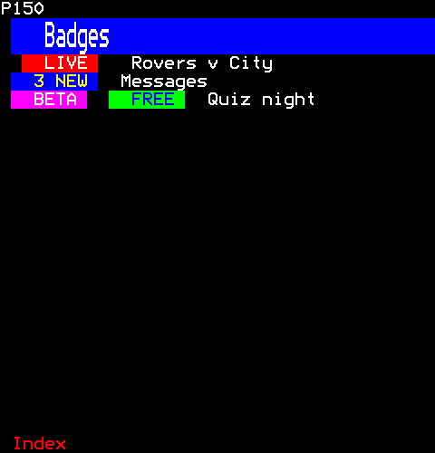

```ts
[
  h(Badges, { key: "live", badges: [{ text: "LIVE", flash: true }], text: "Rovers v City" }),
  h(Badges, { key: "new", badges: [{ text: "3 NEW", background: Colour.Blue, foreground: Colour.Yellow }], text: "Messages" }),
  h(Badges, {
    key: "two",
    badges: [
      { text: "BETA", background: Colour.Magenta },
      { text: "FREE", background: Colour.Green, foreground: Colour.Blue },
    ],
    text: "Quiz night",
  }),
]
```

## BigText

Large text drawn in mosaic graphics, as large digits are (time/big-digits.ts), in their size and by their rules for fitting and drawing: letters A to Z, the digits and the common punctuation, five sixels by seven with a sixel between, below a clear row. Small letters are drawn as capitals; a character it has no letter for is a blank as wide as a letter, so what follows it stays in its place. Only the letters that fit the width are drawn, whole: a letter cut through would read as another.

```ts
import { BigText } from "neottx-server-ts-ui-components";
```

### Props

| Prop | Type | What it is |
| --- | --- | --- |
| `text` (needed) | `string` | The text, small letters as capitals; only as many whole letters as fit the width are drawn. |
| `foreground` | `Colour` | The letters' colour; white when absent. |

### A word in large letters

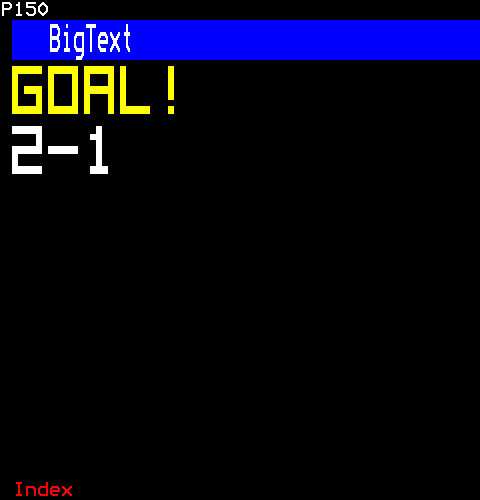

```ts
[h(BigText, { key: "goal", text: "Goal!", foreground: Colour.Yellow }), h(BigText, { key: "score", text: "2-1" })]
```

## Headline

Headlines: a post's title after the page it is on, and how page numbers are written. What goes to a page is a control, from its number to the end of what it says, and only a click there goes.

```ts
import { Headline } from "neottx-server-ts-ui-components";
```

### Props

| Prop | Type | What it is |
| --- | --- | --- |
| `title` (needed) | `string` | The post's title, over its lines, the last cut with an ellipsis. |
| `page` | `number` | The page it is on, written before it in yellow. |
| `foreground` | `Colour` | The title's colour; white when absent. |
| `lines` | `number` | The most lines it takes; one or two, as everywhere on the channel. |
| `linked` | `boolean` | A click on it goes to its page: true when absent. False for a headline that is passing, such as a spinning roulette's. |

### With their pages

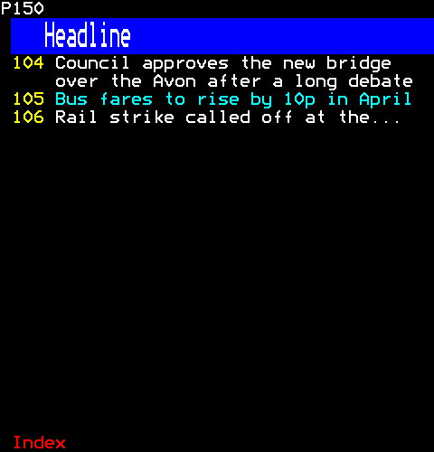

```ts
[
  h(Headline, { key: "bridge", page: 0x104, title: "Council approves the new bridge over the Avon after a long debate" }),
  h(Headline, { key: "fares", page: 0x105, title: "Bus fares to rise by 10p in April", foreground: Colour.Cyan }),
  h(Headline, { key: "rail", page: 0x106, title: "Rail strike called off at the last minute after talks through the night", lines: 1 }),
]
```

## Byline

Byline: who wrote an article and when, and its labels.

```ts
import { Byline } from "neottx-server-ts-ui-components";
```

### Props

| Prop | Type | What it is |
| --- | --- | --- |
| `writer` (needed) | `string` | Who wrote it, after "by". |
| `date` (needed) | `number` | Milliseconds since the Unix epoch. |
| `labels` | `readonly string[]` | Its labels, joined by commas on a second row in green; no second row when absent. |

### Writer, date and labels

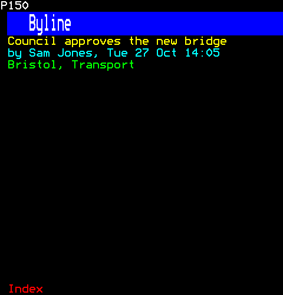

```ts
[
  h(Headline, { key: "title", title: "Council approves the new bridge", foreground: Colour.Yellow }),
  h(Byline, { key: "byline", writer: "Sam Jones", date: Date.UTC(2026, 9, 27, 14, 5), labels: ["Bristol", "Transport"] }),
]
```

## LinesBlock

Lines of a document: an article's blocks laid out as coloured lines, and lines drawn as they are, a row each.

```ts
import { LinesBlock } from "neottx-server-ts-ui-components";
```

### Props

| Prop | Type | What it is |
| --- | --- | --- |
| `lines` (needed) | `readonly Line[]` | The lines, a row each, cut to the width. |
| `empty` | `string` | What it says when there are no lines; nothing when absent. |

#### Line

| Prop | Type | What it is |
| --- | --- | --- |
| `foreground` (needed) | `Colour` | Its colour. |
| `text` (needed) | `string` | Its text: one row of it. |

### An article's lines

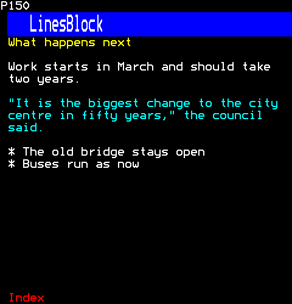

```ts
h(LinesBlock, {
  lines: articleLines(
    [
      { kind: "heading", text: "What happens next" },
      { kind: "paragraph", text: "Work starts in March and should take two years." },
      { kind: "quote", text: '"It is the biggest change to the city centre in fifty years," the council said.' },
      { kind: "item", text: "The old bridge stays open" },
      { kind: "item", text: "Buses run as now" },
    ],
    38,
  ),
})
```

### Nothing to show

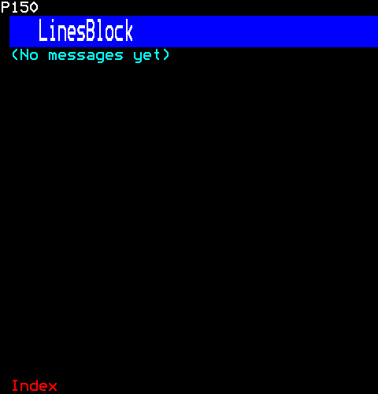

```ts
h(LinesBlock, { lines: [], empty: "No messages yet" })
```

## PageLink

PageLink: a page number and what is there, which a click follows.

```ts
import { PageLink } from "neottx-server-ts-ui-components";
```

### Props

| Prop | Type | What it is |
| --- | --- | --- |
| `page` (needed) | `number` | The page a click goes to, written first in yellow. |
| `label` (needed) | `string` | What is there, after the number. |
| `foreground` | `Colour` | The label's colour; white when absent. |

### Links to pages

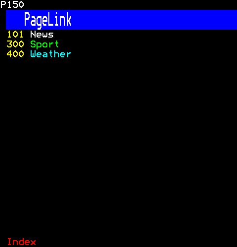

```ts
[
  h(PageLink, { key: "news", page: 0x101, label: "News" }),
  h(PageLink, { key: "sport", page: 0x300, label: "Sport", foreground: Colour.Green }),
  h(PageLink, { key: "weather", page: 0x400, label: "Weather", foreground: Colour.Cyan }),
]
```

## Newsflash

Newsflash: NEWSFLASH, flashing, before a line of news.

```ts
import { Newsflash } from "neottx-server-ts-ui-components";
```

### Props

| Prop | Type | What it is |
| --- | --- | --- |
| `text` (needed) | `string` | The news, in yellow after NEWSFLASH, cut to the row. |

### Before the news

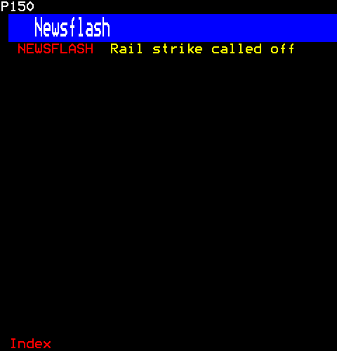

```ts
h(Newsflash, { text: "Rail strike called off" })
```

## Ticker

Ticker: a band whose text changes to the next item every few seconds.

```ts
import { Ticker } from "neottx-server-ts-ui-components";
```

### Props

| Prop | Type | What it is |
| --- | --- | --- |
| `items` (needed) | `readonly string[]` | The items it shows in turn. |
| `everyMs` (needed) | `number` | How long each shows, in milliseconds. |
| `background` | `Colour` | The band's colour; blue when absent. |

### On its second item

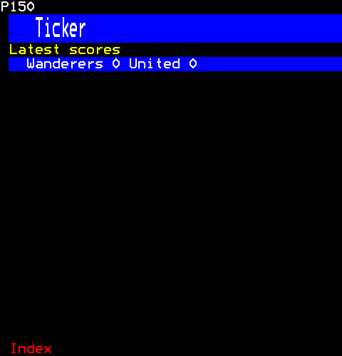

```ts
[
  h(Text, { key: "label", text: "Latest scores", foreground: Colour.Yellow }),
  h(Ticker, { key: "ticker", items: ["Rovers 2 City 1", "Wanderers 0 United 0", "Town 3 Albion 3"], everyMs: 4000 }),
]
```

Then the viewer:

```ts
page.advance(4000);
```

## DoubleHeight

DoubleHeight: a line of text two rows high.

```ts
import { DoubleHeight } from "neottx-server-ts-ui-components";
```

### Props

| Prop | Type | What it is |
| --- | --- | --- |
| `text` (needed) | `string` | The line, cut to the box. |
| `foreground` | `Colour` | Its colour; when absent, the style's own: magenta concealed, red flashing, yellow in double height or width. |

### A headline two rows high

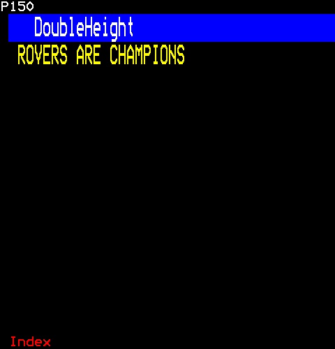

```ts
h(DoubleHeight, { text: "ROVERS ARE CHAMPIONS" })
```

## DoubleWidth

DoubleWidth: a line of text whose letters are two cells wide at Level 2.5, and spaced out at Level 1.

```ts
import { DoubleWidth } from "neottx-server-ts-ui-components";
```

### Props

| Prop | Type | What it is |
| --- | --- | --- |
| `text` (needed) | `string` | The line, cut to the box. |
| `foreground` | `Colour` | Its colour; when absent, the style's own: magenta concealed, red flashing, yellow in double height or width. |

### Letters two cells wide

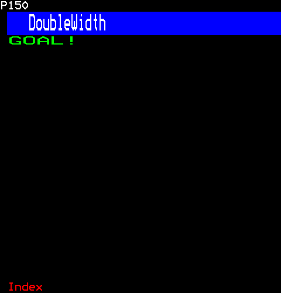

```ts
h(DoubleWidth, { text: "GOAL!", foreground: Colour.Green })
```

## Flashing

Flashing: a line of text that flashes.

```ts
import { Flashing } from "neottx-server-ts-ui-components";
```

### Props

| Prop | Type | What it is |
| --- | --- | --- |
| `text` (needed) | `string` | The line, cut to the box. |
| `foreground` | `Colour` | Its colour; when absent, the style's own: magenta concealed, red flashing, yellow in double height or width. |

### A warning

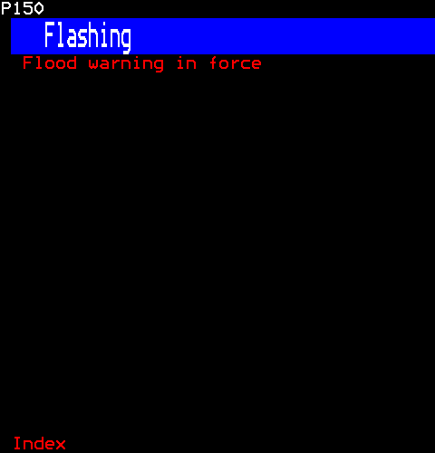

```ts
h(Flashing, { text: "Flood warning in force" })
```

## Concealed

Concealed: text hidden until the viewer presses Reveal.

```ts
import { Concealed } from "neottx-server-ts-ui-components";
```

### Props

| Prop | Type | What it is |
| --- | --- | --- |
| `text` (needed) | `string` | The line, cut to the box. |
| `foreground` | `Colour` | Its colour; when absent, the style's own: magenta concealed, red flashing, yellow in double height or width. |

### An answer until Reveal

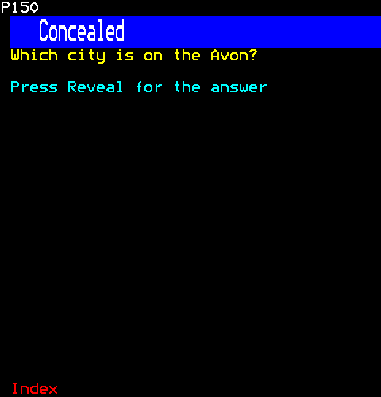

```ts
[
  h(Text, { key: "question", text: "Which city is on the Avon?", foreground: Colour.Yellow }),
  h(Concealed, { key: "answer", text: "Bristol" }),
  h(Text, { key: "reveal", text: "Press Reveal for the answer", foreground: Colour.Cyan }),
]
```

## Placeholder

Placeholder: a line in the middle of its box while something is still coming, or in place of what is missing.

```ts
import { Placeholder } from "neottx-server-ts-ui-components";
```

### Props

| Prop | Type | What it is |
| --- | --- | --- |
| `text` (needed) | `string` | What it says, in white, centred in the box and cut to its width. |

### While the results come

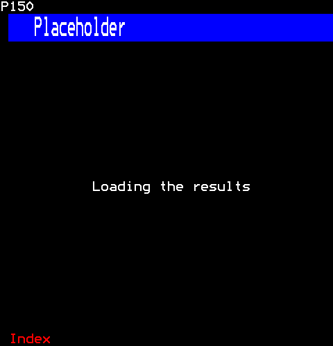

```ts
h(Placeholder, { text: "Loading the results" })
```
