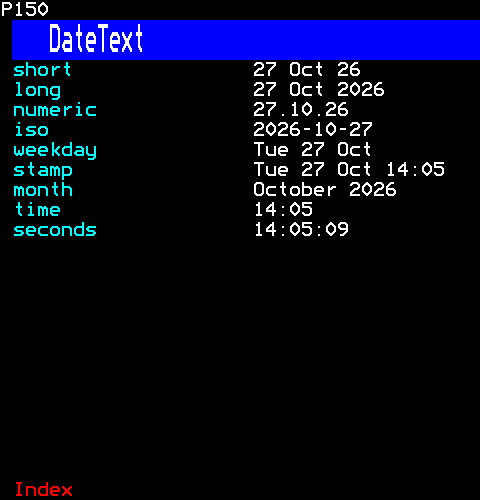
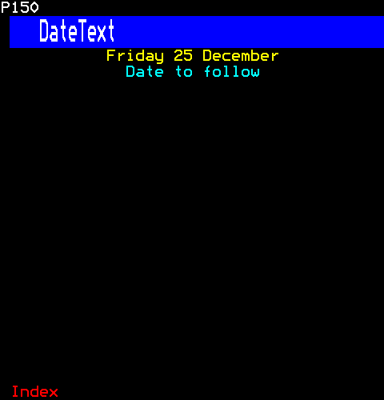
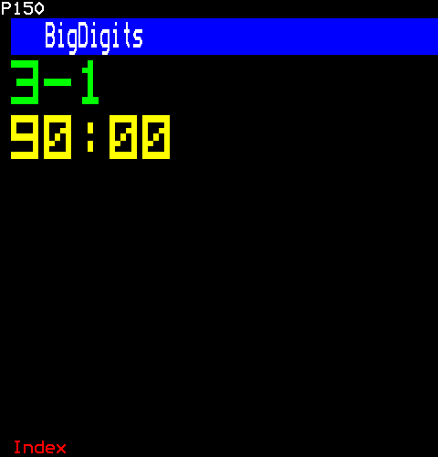
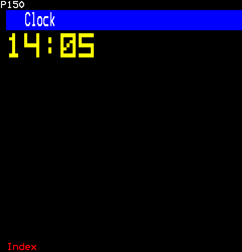
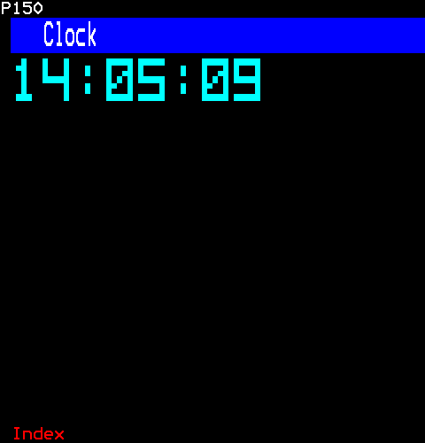
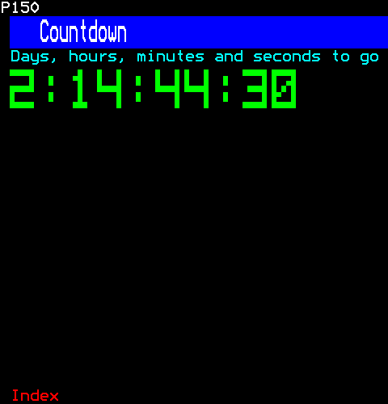
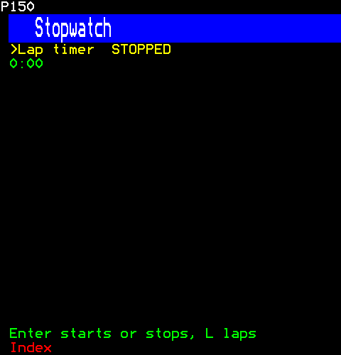
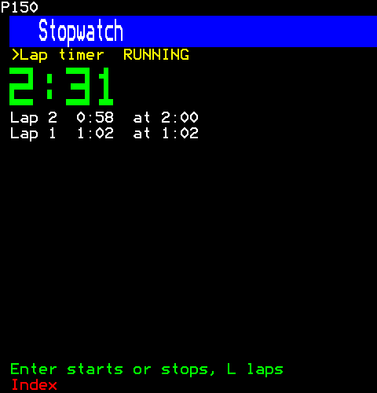
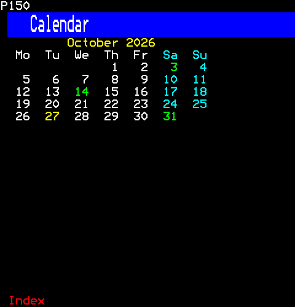
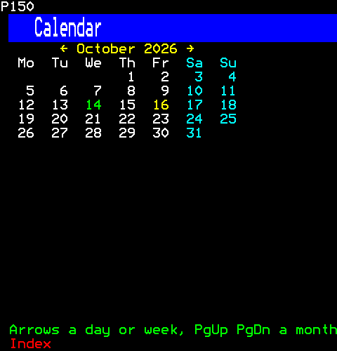

# Time

Dates and times as the pages write them, always in UTC, and the components that keep time: a clock, a countdown and a stopwatch in large digits, and a calendar to choose a day in.

- [DateText](#datetext)
- [BigDigits](#bigdigits)
- [Clock](#clock)
- [Countdown](#countdown)
- [Stopwatch](#stopwatch)
- [Calendar](#calendar)

## DateText

Dates and times as the pages write them: one formatter that every component and channel uses, and a component that shows one date. Times are UTC: one channel serves viewers everywhere, and the archives it shows keep their dates in UTC.

```ts
import { DateText } from "neottx-server-ts-ui-components";
```

### Props

| Prop | Type | What it is |
| --- | --- | --- |
| `value` (needed) | `DateValue` | The date: a Date, milliseconds since the Unix epoch, or an ISO 8601 string, one without a zone read as UTC. |
| `pattern` | `string` | DATE_FORMATS.long when absent. |
| `foreground` | `Colour` | Its colour; white when absent. |
| `fallback` | `string` | What shows when `value` is not a date. |
| `centre` | `boolean` | In the middle of its width. |

### In each format



```ts
h(
  Grid,
  { columns: 2 },
  ...Object.entries(DATE_FORMATS).flatMap(([name, pattern]) => [
    h(Text, { key: `${name}-name`, text: name, foreground: Colour.Cyan }),
    h(DateText, { key: name, value: "2026-10-27T14:05:09Z", pattern }),
  ]),
)
```

### A pattern of its own, centred



```ts
[
  h(DateText, { key: "own", value: Date.UTC(2026, 11, 25), pattern: "dddd D MMMM", foreground: Colour.Yellow, centre: true }),
  h(DateText, { key: "bad", value: "not a date", fallback: "Date to follow", foreground: Colour.Cyan, centre: true }),
]
```

## BigDigits

Large digits drawn in mosaic graphics, five sixels by seven, for counters: as many whole characters as fit the width, counted as characters, not as UTF-16's units, and no more of a long text read than a row can show. The seven rows sit below a clear one, in the nine of their three cells, so they stand apart from a band or a line directly above them. Large text (text/big-text.ts) fits and draws its letters by the same rules.

```ts
import { BigDigits } from "neottx-server-ts-ui-components";
```

### Props

| Prop | Type | What it is |
| --- | --- | --- |
| `text` (needed) | `string` | What it shows: digits, ":" and "-", any other character drawn as "-"; only as many whole characters as fit the width are drawn. |
| `foreground` | `Colour` | Its colour; green when absent. |

### A score and a time



```ts
[h(BigDigits, { key: "score", text: "3-1" }), h(BigDigits, { key: "time", text: "90:00", foreground: Colour.Yellow })]
```

## Clock

A clock: the time, UTC, in large digits, keeping time with a timer of its own that runs only while someone watches.

```ts
import { Clock } from "neottx-server-ts-ui-components";
```

### Props

| Prop | Type | What it is |
| --- | --- | --- |
| `foreground` | `Colour` | The digits' colour; yellow when absent. |
| `seconds` | `boolean` | Seconds shown. |

### The time



```ts
h(Clock, {})
```

Then the viewer:

```ts
page.advance(Date.UTC(2026, 9, 27, 14, 5));
```

### With seconds, in cyan



```ts
h(Clock, { seconds: true, foreground: Colour.Cyan })
```

Then the viewer:

```ts
page.advance(Date.UTC(2026, 9, 27, 14, 5, 9));
```

## Countdown

A countdown: the days, hours, minutes and seconds left to a time, in large digits, ticking each second while someone watches; nought once the time has come.

```ts
import { Countdown } from "neottx-server-ts-ui-components";
```

### Props

| Prop | Type | What it is |
| --- | --- | --- |
| `until` (needed) | `number` | When it reaches nought, in milliseconds since the Unix epoch. |
| `foreground` | `Colour` | The digits' colour; green when absent. |

### Days to Christmas



```ts
[
  h(Text, { key: "label", text: "Days, hours, minutes and seconds to go", foreground: Colour.Cyan }),
  h(Countdown, { key: "countdown", until: Date.UTC(2026, 11, 25) }),
]
```

Then the viewer:

```ts
page.advance(Date.UTC(2026, 11, 22, 9, 15, 30));
```

## Stopwatch

A stopwatch: the time since it was started, counting up, in large digits or as a line of text, its laps beneath, the latest first. It is a control: Enter or Space starts and stops it, its lap key records a lap while it runs, Escape or Backspace sets it back to nought. Its time is read off the channel's clock, not counted in ticks, so a tick missed while nobody watched loses nothing; its timer runs only while it runs and someone watches, to show the time go on.

```ts
import { Stopwatch } from "neottx-server-ts-ui-components";
```

**Keys:** `Enter` starts or stops; `L` laps; `Esc` resets.

**It takes of its page:** a copy of the page for each viewer.

### Props

| Prop | Type | What it is |
| --- | --- | --- |
| `big` | `boolean` | The time in large digits rather than a line of text. |
| `lapKey` | `string` | The key that records a lap; "l" when absent, either case. |
| `mostLaps` | `number` | The most laps kept and shown; older ones go. |
| `foreground` | `Colour` | The time's colour; green when absent. |

And the props of [`ControlProps`](common.md#controlprops).

### Ready to start



```ts
h(Stopwatch, { label: "Lap timer" })
```

### Running, with laps, large



```ts
h(Stopwatch, { label: "Lap timer", big: true })
```

Then the viewer:

```ts
page.press(1, Key.Enter);
page.advance(62_000);
page.press(1, "l");
page.advance(58_000);
page.press(1, "l");
page.advance(31_000);
```

## Calendar

A month: its name, the days of the week, and its days in weeks from Monday. Today is yellow, days with something on are green, the weekend cyan; the day chosen flashes. Chosen with the arrows (a day, a week), Page Up and Page Down (a month), Enter or a click; a click on an arrow of the heading turns the month. Given a new year or month, it shows that month; a month past December or before January is one of the next year or the last, as Date.UTC takes it.

```ts
import { Calendar } from "neottx-server-ts-ui-components";
```

**Keys:** `Arrows` a day or week; `PgUp PgDn` a month; `Enter` chooses.

### Props

| Prop | Type | What it is |
| --- | --- | --- |
| `year` (needed) | `number` | The year shown, until the viewer turns the month; shown again when it changes. |
| `month` (needed) | `number` | The month shown, 0 for January, until the viewer turns it; 12 is the next year's January and -1 the last year's December. |
| `today` | `number` | Today, UTC, in milliseconds since the Unix epoch. |
| `marked` | `readonly CalendarDate[]` | Days with something on, in any month. |
| `selectable` | `boolean` | A day can be chosen. |
| `onChoose` | `(date: CalendarDate, session: number) => void` | A day chosen, with Enter or a click, while it is selectable. |

And the props of [`ControlProps`](common.md#controlprops).

#### CalendarDate

| Prop | Type | What it is |
| --- | --- | --- |
| `year` (needed) | `number` | The year, in full. |
| `month` (needed) | `number` | 0 for January. |
| `day` (needed) | `number` | The day of the month, from 1. |

### A month to read



```ts
h(Calendar, {
  year: 2026,
  month: 9,
  today: Date.UTC(2026, 9, 27),
  marked: [
    { year: 2026, month: 9, day: 3 },
    { year: 2026, month: 9, day: 14 },
    { year: 2026, month: 9, day: 31 },
  ],
})
```

### A day chosen with the arrows



```ts
h(Calendar, { year: 2026, month: 9, selectable: true, marked: [{ year: 2026, month: 9, day: 14 }] })
```

Then the viewer:

```ts
page.press(1, Key.Down);
page.press(1, Key.Down);
page.press(1, Key.Right);
```
